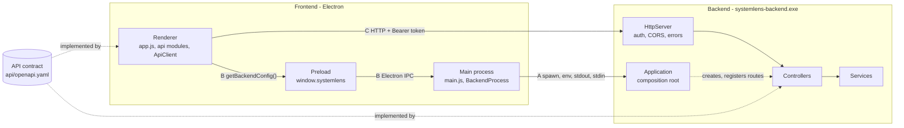
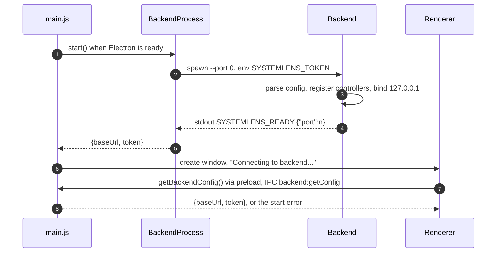
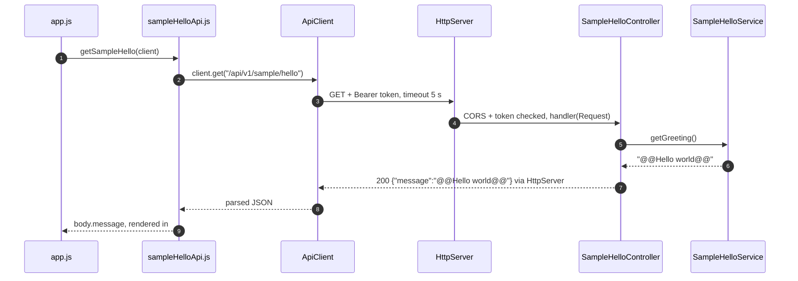
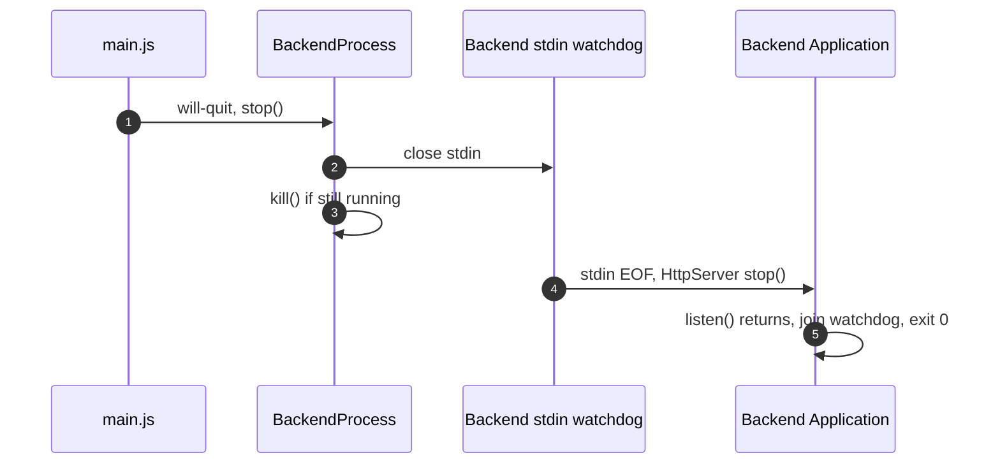

# RQ001 — Architecture

| Item | Value |
|---|---|
| Requirement | [RQ001](../../requirements/RQ001_CoreProject.md): FR-01 / UC-01, NFR-01, NFR-02, NFR-03 |
| API | [api.md](../../api.md) (how to add an API, rules, endpoints); contract [`api/openapi.yaml`](../../../api/openapi.yaml) |

This is the one design document of the project core. It answers: what the components are, how they talk,
how the main flows run, what happens on failure and why the design is this way. How to add an API is in
[api.md](../../api.md).

| Section | Question it answers |
|---|---|
| [1. Components](#1-components) | How many components, and how do they talk? |
| [2. Code map](#2-code-map) | Where is each component in the source? |
| [3. Flows](#3-flows) | How do start, request and stop run? |
| [4. Failures](#4-failures) | What does the user see when something fails? |
| [5. Layers and rules](#5-layers-and-rules) | Who may depend on whom? |
| [6. Design decisions](#6-design-decisions) | Why is it done this way? |
| [7. Requirement coverage](#7-requirement-coverage) | Which requirement is met how? |

## 1. Components

SystemLens is two processes: an **Electron frontend** and a **C++20 backend** (`systemlens-backend.exe`) that
serves an HTTP API on `127.0.0.1`. The frontend starts and stops the backend.



| Component | Role |
|---|---|
| Main process | Starts and stops the backend, keeps its connection info, creates the window. |
| Preload | The only Electron API the sandboxed renderer has: `getBackendConfig()`. |
| Renderer | UI. Calls the backend only through api modules and `ApiClient`. |
| `Application` | Backend composition root: builds services and controllers, registers routes, binds, announces READY, watches stdin. |
| `HttpServer` | The only backend code that knows cpp-httplib: CORS, token check, routing, error conversion. |
| Controller | Maps a `Request` to a service call and back to a `Response`. No business logic. |
| Service | Business logic behind an interface. |
| API contract | `api/openapi.yaml`: the single source of truth for both sides (NFR-01). |

The three links between the processes:

| Link | Used for | Mechanism | Detail |
|---|---|---|---|
| A | Start, stop, handshake | Process spawn, command line, environment, stdout, stdin | [§3.1](#31-start-the-app), [§3.3](#33-end-the-app) |
| B | Hand the connection info to the renderer | Electron IPC channel `backend:getConfig` | [§3.1](#31-start-the-app) |
| C | Every API call | HTTP on `127.0.0.1`, `Authorization: Bearer <token>` | [§3.2](#32-request-an-api-and-display-it) |

Handshake on link A:

| Channel | Direction | Content | Why |
|---|---|---|---|
| Command line | main → backend | `--port 0` | The OS picks a free port. |
| Environment | main → backend | `SYSTEMLENS_TOKEN`: 32 random bytes as hex, new for each run | Not visible in process lists, unlike argv. |
| stdout | backend → main | One line `SYSTEMLENS_READY {"port":<n>}`, flushed after the socket is bound | The frontend waits for this exact line before using the API. Nothing else goes to stdout; logs go to stderr. |
| stdin | main → backend | Kept open, never written | EOF means the parent quit or died, so the backend stops. |
| stderr | backend → main | Logs, forwarded with the prefix `[backend]` | — |

`--dev` (local development only) disables the token check and the stdin watchdog.

## 2. Code map

```
frontend/
├── main/
│   ├── main.js              app events, IPC handler, window
│   ├── backendProcess.js    BackendProcess: spawn, wait for READY, stop
│   └── ipcChannels.js       channel name backend:getConfig
├── preload/preload.js       window.systemlens.getBackendConfig()
└── renderer/
    ├── app.js               UI: bootstrap(), render()
    └── api/
        ├── apiClient.js     ApiClient, ApiError
        └── sample/sampleHelloApi.js   one function per endpoint
backend/src/
├── main.cpp                 exit codes (0 ok, 1 runtime error, 2 usage error)
├── app/
│   ├── AppConfig.h/.cpp     --port, --dev, SYSTEMLENS_TOKEN
│   └── Application.h/.cpp   composition root, READY line, stdin watchdog
├── api/
│   ├── HttpTypes.h          Request, Response, Handler, HttpMethod (library-independent)
│   ├── IRouteRegistry.h, IController.h
│   ├── HttpServer.h/.cpp    cpp-httplib wrapper
│   ├── ApiResponse.h/.cpp   ok(), problem(), status constants
│   └── sample/SampleHelloController.h/.cpp
└── services/sample/         ISampleHelloService.h, SampleHelloService.h/.cpp
api/openapi.yaml             API contract
```

## 3. Flows

### 3.1 Start the app



| # | Step | Detail |
|---|---|---|
| 1 | `app.whenReady()` awaits `backend.start()`. | A failure is kept as `backendStartError` and startup continues (§4). |
| 2 | Spawns the exe with a fresh token. | Exe path: `backend/build/Debug/systemlens-backend.exe` or `SYSTEMLENS_BACKEND_EXE`. |
| 3 | The backend builds everything and binds. | `parseAppConfig()` needs the token unless `--dev`; the watchdog thread starts (not in `--dev`). |
| 4 | READY line. | `BackendProcess` waits for it at most 10 s. Afterwards `HttpServer::listen()` blocks until `stop()`. |
| 5 | Connection info kept for the renderer. | — |
| 6 | The window opens in every case. | Size 1000 × 700. |
| 7 | The renderer asks for the connection info. | The channel name is repeated in `preload.js` because a sandboxed preload cannot `require()` local files. |
| 8 | Returns the info, or throws the stored start error. | The renderer then creates its `ApiClient` and makes the first call (§3.2). |

### 3.2 Request an API and display it

Precondition: the renderer has its `ApiClient`. The example is `GET /api/v1/sample/hello`.



| # | Step | Detail |
|---|---|---|
| 1–2 | The UI never sees HTTP; the api module only knows the path. | One function per endpoint, path exported as a constant. |
| 3 | `ApiClient` adds the token and the timeout and sends the request. | Any failure becomes an `ApiError` (§4). |
| 4 | Pre-routing handler, then exact method + path routing. | `OPTIONS` → 204 before the auth check; missing or wrong token → 401, compared in constant time. |
| 5–6 | The controller calls the service through its interface. | `ISampleHelloService`, injected through the constructor. |
| 7–8 | Response built by `ok()`: `application/json`. | Matches `SampleHelloResponse` in the contract. |
| 9 | The api module returns the data only; the UI shows it. | `#message` text = greeting (UC-01 main flow). |

### 3.3 End the app



| # | Step | Detail |
|---|---|---|
| 1 | The last window closes, `app.quit()` fires `will-quit`. | Not on macOS (`darwin`): the app stays open there. |
| 2 | Closing stdin is the normal shutdown signal. | The same happens when the frontend dies: the OS closes the pipe. |
| 3 | `kill()` follows right away. | The backend must never outlive the app, so steps 4–5 may not run when the app quits normally. |
| 4–5 | The watchdog sees EOF and stops the server; `run()` returns 0. | There is no watchdog in `--dev`. |

## 4. Failures

| Case | Detected by | What the user sees |
|---|---|---|
| Exe cannot be started | `child` `error` event | `Cannot reach backend: Cannot start backend (<path>): ...` |
| Invalid arguments or missing token | `parseAppConfig()`, exit code 2 | `... Backend exited before it was ready (exit code 2)` |
| Port cannot be bound, other runtime error | `Application::run()` throws, exit code 1 | `... Backend exited before it was ready (exit code 1)` |
| No READY line within 10 s | timer in `#waitForReady()` | `... Backend not ready after 10000 ms` |
| Missing or wrong token | pre-routing handler, 401 | `Cannot reach backend: Unauthorized: Missing or invalid bearer token.` |
| Unknown method + path | error handler, 404 | `ApiError` status 404 |
| Exception in a handler | exception handler, 500, logged to stderr, server keeps running | `ApiError` status 500 |
| Error response without a problem body | — | `<METHOD> <path> returned HTTP <status>` |
| No response (backend down, 5 s timeout) | `fetch` rejects | `ApiError` status 0: `<METHOD> <path> failed: <reason>` |

- Startup failures (first four rows): the window still opens; `getBackendConfig()` rejects and the renderer
  shows `Cannot reach backend: <message>` in error style (UC-01 A1).
- API failures (last five rows): the same text is shown (UC-01 A2).
- Problem bodies are RFC 7807 `application/problem+json` with `type: "about:blank"`, `title`, `status`,
  `detail`, built only by `api::problem()`. CORS headers are added to error responses too.
- Only 404 and exceptions get a problem body from the server itself. Other error statuses produced by
  cpp-httplib have no problem body; `ApiClient` handles them with the "without a problem body" row.

## 5. Layers and rules

| Layer | Responsibility | Depends on |
|---|---|---|
| UI (`app.js`) | Calls an api function, shows data or the error. | api module |
| api module (`api/<area>/*Api.js`) | One function per endpoint: path constant, `client.get(path)`, returns plain data. | `ApiClient` |
| `ApiClient` | Bearer token, 5 s timeout, any failure → `ApiError`. | `fetch` |
| `HttpServer` | Loopback bind; before routing: CORS, preflight, token; after: 404 / exception → problem. | cpp-httplib |
| Controller (`IController`) | Registers its routes through `IRouteRegistry`; Request → service → `ok(json)`. | `HttpTypes.h`, service interface |
| Service (`I…Service`) | Business logic, injected into the controller as an interface. | — |
| `ApiResponse` | The only place that builds a `Response`. | nlohmann/json |

Routes are registered once at startup: `Application::registerControllers()` → `registerRoutes(server)` →
`addRoute(method, path, handler)`. `HttpServer` wraps each handler to convert between cpp-httplib types and
`Request` / `Response`.

`Application` declares its controllers before the server so they are destroyed after it: the server's
handlers point into them.

## 6. Design decisions

| # | Decision | Reason | Req. |
|---|---|---|---|
| D1 | The API is defined in `api/openapi.yaml`; controllers and api modules name it in their file header. | One authoritative reference for both sides. | NFR-01 |
| D2 | Transport is HTTP on `127.0.0.1` only. | Reason not recorded in the code. The server must stay on a loopback address (`HttpServerOptions`). | NFR-02 |
| D3 | `--port 0` and one READY line on stdout; logs go to stderr. | The OS picks a free port; the frontend waits for that exact line. | NFR-02 |
| D4 | Random token per run, in the `SYSTEMLENS_TOKEN` environment variable, `Bearer` on every request, constant-time compare. | Env instead of argv keeps it out of process lists; constant-time compare resists timing guesses. | NFR-02 |
| D5 | The backend stops when its stdin closes; the frontend closes stdin and kills the process on quit. | The backend must never outlive the app. | NFR-02 |
| D6 | The renderer is sandboxed (`contextIsolation`, `sandbox`, no `nodeIntegration`); preload exposes only `getBackendConfig()`. | The renderer gets the minimum it needs. | NFR-02 |
| D7 | All frontend calls go through `ApiClient`; all cpp-httplib code is in `HttpServer.cpp`. | Token, timeout and errors live in one place; swapping the HTTP library touches one file. | NFR-02 |
| D8 | Controllers depend on interfaces: `IRouteRegistry`, and a service interface through the constructor. | Controllers do not depend on the server; services can be swapped. | NFR-02 |
| D9 | Responses are built by `ok()` / `problem()`; errors are RFC 7807; an exception becomes a 500 problem. | Same shape for every endpoint; an exception does not crash the server. | NFR-01 |
| D10 | CORS `Access-Control-Allow-Origin: *`; `OPTIONS` is answered before the auth check. | The renderer is loaded from `file://` (origin `null`); `*` is acceptable because the API is loopback-only and needs the token; browsers send the preflight without `Authorization`. | NFR-02 |
| D11 | If the backend fails to start, the window still opens. | The window displays the error. | FR-01 |
| D12 | The sample endpoint is compiled only with `SYSTEMLENS_ENABLE_SAMPLE_API=ON` (default). | It exercises the FE ↔ BE plumbing and is the reference example for real APIs. | FR-01 |

## 7. Requirement coverage

| Requirement | Status | How |
|---|---|---|
| [FR-01](../../requirements/RQ001_CoreProject.md#rq001-fr-01) / [UC-01](../../requirements/RQ001_CoreProject.md#rq001-uc-01) | Implemented | Start §3.1, request §3.2; A1 and A2 in §4; D11, D12. |
| [NFR-01](../../requirements/RQ001_CoreProject.md#rq001-nfr-01) | Implemented | Contract first, then both sides ([api.md](../../api.md)); `ApiResponse` keeps every response on the contract's shapes; D1, D9. |
| [NFR-02](../../requirements/RQ001_CoreProject.md#rq001-nfr-02) | Implemented | Only the code in the table below knows the current IPC method; D2–D8, D10. |
| [NFR-03](../../requirements/RQ001_CoreProject.md#rq001-nfr-03) | Not implemented | No design yet, see below. |

Code that knows the current IPC method (HTTP + stdio handshake + Electron IPC):

| Side | Knows it | Does not know it |
|---|---|---|
| Frontend main | `backendProcess.js` (spawn, token, READY line, stdin), the IPC handler in `main.js`, `ipcChannels.js` | — |
| Preload | `preload.js` | — |
| Renderer | `api/apiClient.js` (`fetch`, Bearer token, errors), CSP `connect-src` in `index.html` | `app.js`, `api/<area>/*Api.js` |
| Backend | `HttpServer.h/.cpp` (cpp-httplib, auth, CORS), `Application` (READY line, stdin watchdog), `AppConfig` (`--port`, token env) | Controllers (only `HttpTypes.h`, `IRouteRegistry.h`), services |

NFR-03 is not implemented: no interface / OS-specific layer exists yet and the backend reads no OS data.
Windows-specific code today: `_WIN32_WINNT`, `WIN32_LEAN_AND_MEAN`, `NOMINMAX` in `backend/CMakeLists.txt`
(for cpp-httplib), the `_MSC_VER` branch (`_dupenv_s`) in `AppConfig.cpp`, and the `.exe` path in
`backendProcess.js`.
