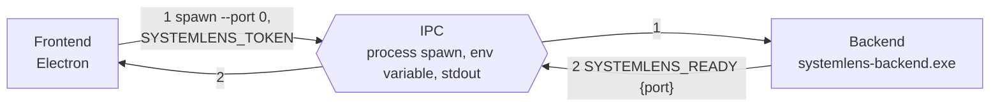
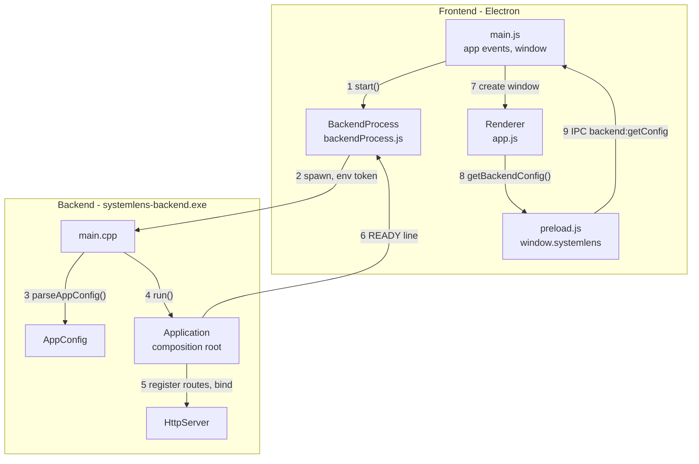
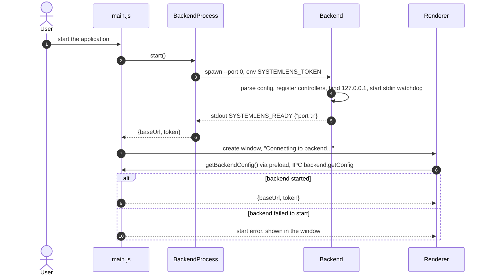
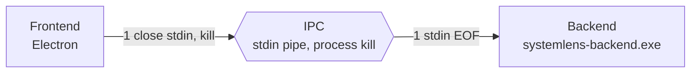
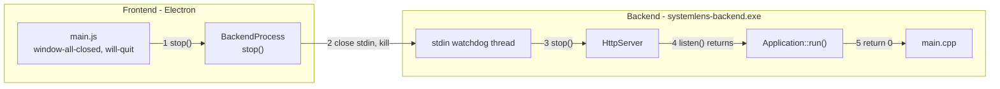
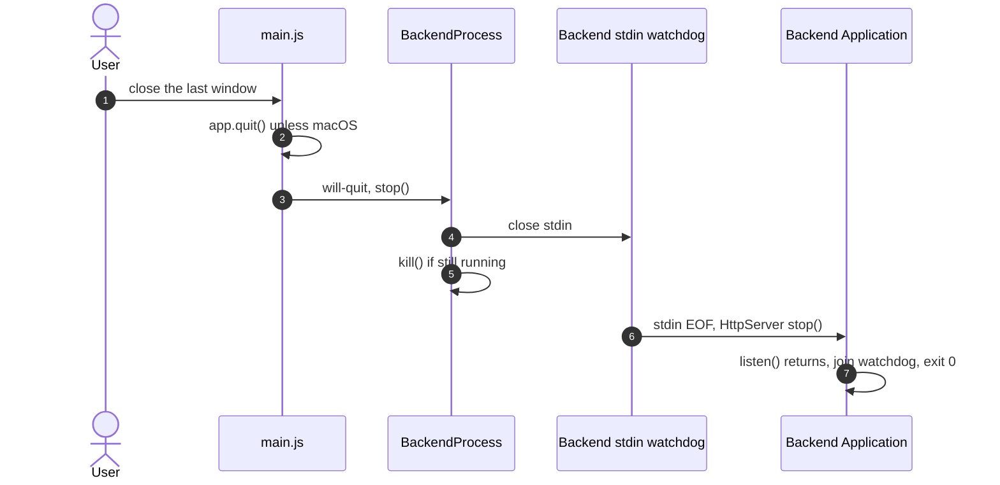
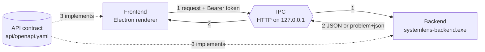
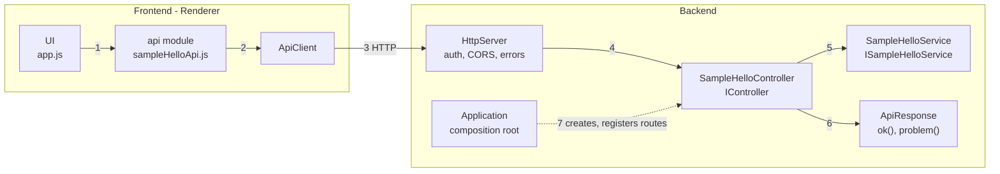
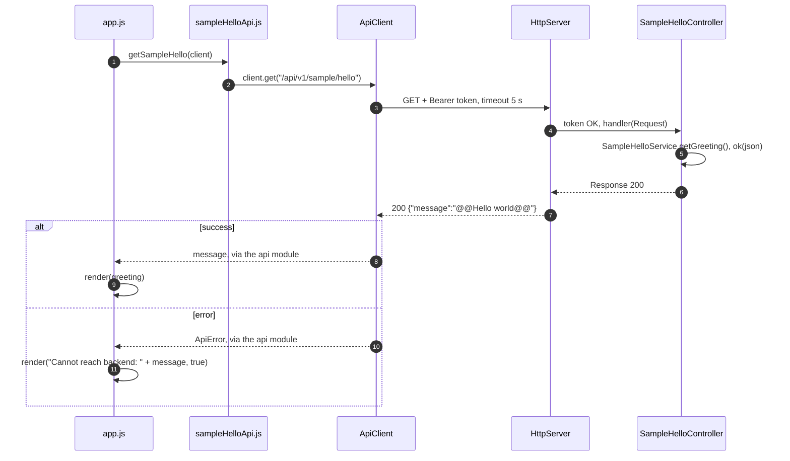

# RQ001 — High-level design

| Item | Value |
|---|---|
| Traces to | [RQ001-FR-01](../../requirements/RQ001_CoreProject.md#rq001-fr-01), [RQ001-UC-01](../../requirements/RQ001_CoreProject.md#rq001-uc-01), [RQ001-NFR-01](../../requirements/RQ001_CoreProject.md#rq001-nfr-01), [RQ001-NFR-02](../../requirements/RQ001_CoreProject.md#rq001-nfr-02), [RQ001-NFR-03](../../requirements/RQ001_CoreProject.md#rq001-nfr-03) |
| Detailed in | [RQ001-LLD-01](RQ001_LLD-01-backend-lifecycle.md) backend lifecycle, [RQ001-LLD-02](RQ001_LLD-02-api-request-pipeline.md) API request pipeline + sample feature |
| API | [api-schema.md](../../api-schema.md), rules in [api-convention.md](../../api-convention.md) |
| Index / matrix | [docs/README.md](../../README.md#4-traceability-matrix) |

| Section | Content |
|---|---|
| [RQ001-HLD-01](#rq001-hld-01) | Trigger: start app |
| [RQ001-HLD-02](#rq001-hld-02) | Trigger: end app |
| [RQ001-HLD-03](#rq001-hld-03) | Trigger: request an API from the backend and display it in the frontend |
| [RQ001-HLD-04](#rq001-hld-04) | Design decisions and their reasons |
| [RQ001-HLD-05](#rq001-hld-05) | How each requirement is satisfied |

SystemLens runs as two processes: an **Electron frontend** (main process, preload, renderer) and a **C++20
backend** (`systemlens-backend.exe`) that serves an HTTP API on `127.0.0.1`. The frontend starts and stops the
backend; the API between them is defined by [`api/openapi.yaml`](../../../api/openapi.yaml).

Each trigger below goes from overview to detail: overview component diagram (Frontend, IPC, Backend, and the
API contract where it matters) → detail component diagram (parts inside Frontend and Backend) → sequence.

## RQ001-HLD-01 — Start app

### Overview component

| # | From → To | Interaction |
|---|---|---|
| 1 | Frontend → Backend | The frontend starts the backend process; the OS picks the port, the token is passed in the environment (D3, D4). |
| 2 | Backend → Frontend | Once its socket is bound, the backend reports the port with one stdout line; the frontend now knows `http://127.0.0.1:<port>`. |

### Detail component

| # | From → To | Interaction |
|---|---|---|
| 1 | `main.js` → `BackendProcess` | `start()` when Electron is ready. |
| 2 | `BackendProcess` → `main.cpp` | Spawns the exe with `--port 0` and `SYSTEMLENS_TOKEN`; keeps stdin open (used to stop it, [HLD-02](#rq001-hld-02)). |
| 3 | `main.cpp` → `AppConfig` | Reads `--port`, `--dev` and the token; missing token outside `--dev` → exit code 2. |
| 4 | `main.cpp` → `Application` | Builds the object graph and runs it. |
| 5 | `Application` → `HttpServer` | Creates services and controllers, registers their routes, binds `127.0.0.1` on a free port, starts the stdin watchdog. |
| 6 | `Application` → `BackendProcess` | Prints `SYSTEMLENS_READY {"port":n}` on stdout. |
| 7 | `main.js` → Renderer | Opens the window, also when the backend failed to start (D11). |
| 8 | Renderer → preload | The only Electron API the sandboxed renderer has (D6). |
| 9 | preload → `main.js` | Electron IPC returns `{baseUrl, token}` or the start error. |

### Sequence

| # | Step | Detail |
|---|---|---|
| 1 | User starts the app. | — |
| 2 | Main asks `BackendProcess` to start the backend. | [RQ001-LLD-01 §3.1](RQ001_LLD-01-backend-lifecycle.md#rq001-lld-01-start) |
| 3 | Backend spawned with a fresh token (32 random bytes) and `--port 0`. | [RQ001-LLD-01 §2](RQ001_LLD-01-backend-lifecycle.md#rq001-lld-01-handshake) |
| 4 | Backend prepares and starts listening. | [RQ001-LLD-01 §3.1](RQ001_LLD-01-backend-lifecycle.md#rq001-lld-01-start) |
| 5 | READY line; `BackendProcess` waits for it at most 10 s. | [RQ001-LLD-01 §6](RQ001_LLD-01-backend-lifecycle.md#rq001-lld-01-waitforready) |
| 6 | Connection info kept for the renderer. | — |
| 7 | Window opened in every case. | — |
| 8 | Renderer asks for the connection info. | [RQ001-LLD-01 §3.2](RQ001_LLD-01-backend-lifecycle.md#rq001-lld-01-renderer-config) |
| 9 | Renderer creates its `ApiClient` and makes the first call ([HLD-03](#rq001-hld-03)). | same |
| 10 | Spawn error, early exit or timeout: the error is shown (UC-01 A1). | [RQ001-LLD-01 §5](RQ001_LLD-01-backend-lifecycle.md#rq001-lld-01-failures) |

## RQ001-HLD-02 — End app

### Overview component

| # | From → To | Interaction |
|---|---|---|
| 1 | Frontend → Backend | The frontend closes the backend's stdin and kills the process; stdin EOF is the backend's signal to stop. The pipe also closes when the frontend dies, so the backend never outlives it (D5). |

### Detail component

| # | From → To | Interaction |
|---|---|---|
| 1 | `main.js` → `BackendProcess` | On `will-quit`. |
| 2 | `BackendProcess` → watchdog | Closes stdin, then kills the process if it has not exited. |
| 3 | watchdog → `HttpServer` | On stdin EOF; not started in `--dev`. |
| 4 | `HttpServer` → `Application` | The blocking `listen()` in `run()` returns. |
| 5 | `Application` → `main.cpp` | Exit code 0. |

### Sequence

| # | Step | Detail |
|---|---|---|
| 1 | All windows closed (`window-all-closed`). | — |
| 2 | On macOS (`darwin`) the app does not quit here. | — |
| 3 | `will-quit` handler. | [RQ001-LLD-01 §4](RQ001_LLD-01-backend-lifecycle.md#rq001-lld-01-stop) |
| 4 | Normal shutdown signal. | same |
| 5 | Kill right away; steps 6–7 may therefore not run. | same |
| 6 | Watchdog sees EOF and stops the server. | same |
| 7 | `run()` returns 0. | same |

## RQ001-HLD-03 — Request API from BE and display in FE

Precondition: the renderer has its `ApiClient` ([HLD-01](#rq001-hld-01) step 9). Example: the sample endpoint
`GET /api/v1/sample/hello` ([RQ001-FR-01](../../requirements/RQ001_CoreProject.md#rq001-fr-01)).

### Overview component

| # | From → To | Interaction |
|---|---|---|
| 1 | Frontend → Backend | HTTP request to `127.0.0.1:<port>` with `Authorization: Bearer <token>` (D2, D4). |
| 2 | Backend → Frontend | `application/json` on success, RFC 7807 `application/problem+json` on error (D9). |
| 3 | API contract → both | Paths, schemas and errors come from `api/openapi.yaml` (D1); readable form in [api-schema.md](../../api-schema.md). |

### Detail component

| # | Interaction | Who knows HTTP |
|---|---|---|
| 1 | The UI calls one function per endpoint and gets plain data or an `ApiError`. | no |
| 2 | The api module calls `client.get(path)`. | knows the path only |
| 3 | `ApiClient` adds the token and a 5 s timeout, sends the request, converts every failure to `ApiError` (D7). | **yes** |
| 4 | `HttpServer` applies CORS, checks the token, routes to the registered handler, turns unknown routes and exceptions into problems; cpp-httplib is used only here (D7, D10). | **yes** |
| 5 | The controller calls the service through its interface; it has no business logic (D8). | no — only `HttpTypes.h` / `IRouteRegistry.h` |
| 6 | Every response is built by `ok()` / `problem()` (D9). | no |
| 7 | `Application` creates the service and controller and registers the route at startup; the sample is compiled only with `SYSTEMLENS_ENABLE_SAMPLE_API=ON` (D12). | no |

### Sequence

| # | Step | Detail |
|---|---|---|
| 1–2 | The UI never sees HTTP; the api module only knows the path. | [RQ001-LLD-02 §3.1](RQ001_LLD-02-api-request-pipeline.md#rq001-lld-02-sequences) |
| 3 | Request with the run's token. | same |
| 4 | Pre-routing: CORS headers, preflight answered, token checked (wrong token → 401). | [RQ001-LLD-02 §5](RQ001_LLD-02-api-request-pipeline.md#rq001-lld-02-prerouting) |
| 5 | The service returns `@@Hello world@@`; the controller wraps it as `{"message": ...}`. | [RQ001-LLD-02 §6](RQ001_LLD-02-api-request-pipeline.md#rq001-lld-02-sample) |
| 6–7 | JSON response, matching `SampleHelloResponse` in the contract. | [api-schema.md](../../api-schema.md#getsamplehello) |
| 8 | The api module returns `body.message`. | — |
| 9 | `#message` shows the greeting (UC-01 main flow). | — |
| 10 | 401 / 404 / 500 problem, or no response (backend down, timeout): `ApiError`; steps 4–7 may not happen. | [RQ001-LLD-02 §4](RQ001_LLD-02-api-request-pipeline.md#rq001-lld-02-errors) |
| 11 | `#message` shows the error in error style (UC-01 A2). | — |

## RQ001-HLD-04 — Design decisions

Reasons are taken from the code comments; "not recorded" means the code does not state one.

| # | Decision | Reason | Requirement | Detail |
|---|---|---|---|---|
| D1 | The API is defined in `api/openapi.yaml`; controllers and api modules name it in their file header. | One authoritative reference for both sides. | NFR-01 | [api-convention.md](../../api-convention.md) |
| D2 | Frontend ↔ backend transport is HTTP on `127.0.0.1` only. | Not recorded. The server must stay on a loopback address (`HttpServerOptions`). | NFR-02 | [RQ001-LLD-02](RQ001_LLD-02-api-request-pipeline.md) |
| D3 | The backend is started with `--port 0` and announces the port with one stdout line `SYSTEMLENS_READY {"port":n}`; stdout carries nothing else, logs go to stderr. | The OS picks a free port; the frontend waits for that exact line before using the API. | NFR-02 | [RQ001-LLD-01 §2](RQ001_LLD-01-backend-lifecycle.md#rq001-lld-01-handshake) |
| D4 | A random token per run, passed in the `SYSTEMLENS_TOKEN` environment variable, required as `Bearer` on every request and compared in constant time. | Env instead of argv so it does not show up in process lists; constant-time compare so the token cannot be guessed by timing. | NFR-02 | [RQ001-LLD-02 §4](RQ001_LLD-02-api-request-pipeline.md#rq001-lld-02-errors) |
| D5 | The backend stops when its stdin closes; the frontend closes stdin and kills the process on quit. | stdin closes when the parent quits or dies; the backend must never outlive the app. | NFR-02 | [RQ001-LLD-01 §4](RQ001_LLD-01-backend-lifecycle.md#rq001-lld-01-stop) |
| D6 | The renderer is sandboxed (`contextIsolation`, `sandbox`, no `nodeIntegration`); the preload exposes only `getBackendConfig()`. | The renderer gets the minimum it needs. | NFR-02 | [RQ001-LLD-01 §3.2](RQ001_LLD-01-backend-lifecycle.md#rq001-lld-01-renderer-config) |
| D7 | All frontend calls go through `ApiClient`; all HTTP-library code of the backend is in `HttpServer.cpp`. | Token, timeout and error conversion live in one place; swapping the HTTP library only touches `HttpServer.cpp`. | NFR-02 | [RQ001-LLD-02 §2](RQ001_LLD-02-api-request-pipeline.md#rq001-lld-02-layers) |
| D8 | Controllers depend on interfaces: `IRouteRegistry` to register routes, a service interface injected through the constructor. | Controllers do not depend on the server; the service implementation can be swapped. | NFR-02 | [RQ001-LLD-02 §2](RQ001_LLD-02-api-request-pipeline.md#rq001-lld-02-layers) |
| D9 | Responses are built only by `ok()` / `problem()`; errors are RFC 7807 `application/problem+json`; any exception becomes a 500 problem. | Every endpoint has the same shape; an exception does not crash the server. | NFR-01 | [RQ001-LLD-02 §4](RQ001_LLD-02-api-request-pipeline.md#rq001-lld-02-errors) |
| D10 | CORS `Access-Control-Allow-Origin: *`; `OPTIONS` answered before the auth check. | The renderer is loaded from `file://` (origin `null`); `*` is acceptable because the API is loopback-only and needs the token; browsers send the preflight without `Authorization`. | NFR-02 | [RQ001-LLD-02 §5](RQ001_LLD-02-api-request-pipeline.md#rq001-lld-02-prerouting) |
| D11 | If the backend fails to start, the window still opens. | The window displays the error. | FR-01 (UC-01 A1) | [RQ001-LLD-01 §5](RQ001_LLD-01-backend-lifecycle.md#rq001-lld-01-failures) |
| D12 | The sample endpoint is compiled only with `SYSTEMLENS_ENABLE_SAMPLE_API=ON` (default). | It exists to exercise the FE ↔ BE plumbing and as the reference example for real APIs. | FR-01 | [RQ001-LLD-02 §6](RQ001_LLD-02-api-request-pipeline.md#rq001-lld-02-sample) |

## RQ001-HLD-05 — How each requirement is satisfied

| Requirement | Status | How | Decisions |
|---|---|---|---|
| [RQ001-FR-01](../../requirements/RQ001_CoreProject.md#rq001-fr-01) / [UC-01](../../requirements/RQ001_CoreProject.md#rq001-uc-01) | Implemented | Start in [HLD-01](#rq001-hld-01), request and display in [HLD-03](#rq001-hld-03). A1 (backend not started) → HLD-01 step 10; A2 (API call fails) → HLD-03 step 10. | D11, D12 |
| [RQ001-NFR-01](../../requirements/RQ001_CoreProject.md#rq001-nfr-01) | Implemented | The contract is changed first, then both sides ([api-convention.md §8](../../api-convention.md#8-adding-an-api)); [api-schema.md](../../api-schema.md) is its readable form; `ApiResponse` keeps every response on the contract's shapes. | D1, D9 |
| [RQ001-NFR-02](../../requirements/RQ001_CoreProject.md#rq001-nfr-02) | Implemented | Only the code in the table below knows the current IPC method. | D2–D8, D10 |
| [RQ001-NFR-03](../../requirements/RQ001_CoreProject.md#rq001-nfr-03) | Not implemented | No design yet, see below. | — |

### RQ001-NFR-02 — code that knows the IPC method

| Side | Knows the current IPC method (HTTP + stdio handshake + Electron IPC) | Does not know it |
|---|---|---|
| Frontend main | `backendProcess.js` (spawn, token, READY line, stdin), `main.js` IPC handler, `ipcChannels.js` | — |
| Preload | `preload.js` (`backend:getConfig`) | — |
| Renderer | `api/apiClient.js` (`fetch`, Bearer token, error conversion), CSP `connect-src` in `index.html` | `app.js`, `api/<area>/*Api.js` (they call `client.get(path)`) |
| Backend | `HttpServer.h/.cpp` (cpp-httplib, auth, CORS), `Application` (READY line, stdin watchdog), `AppConfig` (`--port`, token env) | Controllers (`HttpTypes.h`, `IRouteRegistry.h` only), services |

### RQ001-NFR-03 — not implemented

No interface / OS-specific layer exists yet; the backend reads no OS data. Windows-specific code present today:
`_WIN32_WINNT`, `WIN32_LEAN_AND_MEAN`, `NOMINMAX` in `backend/CMakeLists.txt` (for cpp-httplib), the
`_MSC_VER` branch (`_dupenv_s`) in `AppConfig.cpp`, and the `.exe` path in `backendProcess.js`.
