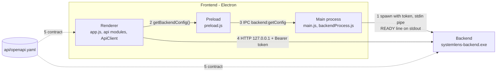
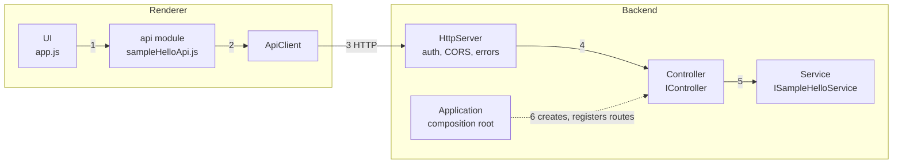
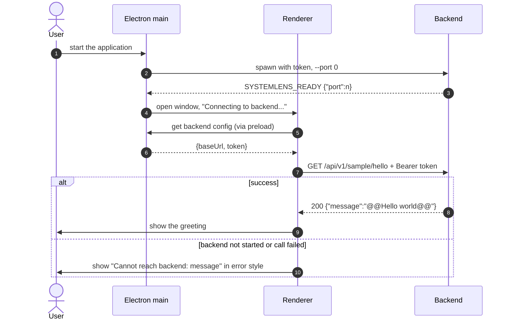

# RQ001 — High-level design

| Item | Value |
|---|---|
| Traces to | [RQ001-FR-01](../../requirements/RQ001_CoreProject.md#rq001-fr-01), [RQ001-UC-01](../../requirements/RQ001_CoreProject.md#rq001-uc-01), [RQ001-NFR-01](../../requirements/RQ001_CoreProject.md#rq001-nfr-01), [RQ001-NFR-02](../../requirements/RQ001_CoreProject.md#rq001-nfr-02), [RQ001-NFR-03](../../requirements/RQ001_CoreProject.md#rq001-nfr-03) |
| Detailed in | [RQ001-LLD-01](RQ001_LLD-01-backend-lifecycle.md) backend lifecycle, [RQ001-LLD-02](RQ001_LLD-02-api-request-pipeline.md) API request pipeline + sample feature |
| API | [api-schema.md](../../api-schema.md), rules in [api-convention.md](../../api-convention.md) |
| Index / matrix | [docs/README.md](../../README.md#4-traceability-matrix) |

| Section | Content |
|---|---|
| [RQ001-HLD-01](#rq001-hld-01) | Components and layers |
| [RQ001-HLD-02](#rq001-hld-02) | Design decisions and their reasons |
| [RQ001-HLD-03](#rq001-hld-03) | How each requirement is satisfied |
| [RQ001-HLD-04](#rq001-hld-04) | Overview flow: start → greeting |

SystemLens runs as two processes: an **Electron frontend** (main process, preload, renderer) and a **C++20
backend** (`systemlens-backend.exe`) that serves an HTTP API on `127.0.0.1`. The frontend starts and stops the
backend; the API between them is defined by [`api/openapi.yaml`](../../../api/openapi.yaml).

## RQ001-HLD-01 — Components and layers

### Processes

| # | From → To | Interaction | Detail |
|---|---|---|---|
| 1 | Main → Backend | Starts the backend, gives it a token, learns its port, stops it on quit. | [RQ001-LLD-01](RQ001_LLD-01-backend-lifecycle.md) |
| 2 | Renderer → Preload | The only API the renderer gets from Electron: `window.systemlens.getBackendConfig()`. | [RQ001-LLD-01 §3.2](RQ001_LLD-01-backend-lifecycle.md#rq001-lld-01-renderer-config) |
| 3 | Preload → Main | Electron IPC returns `{baseUrl, token}`, or the backend start error. | same |
| 4 | Renderer → Backend | Every API call. | [RQ001-LLD-02](RQ001_LLD-02-api-request-pipeline.md) |
| 5 | Contract → both sides | Frontend api modules and backend controllers implement `api/openapi.yaml`. | [api-schema.md](../../api-schema.md) |

### Layers inside the API path

| # | Interaction | Who knows HTTP |
|---|---|---|
| 1 | UI calls one function per endpoint and gets plain data or an `ApiError`. | no |
| 2 | The api module calls `client.get(path)`. | knows the path only |
| 3 | `ApiClient` adds the token and timeout, sends the request, converts errors. | **yes** |
| 4 | `HttpServer` checks the token, applies CORS, routes to the handler a controller registered, converts exceptions/unknown routes to errors. cpp-httplib is used only here. | **yes** |
| 5 | The controller calls the service through its interface and returns `ok(json)`; it has no business logic. Controllers see only `HttpTypes.h` / `IRouteRegistry.h`. | no (library-independent types) |
| 6 | `Application` creates services and controllers and registers their routes on the server. | no |

Backend layering: `HttpServer` → Controller → Service. There is no provider / OS layer yet (see
[RQ001-NFR-03](#rq001-hld-03-nfr-03)).

## RQ001-HLD-02 — Design decisions

Reasons are taken from the code comments; "not recorded" means the code does not state one.

| # | Decision | Reason | Requirement | Detail |
|---|---|---|---|---|
| D1 | The API is defined in `api/openapi.yaml`; controllers and api modules name it in their file header. | One authoritative reference for both sides. | NFR-01 | [api-convention.md](../../api-convention.md) |
| D2 | Frontend ↔ backend transport is HTTP on `127.0.0.1` only. | Not recorded. The server must stay on a loopback address (`HttpServerOptions`). | NFR-02 | [RQ001-LLD-02](RQ001_LLD-02-api-request-pipeline.md) |
| D3 | The backend is started with `--port 0` and announces the port with one stdout line `SYSTEMLENS_READY {"port":n}`; stdout carries nothing else, logs go to stderr. | The OS picks a free port; the frontend waits for that exact line before using the API. | NFR-02 | [RQ001-LLD-01 §2](RQ001_LLD-01-backend-lifecycle.md#rq001-lld-01-handshake) |
| D4 | A random token per run, passed in the `SYSTEMLENS_TOKEN` environment variable, required as `Bearer` on every request and compared in constant time. | Env instead of argv so it does not show up in process lists; constant-time compare so the token cannot be guessed by timing. | NFR-02 | [RQ001-LLD-02 §4](RQ001_LLD-02-api-request-pipeline.md#rq001-lld-02-errors) |
| D5 | The backend stops when its stdin closes; the frontend closes stdin and kills the process on quit. | stdin closes when the parent quits or dies; the backend must never outlive the app. | NFR-02 | [RQ001-LLD-01 §4](RQ001_LLD-01-backend-lifecycle.md#rq001-lld-01-stop) |
| D6 | The renderer is sandboxed (`contextIsolation`, `sandbox`, no `nodeIntegration`); the preload exposes only `getBackendConfig()`. | The renderer gets the minimum it needs. | NFR-02 | [RQ001-LLD-01 §3.2](RQ001_LLD-01-backend-lifecycle.md#rq001-lld-01-renderer-config) |
| D7 | All frontend calls go through `ApiClient`; all HTTP-library code of the backend is in `HttpServer.cpp`. | Token, timeout and error conversion live in one place; swapping the HTTP library only touches `HttpServer.cpp`. | NFR-02 | [RQ001-LLD-02 §2](RQ001_LLD-02-api-request-pipeline.md#rq001-lld-02-layers) |
| D8 | Controllers depend on interfaces: `IRouteRegistry` to register routes, a service interface injected through the constructor. | Controllers do not depend on the server; the service implementation can be swapped. | NFR-02 | [RQ001-LLD-02 §2](RQ001_LLD-02-api-request-pipeline.md#rq001-lld-02-layers) |
| D9 | Responses are built only by `ok()` / `problem()`; errors are RFC 7807 `application/problem+json`; any exception becomes a 500 problem. | Every endpoint has the same shape; an exception does not crash the server. | NFR-01 | [RQ001-LLD-02 §4](RQ001_LLD-02-api-request-pipeline.md#rq001-lld-02-errors) |
| D10 | CORS `Access-Control-Allow-Origin: *`; `OPTIONS` answered before the auth check. | The renderer is loaded from `file://` (origin `null`); `*` is acceptable because the API is loopback-only and needs the token; browsers send the preflight without `Authorization`. | NFR-02 | [RQ001-LLD-02 §5](RQ001_LLD-02-api-request-pipeline.md#rq001-lld-02-prerouting) |
| D11 | If the backend fails to start, the window still opens. | The window displays the error. | FR-01 (UC-01 A1) | [RQ001-LLD-01 §5](RQ001_LLD-01-backend-lifecycle.md#rq001-lld-01-failures) |
| D12 | The sample endpoint is compiled only with `SYSTEMLENS_ENABLE_SAMPLE_API=ON` (default). | It exists to exercise the FE ↔ BE plumbing and as the reference example for real APIs. | FR-01 | [RQ001-LLD-02 §6](RQ001_LLD-02-api-request-pipeline.md#rq001-lld-02-sample) |

## RQ001-HLD-03 — How each requirement is satisfied

| Requirement | Status | How | Decisions |
|---|---|---|---|
| [RQ001-FR-01](../../requirements/RQ001_CoreProject.md#rq001-fr-01) / [UC-01](../../requirements/RQ001_CoreProject.md#rq001-uc-01) | Implemented | Flow in [RQ001-HLD-04](#rq001-hld-04). Alternative flow A1 (backend not started) → [RQ001-LLD-01 §5](RQ001_LLD-01-backend-lifecycle.md#rq001-lld-01-failures); A2 (API call fails) → [RQ001-LLD-02 §4](RQ001_LLD-02-api-request-pipeline.md#rq001-lld-02-errors). | D11, D12 |
| [RQ001-NFR-01](../../requirements/RQ001_CoreProject.md#rq001-nfr-01) | Implemented | The contract is changed first, then both sides ([api-convention.md §8](../../api-convention.md#8-adding-an-api)); [api-schema.md](../../api-schema.md) is its readable form; `ApiResponse` keeps every response on the contract's shapes. | D1, D9 |
| [RQ001-NFR-02](../../requirements/RQ001_CoreProject.md#rq001-nfr-02) | Implemented | Only the code in the table below knows the current IPC method. | D2–D8, D10 |
| [RQ001-NFR-03](../../requirements/RQ001_CoreProject.md#rq001-nfr-03) | Not implemented | No design yet, see below. | — |

### RQ001-NFR-02 — code that knows the IPC method

| Side | Knows the current IPC method (HTTP + stdio handshake + Electron IPC) | Does not know it |
|---|---|---|
| Frontend main | `backendProcess.js` (spawn, token, READY line, stdin), `main.js` IPC handler, `ipcChannels.js` | — |
| Preload | `preload.js` (`backend:getConfig`) | — |
| Renderer | `api/apiClient.js` (`fetch`, Bearer token, error conversion), CSP `connect-src` in `index.html` | `app.js`, `api/<area>/*Api.js` (they call `client.get(path)`) |
| Backend | `HttpServer.h/.cpp` (cpp-httplib, auth, CORS), `Application` (READY line, stdin watchdog), `AppConfig` (`--port`, token env) | Controllers (`HttpTypes.h`, `IRouteRegistry.h` only), services |

### RQ001-NFR-03 — not implemented

No interface / OS-specific layer exists yet; the backend reads no OS data. Windows-specific code present today:
`_WIN32_WINNT`, `WIN32_LEAN_AND_MEAN`, `NOMINMAX` in `backend/CMakeLists.txt` (for cpp-httplib), the
`_MSC_VER` branch (`_dupenv_s`) in `AppConfig.cpp`, and the `.exe` path in `backendProcess.js`.

## RQ001-HLD-04 — Overview flow: start → greeting

Realizes [RQ001-UC-01](../../requirements/RQ001_CoreProject.md#rq001-uc-01).

| # | Step | Detail |
|---|---|---|
| 1 | User starts the app. | — |
| 2 | Main spawns the backend with a fresh token and `--port 0`. | [RQ001-LLD-01 §3.1](RQ001_LLD-01-backend-lifecycle.md#rq001-lld-01-start) |
| 3 | Backend binds a port and prints the READY line. | same |
| 4 | Main opens the window (also when steps 2–3 failed, D11). | same |
| 5–6 | Renderer gets the connection info through the preload. | [RQ001-LLD-01 §3.2](RQ001_LLD-01-backend-lifecycle.md#rq001-lld-01-renderer-config) |
| 7 | Renderer calls the sample API through `ApiClient`. | [RQ001-LLD-02 §3](RQ001_LLD-02-api-request-pipeline.md#rq001-lld-02-sequences) |
| 8–9 | Greeting shown (UC-01 main flow). | [RQ001-LLD-02 §6](RQ001_LLD-02-api-request-pipeline.md#rq001-lld-02-sample) |
| 10 | Error shown (UC-01 A1 / A2). | [RQ001-LLD-01 §5](RQ001_LLD-01-backend-lifecycle.md#rq001-lld-01-failures), [RQ001-LLD-02 §4](RQ001_LLD-02-api-request-pipeline.md#rq001-lld-02-errors) |
