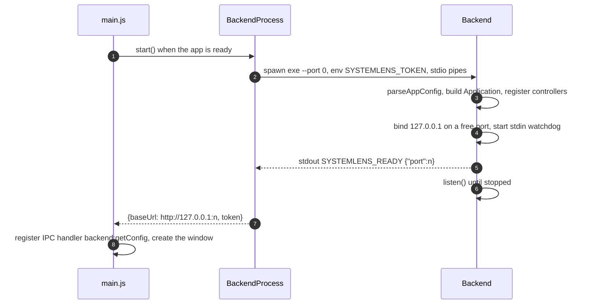
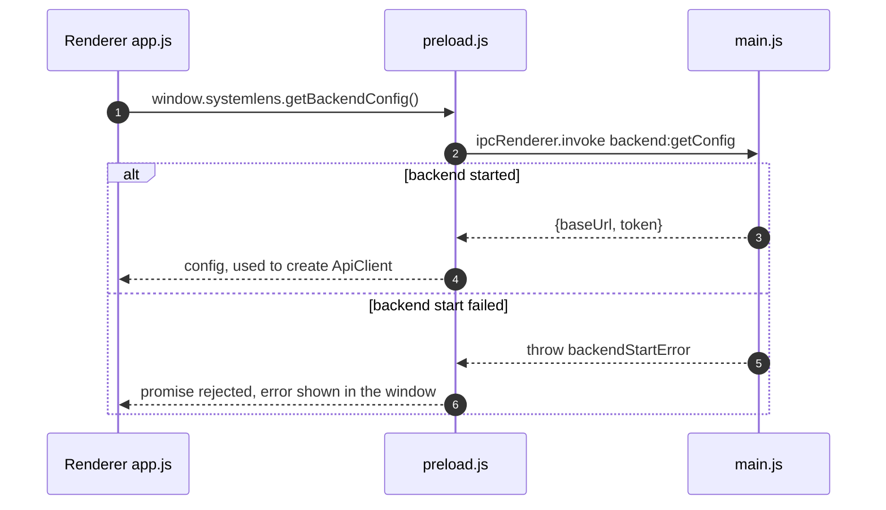
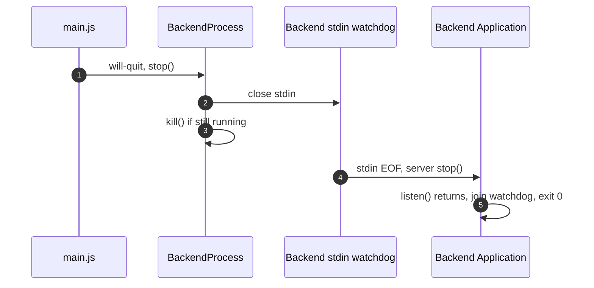
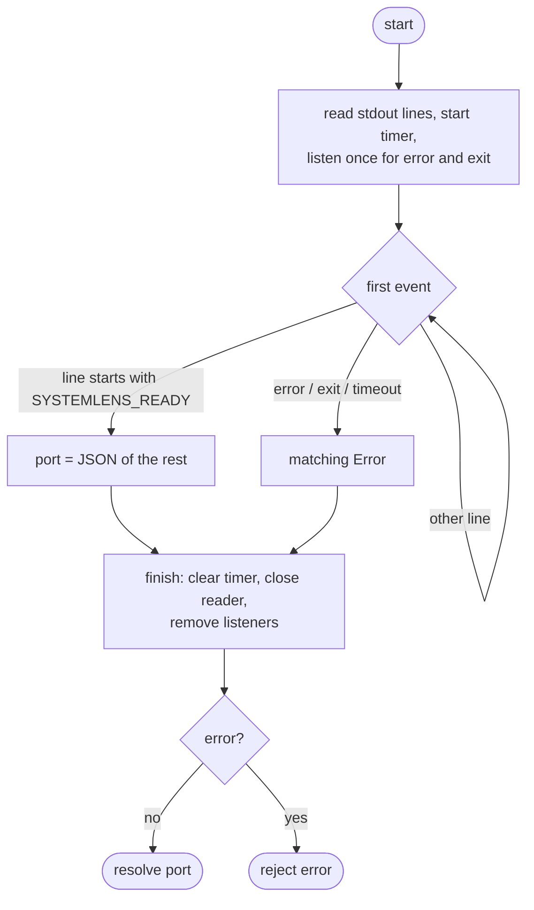

# RQ001-LLD-01 — Backend process lifecycle

| Item | Value |
|---|---|
| Traces to | [RQ001-NFR-02](../../requirements/RQ001_CoreProject.md#rq001-nfr-02), [RQ001-UC-01](../../requirements/RQ001_CoreProject.md#rq001-uc-01) (A1), [RQ001-HLD-01](RQ001_HLD.md#rq001-hld-01), [RQ001-HLD-02](RQ001_HLD.md#rq001-hld-02), [RQ001-HLD-04](RQ001_HLD.md#rq001-hld-04) D3–D6, D11 |
| Detailed in | — |
| Index / matrix | [docs/README.md](../../README.md#4-traceability-matrix) |

## 1. Scope

How Electron main starts the backend, learns where it listens, hands that to the renderer, and stops it.

```
frontend/
├── main/
│   ├── main.js              app events, IPC handler, window
│   ├── backendProcess.js    BackendProcess: spawn, wait for READY, stop
│   └── ipcChannels.js       channel name backend:getConfig
└── preload/
    └── preload.js           window.systemlens.getBackendConfig()
backend/src/
├── main.cpp                 exit codes
└── app/
    ├── AppConfig.h/.cpp     --port, --dev, SYSTEMLENS_TOKEN
    └── Application.h/.cpp   bind, READY line, stdin watchdog
```

<a id="rq001-lld-01-handshake"></a>
## 2. Handshake protocol

| Channel | Direction | Content | Why |
|---|---|---|---|
| Command line | main → backend | `--port 0` | The OS picks a free port. |
| Environment | main → backend | `SYSTEMLENS_TOKEN` = 32 random bytes as hex, new for each run | Not visible in process lists (unlike argv). |
| stdout | backend → main | One line `SYSTEMLENS_READY {"port":<n>}`, flushed after the socket is bound | The frontend waits for this exact line before using the API; nothing else is written to stdout, logs go to stderr. |
| stdin | main → backend | Kept open, never written | EOF means the parent quit or died → the backend stops. |
| stderr | backend → main | Logs, forwarded with prefix `[backend]` | — |

`--dev` (local development only) disables the token check and the stdin watchdog.

<a id="rq001-lld-01-start"></a>
## 3. Start

### 3.1 Backend start and handshake



| # | Processing |
|---|---|
| 1 | `app.whenReady()` awaits `backend.start()`; a failure is kept as `backendStartError` and startup continues (§5). |
| 2 | `BackendProcess.start()` creates the token and spawns the exe (default `backend/build/Debug/systemlens-backend.exe`, or `SYSTEMLENS_BACKEND_EXE`). |
| 3 | `parseAppConfig()` requires the token unless `--dev`; `Application` creates services/controllers and registers their routes. |
| 4 | `HttpServer::bind()` returns the port chosen by the OS; the watchdog thread is started (not in `--dev`). |
| 5 | `announceReady()` prints the line and flushes. `#waitForReady()` resolves on it (§6). |
| 6 | `HttpServer::listen()` blocks until `stop()`. |
| 7 | Connection info is kept by `BackendProcess` for the IPC handler. |
| 8 | The window is created even if steps 1–7 failed. |

<a id="rq001-lld-01-renderer-config"></a>
### 3.2 Renderer gets the connection info



| # | Processing |
|---|---|
| 1 | The only Electron API exposed to the sandboxed renderer. |
| 2 | Channel name from `ipcChannels.js`, repeated in `preload.js` because a sandboxed preload cannot `require()` local files. |
| 3–4 | `handleGetBackendConfig()` returns `backend.getConfig()`. |
| 5–6 | The stored start error is thrown; the renderer shows it (UC-01 A1). |

<a id="rq001-lld-01-stop"></a>
## 4. Stop



| # | Processing |
|---|---|
| 1 | After the last window closes, `app.quit()` (not on macOS) fires `will-quit`. |
| 2 | Closing stdin is the normal shutdown signal. |
| 3 | Killed right away because the app is quitting and the backend must never outlive it; steps 4–5 may therefore not run. |
| 4 | The same happens when the frontend dies: the OS closes the pipe. |
| 5 | `run()` returns 0. |

<a id="rq001-lld-01-failures"></a>
## 5. Failure handling

| Failure | Detected by | Result |
|---|---|---|
| Executable cannot be started | `child` `error` event | `start()` rejects: `Cannot start backend (<path>): ...` |
| Invalid arguments or missing token | `parseAppConfig()` | Backend exits with code 2 (`Error: ...` + usage on stderr); frontend sees exit before READY. |
| Port cannot be bound, other runtime error | `Application::run()` throws | Backend exits with code 1 (`Fatal: ...`); frontend sees exit before READY. |
| Exit before READY | `child` `exit` event | `start()` rejects: `Backend exited before it was ready (exit code N)` |
| No READY within 10 s | timer in `#waitForReady()` | `start()` rejects: `Backend not ready after 10000 ms` |
| Any of the above | `main.js` | Window still opens; `getBackendConfig()` rejects; renderer shows `Cannot reach backend: <message>` (UC-01 A1). |

<a id="rq001-lld-01-waitforready"></a>
## 6. `BackendProcess.#waitForReady()`



Every exit path goes through one `finish()` so the timer and listeners are always cleaned up.

## 7. Notes

- `Application` declares its controllers before the server so they are destroyed after it: the server's
  handlers point into them.
- `listen()` only returns after `stop()`, which the watchdog itself calls, so `join()` returns immediately.
