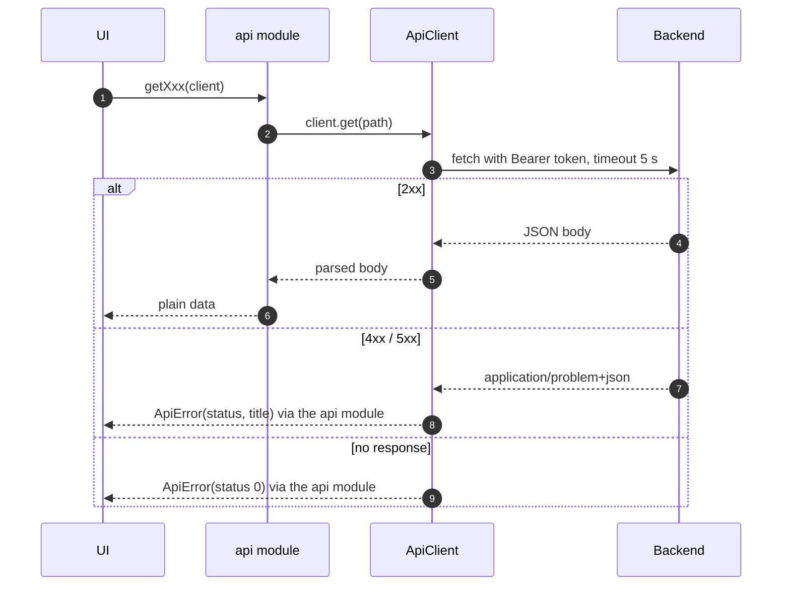
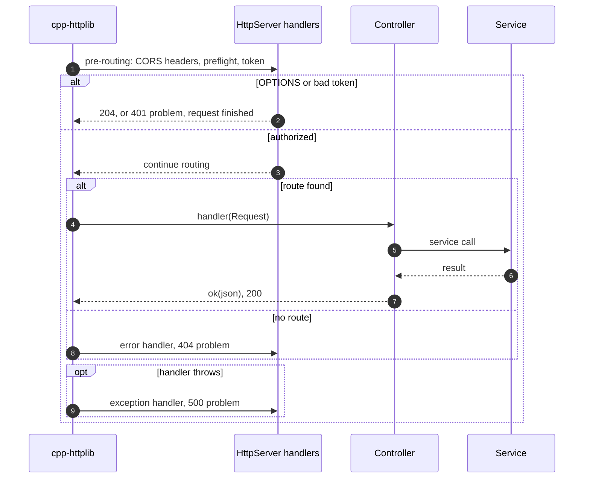
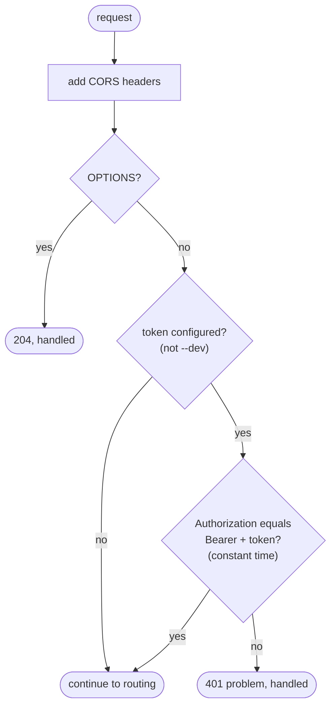
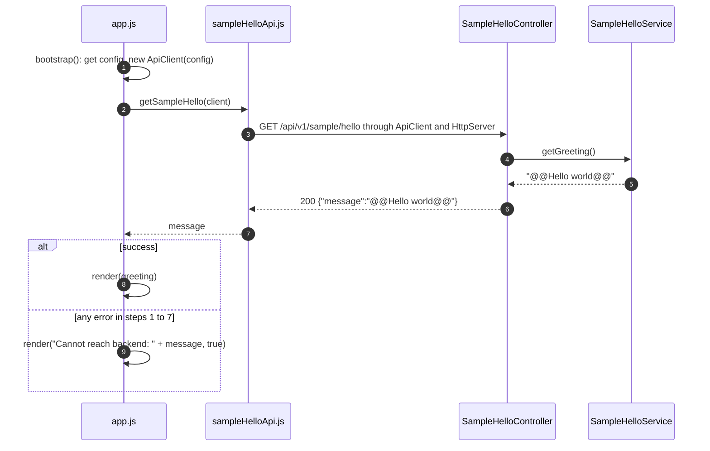

# RQ001-LLD-02 — API request pipeline and sample feature

| Item | Value |
|---|---|
| Traces to | [RQ001-FR-01](../../requirements/RQ001_CoreProject.md#rq001-fr-01), [RQ001-UC-01](../../requirements/RQ001_CoreProject.md#rq001-uc-01) (A2), [RQ001-NFR-01](../../requirements/RQ001_CoreProject.md#rq001-nfr-01), [RQ001-NFR-02](../../requirements/RQ001_CoreProject.md#rq001-nfr-02), [RQ001-HLD-02](RQ001_HLD.md#rq001-hld-02) D2, D4, D7–D10, D12 |
| Detailed in | — |
| API | all endpoints ([api-schema.md](../../api-schema.md)); rules in [api-convention.md](../../api-convention.md) |
| Index / matrix | [docs/README.md](../../README.md#4-traceability-matrix) |

## 1. Scope

The path every API call takes, frontend and backend, and the sample endpoint `GET /api/v1/sample/hello`
that proves it works ([RQ001-FR-01](../../requirements/RQ001_CoreProject.md#rq001-fr-01)).

```
frontend/renderer/
├── app.js                          UI: bootstrap(), render()
└── api/
    ├── apiClient.js                ApiClient, ApiError
    └── sample/sampleHelloApi.js    getSampleHello()
backend/src/api/
├── HttpTypes.h                     Request, Response, Handler, HttpMethod (library-independent)
├── IRouteRegistry.h, IController.h
├── HttpServer.h/.cpp               cpp-httplib wrapper: auth, CORS, error conversion
├── ApiResponse.h/.cpp              ok(), problem(), status constants
└── sample/SampleHelloController.h/.cpp
backend/src/services/sample/
├── ISampleHelloService.h
└── SampleHelloService.h/.cpp
```

<a id="rq001-lld-02-layers"></a>
## 2. Layers

| Layer | Responsibility | Depends on |
|---|---|---|
| UI (`app.js`) | Calls an api function, shows data or the error. | api module |
| api module (`api/<area>/*Api.js`) | One function per endpoint: path constant, `client.get(path)`, returns plain data. | `ApiClient` |
| `ApiClient` | Adds `Authorization: Bearer <token>`, timeout (5 s), turns any failure into `ApiError`. | `fetch` |
| `HttpServer` | Loopback bind; before routing: CORS, preflight, token check; after: 404 / exception → problem. | cpp-httplib |
| Controller (`IController`) | Registers its routes through `IRouteRegistry`; Request → service call → `ok(json)`. No business logic. | `HttpTypes.h`, service interface |
| Service (`I…Service`) | Business logic, behind an interface injected into the controller. | — |
| `ApiResponse` | The only place that builds a `Response`: `ok()` JSON, `problem()` RFC 7807. | nlohmann/json |

Routes are registered once at startup: `Application::registerControllers()` → `registerRoutes(server)` →
`addRoute(method, path, handler)`; `HttpServer` wraps each handler to convert between cpp-httplib types and
`Request` / `Response`.

<a id="rq001-lld-02-sequences"></a>
## 3. One request

### 3.1 Frontend side



| # | Processing |
|---|---|
| 1–2 | The UI never sees HTTP; the api module only knows the path. |
| 3 | Backend side in §3.2. |
| 4–6 | Success: the api module extracts the data (e.g. `body.message`). |
| 7–8 | Error response: message `<title>: <detail>` from the problem body (§4). |
| 9 | `fetch` rejected (backend down, timeout): message `<METHOD> <path> failed: <reason>`. |

### 3.2 Backend side



| # | Processing |
|---|---|
| 1 | Runs before routing for every request (§5). |
| 2 | Preflight → 204 (before auth: browsers send it without `Authorization`); wrong/missing token → 401. |
| 3 | Authorized: cpp-httplib routes by exact method + path. |
| 4 | The adapter from `addRoute()` passes a library-independent `Request{path, body}`. |
| 5–6 | Through the service interface. |
| 7 | `ok()` → `application/json`. |
| 8 | Unknown route → `problem(404, ...)`. |
| 9 | Any exception → logged to stderr, `problem(500, ..., what())`; the server keeps running. |

<a id="rq001-lld-02-errors"></a>
## 4. Error handling

| Case | Status | Produced by | Problem `title` / `detail` | `ApiError` in the frontend |
|---|---|---|---|---|
| Missing or wrong token | 401 | pre-routing handler | `Unauthorized` / `Missing or invalid bearer token.` | `status` 401, message `Unauthorized: Missing or invalid bearer token.` |
| Unknown method + path | 404 | error handler | `Not Found` / `No route for <METHOD> <path>` | `status` 404 |
| Exception in a handler | 500 | exception handler | `Internal Server Error` / exception text | `status` 500 |
| Error without a problem body | any 4xx/5xx | — | — | message `<METHOD> <path> returned HTTP <status>` |
| No response (backend down, 5 s timeout) | — | `fetch` rejects | — | `status` 0, message `<METHOD> <path> failed: <reason>` |

Problem bodies always have `type: "about:blank"`, `title`, `status`, `detail` (`api::problem()`). CORS headers
are added to error responses too.

<a id="rq001-lld-02-prerouting"></a>
## 5. Pre-routing handler (`HttpServer::installMiddleware`)



Controllers never deal with auth or CORS: this handler runs for every request before routing.

<a id="rq001-lld-02-sample"></a>
## 6. Sample feature: show the greeting (RQ001-FR-01)

Built only with `SYSTEMLENS_ENABLE_SAMPLE_API=ON` (default). It is also the reference example for a new
endpoint: contract → service interface + implementation → controller → register in
`Application::registerControllers()` → frontend api module (steps in [api-convention.md §8](../../api-convention.md#8-adding-an-api)).



| # | Processing |
|---|---|
| 1 | Connection info as in [RQ001-LLD-01 §3.2](RQ001_LLD-01-backend-lifecycle.md#rq001-lld-01-renderer-config); fails when the backend did not start (UC-01 A1). |
| 2–3 | Generic path of §3; path constant `SAMPLE_HELLO_PATH`. |
| 4–5 | `ISampleHelloService` injected into the controller; the service returns its constant greeting. |
| 6 | `handleGetHello()` → `ok({"message": ...})`, matching `SampleHelloResponse` in the contract. |
| 7 | The api module returns `body.message` only. |
| 8 | `#message` text = greeting, CSS class `error` removed (UC-01 main flow step 4). |
| 9 | `#message` text = error, CSS class `error` added (UC-01 A1 / A2). |

UI: one `<h1 id="message">` in `index.html`, initial text `Connecting to backend...`; `.error` style in
`styles.css`. No UI design yet ([ui-design/](../../ui-design/)).
