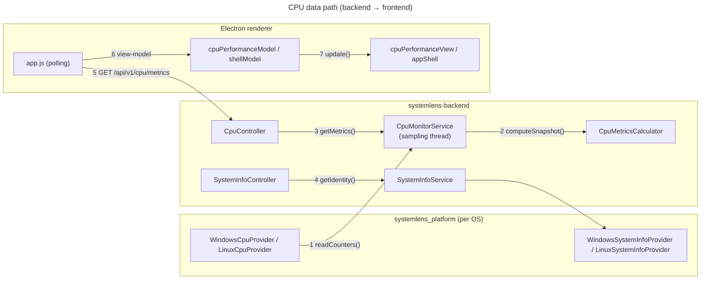
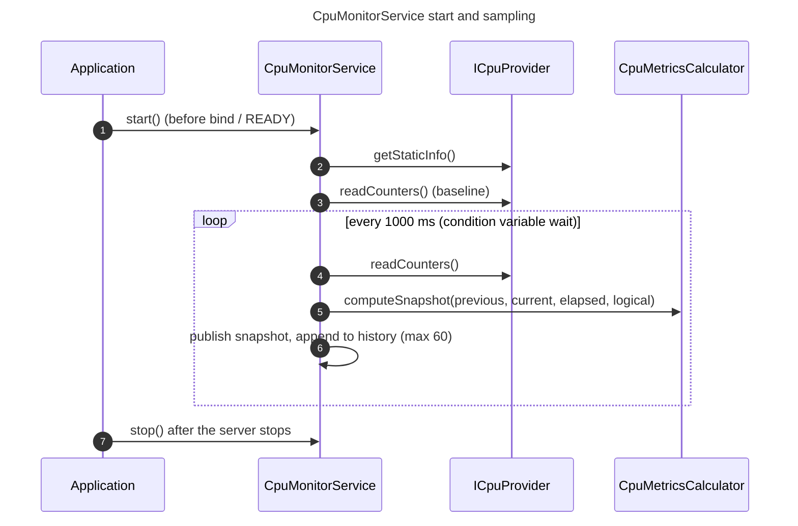
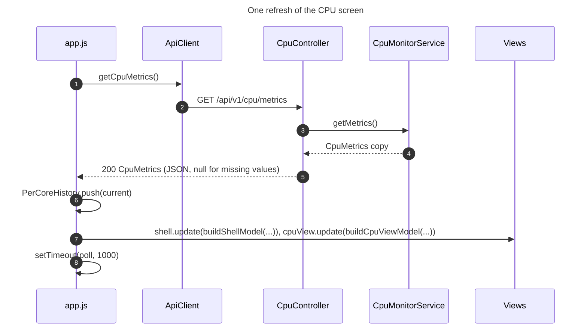

# RQ002 — Architecture

| Item | Value |
|---|---|
| Requirement | [RQ002_CpuPerformance.md](../../requirements/RQ002_CpuPerformance.md) |
| Base architecture | [RQ001_Architecture.md](../RQ001_CoreProject/RQ001_Architecture.md) (processes, handshake, request pipeline) |
| Platform plugin | `openspec/changes/add-platform-plugin/design.md` (loading, ABI, failure levels) |
| Contract | [`api/openapi.yaml`](../../../api/openapi.yaml): `getCpuInfo`, `getCpuMetrics`, `getSystemInfo` |

| Section | Content |
|---|---|
| [1. Components](#1-components) | Layers involved and what each one owns |
| [2. Code map](#2-code-map) | Where each part lives |
| [3. Flows](#3-flows) | Sampling, metrics request, frontend refresh |
| [4. Computations](#4-computations) | How counters become percentages and rates |
| [5. Platform sources](#5-platform-sources) | Which OS API gives which value |
| [6. Failures](#6-failures) | Status codes and frontend behavior |
| [7. Tests](#7-tests) | Backend and frontend test suites |

## 1. Components



| # | Edge | Description |
|---|---|---|
| 1 | Provider → service | Cumulative counters (CPU times per core, event counts, processes) read once per second by the sampling thread. |
| 2 | Service → calculator | Two consecutive reads and the elapsed time become one `CpuSnapshot`. |
| 3 | Controller → service | Copy of the latest snapshot and of the 60-sample history. |
| 4 | Controller → service → provider | Machine identity, read on each request. |
| 5 | Renderer → backend | One request per second through `ApiClient` (bearer token, timeout). |
| 6 | Model | API data → view-model shaped like the mock objects of the UI design; formatting and scaling. |
| 7 | View | Refills the data slots of a DOM built once (cards, titles and info icons are not recreated). |

## 2. Code map

```
backend/
├── src/
│   ├── providers/cpu/ICpuProvider.h            provider contract: CpuStaticInfo, CpuCounters
│   ├── providers/system/ISystemInfoProvider.h  provider contract: SystemIdentity
│   ├── providers/PluginAbi.h                   ABI version 2, create/destroy entry points
│   ├── platform/PlatformPlugin.*               createCpuProvider(), createSystemInfoProvider()
│   ├── services/cpu/                           CpuMetricsCalculator, CpuMonitorService, CpuMetrics.h
│   ├── services/system/                        SystemInfoService
│   ├── services/NotReadyError.h                → 503
│   ├── api/cpu/                                CpuController, CpuJson
│   └── api/system/                             SystemInfoController
├── plugins/
│   ├── windows/                                WindowsCpuProvider, WindowsSystemInfoProvider, WideString
│   ├── linux/                                  LinuxCpuProvider, LinuxProcFs (parsers), LinuxSystemInfoProvider
│   └── macos/                                  no CPU / system provider
└── tests/                                      GoogleTest suite
frontend/
├── renderer/
│   ├── api/cpu/cpuApi.js, api/system/systemApi.js
│   ├── app.js                                  state, polling loop
│   ├── shell/appShell.js, shell/shellModel.js
│   ├── ui/format.js                            value formatting, "—" placeholder
│   └── views/cpu/                              cpuPerformanceView, cpuPerformanceModel, perCoreHistory, cpuPerformanceMock
├── playwright.config.js
└── tests/e2e/                                  fixtures.js, cpuPerformance.spec.js
```

## 3. Flows

### 3.1 Sampling (backend)



| # | Step |
|---|---|
| 1 | `Application::run()` starts the service before binding, so metrics exist about one second after READY. |
| 2 | Static facts are read once. On failure the provider is dropped (endpoints answer 501), the backend keeps running. |
| 3 | First read: baseline for the first interval. |
| 4 | Each tick reads the counters. A provider exception is logged once per distinct message and the tick is skipped. |
| 5 | Deltas, percentages and rates of the interval ([§4](#4-computations)). |
| 6 | Under the mutex: the snapshot becomes current; the history keeps the last 60. |
| 7 | `stop()` wakes the thread immediately through the condition variable and joins it. |

### 3.2 Metrics request and frontend refresh



| # | Step |
|---|---|
| 1 | `getSystemInfo` and `getCpuInfo` are requested first if still missing (501 marks them unavailable for good). |
| 2 | Same pipeline as every API ([RQ001 §3.2](../RQ001_CoreProject/RQ001_Architecture.md#32-request-an-api-and-display-it)). |
| 3 | Copy taken under the service mutex. |
| 4 | Latest snapshot + history arrays, oldest first. |
| 5 | `CpuJson` rounds numbers to two decimals and writes `null` instead of omitting fields. |
| 6 | Per-core history is accumulated on the client (the API only carries current per-core values). |
| 7 | Models map data to the view-model; views refill their slots. Info icons are not recreated, so an open tooltip stays open. |
| 8 | The next request is scheduled after this one completes; slow responses never overlap. |

## 4. Computations

`CpuMetricsCalculator` (pure functions, `services/cpu/`):

| Value | Formula |
|---|---|
| Time shares | `Δpart / Δ(user + kernel + dpc + interrupt + idle) × 100`; all idle when no time elapsed |
| Usage (total, per core) | `100 − idle share`, clamped to [0, 100] |
| Rates | `counterDelta(prev, cur) / elapsedSeconds`; `null` when a side is missing or `elapsed ≤ 0` |
| `counterDelta` | `cur − prev`; when `cur < prev` and `prev < 2^32`: wrapped 32-bit counter, `cur + 2^32 − prev`; otherwise reset → `null` |
| Process CPU % | `ΔcpuTime / (elapsed × unitsPerSecond × logicalProcessors) × 100`, clamped; matched on pid **and** name (a reused pid starts at 0 %) |
| Top processes | 10 highest CPU %, ties by ascending pid |

Frontend scaling (`cpuPerformanceModel.js`):

| Value | Rule |
|---|---|
| Clock gauge / series | % of `maxSpeedMhz`, else of `2 × baseSpeedMhz` |
| Temperature gauge / series | % of 100 °C |
| Breakdown bar | width `p / 100 × 584 px`, at least 2 px for a non-zero part, idle takes the rest |
| CPU % cell shade | linear between `#254036` (0) and `#2daf6a` (highest value in the table) |
| Charts | 60 slots; a shorter history is drawn from the right edge; `null` samples take the previous value |

## 5. Platform sources

| Data | Windows | Linux |
|---|---|---|
| CPU times | `NtQuerySystemInformation(SystemProcessorPerformanceInformation)`; kernel = Kernel − Idle − DPC − Interrupt | `/proc/stat`: user+nice, system+steal, softirq (DPC), irq, idle+iowait |
| Context switches / interrupts / system calls / DPCs | PDH raw values of `\System\Context Switches/sec`, `\Processor(_Total)\Interrupts/sec`, `\System\System Calls/sec`, `\Processor(_Total)\DPCs Queued/sec` | `/proc/stat` `ctxt`, `intr`, — (null), `softirq` |
| Current speed | PDH `\Processor Information(_Total)\% Processor Performance` × registry `~MHz` | mean `cpufreq/scaling_cur_freq`, else `/proc/cpuinfo` `cpu MHz` |
| Temperature | PDH `\Thermal Zone Information(*)\Temperature` (K), hottest zone | hwmon `coretemp` / `k10temp` / `zenpower` / `cpu_thermal` `temp1_input`, else thermal zone `x86_pkg_temp` / `*cpu*` |
| Processes, threads, handles | `SystemProcessInformation` (pid 0 excluded) | `/proc/<pid>/stat` count and `num_threads`; `/proc/sys/fs/file-nr` |
| Process CPU time, memory | User + Kernel time (100 ns); private working set | `utime + stime` (`_SC_CLK_TCK`); RSS (`statm` × page size) |
| Uptime, boot time | `GetTickCount64`; now − uptime | `/proc/uptime`; `btime` |
| Model, base speed | registry `CentralProcessor\0` `ProcessorNameString`, `~MHz` | `model name` (ARM: `Hardware`); `cpufreq/base_frequency`, else `@ x.xxGHz` of the model, else `cpu MHz` |
| Max speed | null | `cpufreq/cpuinfo_max_freq` |
| Topology, caches | `GetLogicalProcessorInformationEx(RelationAll)` | sysfs `topology/`, `cache/index*/` (shared caches counted once) |
| Virtualization | `IsProcessorFeaturePresent(PF_VIRT_FIRMWARE_ENABLED)` | `vmx` / `svm` flag |
| Identity | `GetComputerNameW`, registry `ProductName` (+ "Windows 11" from build 22000), `RtlGetVersion`, `GetUserNameW` | `uname`, `/etc/os-release` `PRETTY_NAME`, `getpwuid_r` |

Constraints: only processor group 0 is read on Windows (≤ 64 logical processors). PDH counter names are
English (`PdhAddEnglishCounterW`). Values not available on a machine are `null`. The Windows plugin links
`ntdll`, `pdh` and `advapi32`.

## 6. Failures

| Situation | Backend | Frontend |
|---|---|---|
| No CPU / system info provider (macOS, create failed) | 501 problem; warning at startup | Values stay `—`; the resource is not requested again |
| Static info read fails at start | Provider dropped → 501 | Same as above |
| Before the first interval | `getCpuMetrics` 503 problem | Placeholders kept; status stays "Connected" |
| A counter read fails | Tick skipped, last snapshot kept, message logged once | No change |
| Backend unreachable / other error | — | Status bar `Backend unreachable`, red dot; polling continues |

## 7. Tests

| Suite | Location | Run | Content |
|---|---|---|---|
| Backend unit + integration | `backend/tests/` (GoogleTest 1.15.2, FetchContent) | `cmake -DSYSTEMLENS_BUILD_TESTS=ON …`, then `ctest --test-dir backend/build --output-on-failure` | calculator, monitor service (fake provider), controllers and JSON (fake service), Linux parsers and provider (fixed text and a fake `/proc` tree), real plugin loading |
| Frontend end-to-end | `frontend/tests/e2e/` (`@playwright/test`, `_electron`) | `npm run test:e2e` in `frontend/` (Linux: `xvfb-run -a npm run test:e2e`) | app on the CPU screen, values compared with the API, refresh, header, top processes order, per-core sub-tab, tooltip across a refresh, usage under a generated load, hello toggle, one walkthrough |

The end-to-end fixture launches the Electron app with the real Debug backend, records a video of every
test and attaches named screenshots; output goes to `frontend/tests/e2e/results/` and the HTML report to
`frontend/tests/e2e/report/` (both ignored by git).
