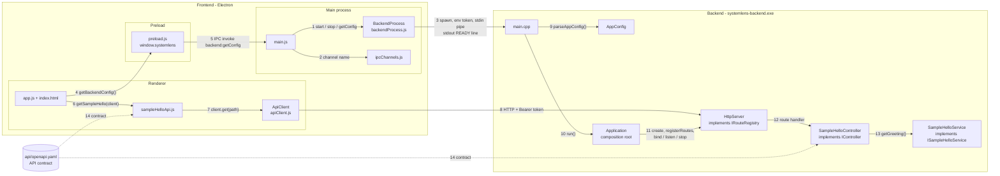
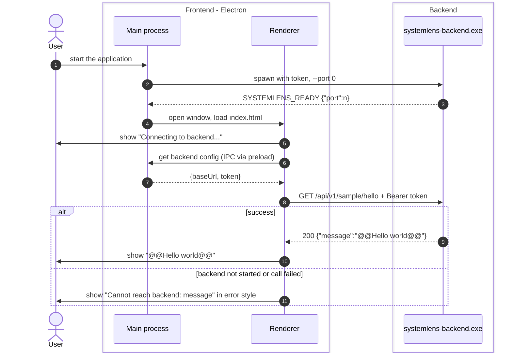
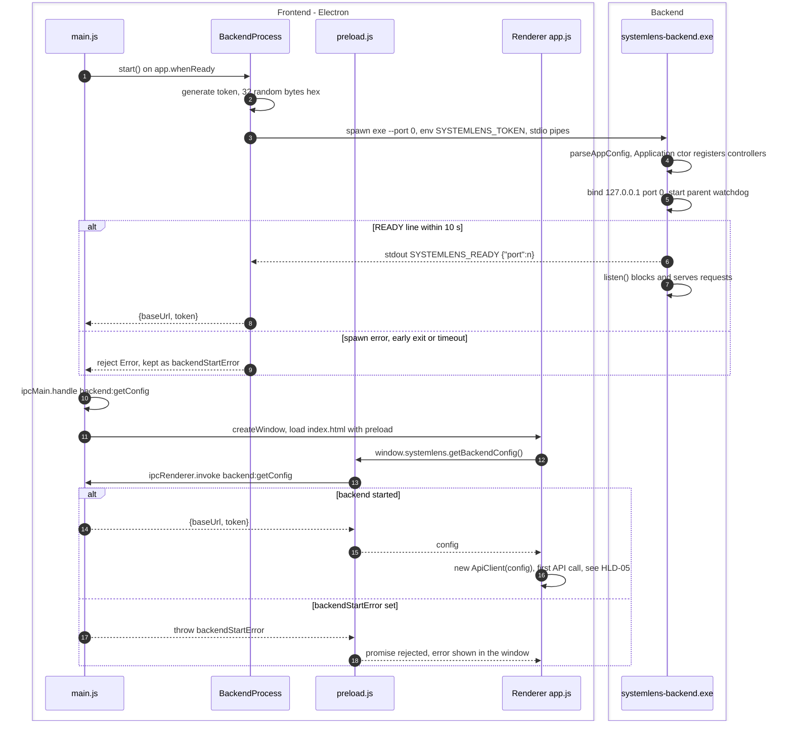
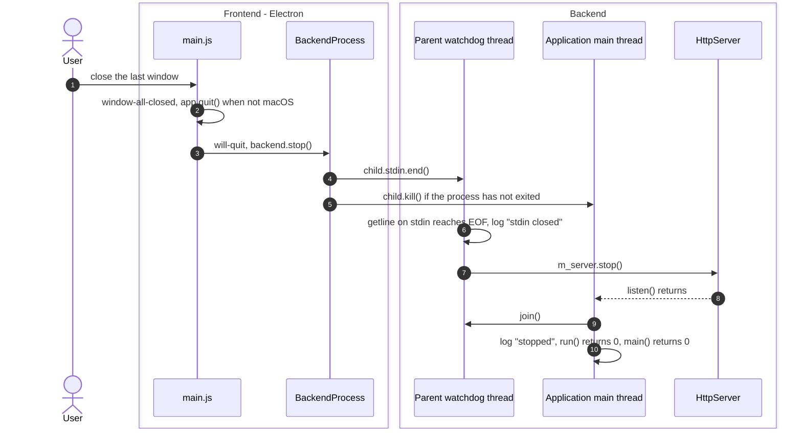
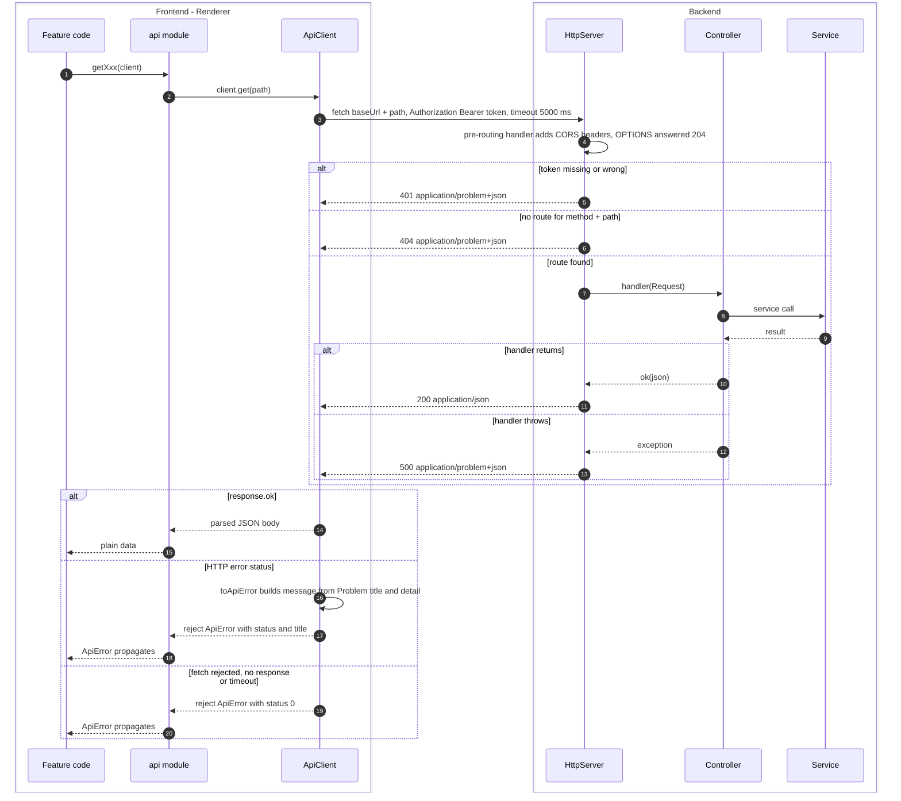

# High-level design

| Item | Value |
|---|---|
| Scope | Components of SystemLens and the overview flows between them |
| Traces to | [FR-SMP-01](../requirements/functional-requirements.md#fr-smp-01), [NFR-01](../requirements/non-functional-requirements.md#nfr-01), [NFR-02](../requirements/non-functional-requirements.md#nfr-02) |
| Detailed in | [LLD-01](lld/LLD-01-backend-lifecycle.md), [LLD-02](lld/LLD-02-api-request-pipeline.md), [LLD-03](lld/LLD-03-sample-hello.md) |
| API | [api-schema.md](../api-schema.md), rules in [api-convention.md](../api-convention.md) |
| Index / matrix | [docs/README.md](../README.md#3-traceability-matrix) |

| Section | Content | Traces to | Detailed in |
|---|---|---|---|
| [HLD-01](#hld-01) | Component diagram | NFR-01, NFR-02 | LLD-01, LLD-02, LLD-03 |
| [HLD-02](#hld-02) | Overview: UI → backend → display | FR-SMP-01 | LLD-03 |
| [HLD-03](#hld-03) | App start | NFR-02 | LLD-01 |
| [HLD-04](#hld-04) | App end | NFR-02 | LLD-01 |
| [HLD-05](#hld-05) | Calling one API | NFR-01, NFR-02 | LLD-02 |

## Overview

SystemLens has two processes:

| Process | Technology | Role |
|---|---|---|
| Frontend | Electron (HTML/CSS/JS): main process, preload script, renderer | Starts and stops the backend, shows the UI. |
| Backend | C++20 executable `systemlens-backend.exe` (cpp-httplib, nlohmann/json) | Serves the HTTP API on `127.0.0.1`. |

The API between them is defined by [`api/openapi.yaml`](../../api/openapi.yaml) (NFR-01).

Source tree of the components below:

```
frontend/
├── main/
│   ├── main.js                    Electron main: starts backend, IPC handler, window
│   ├── backendProcess.js          BackendProcess: spawn / handshake / stop of the backend
│   └── ipcChannels.js             IPC channel names
├── preload/
│   └── preload.js                 exposes window.systemlens to the renderer
└── renderer/
    ├── index.html                 single page (CSP, #message)
    ├── styles.css
    ├── app.js                     renderer entry point
    └── api/
        ├── apiClient.js           ApiClient, ApiError
        └── sample/
            └── sampleHelloApi.js  getSampleHello()
backend/
├── CMakeLists.txt                 systemlens_core (static lib) + systemlens-backend (exe)
└── src/
    ├── main.cpp                   entry point
    ├── app/
    │   ├── AppConfig.h/.cpp       command line + environment parsing
    │   └── Application.h/.cpp     composition root, handshake, parent watchdog
    ├── api/
    │   ├── HttpTypes.h            Request, Response, Handler, HttpMethod
    │   ├── IRouteRegistry.h       route registration interface
    │   ├── IController.h          controller interface
    │   ├── HttpServer.h/.cpp      cpp-httplib wrapper: auth, CORS, errors
    │   ├── ApiResponse.h/.cpp     ok() / problem() builders, status constants
    │   └── sample/
    │       └── SampleHelloController.h/.cpp
    └── services/
        └── sample/
            ├── ISampleHelloService.h
            └── SampleHelloService.h/.cpp
api/
└── openapi.yaml                   API contract
```

<a id="hld-01"></a>
## HLD-01 — Component diagram



| # | From → To | Interaction | Source |
|---|---|---|---|
| 1 | `main.js` → `BackendProcess` | `start()` when the app is ready, `getConfig()` for the IPC handler, `stop()` on `will-quit`. | `frontend/main/main.js` |
| 2 | `main.js` → `ipcChannels.js` | Uses the channel name `BACKEND_GET_CONFIG` = `backend:getConfig`. | `frontend/main/ipcChannels.js` |
| 3 | `BackendProcess` → backend `main.cpp` | Spawns the exe with `--port 0` and `SYSTEMLENS_TOKEN`; reads the `SYSTEMLENS_READY {"port":n}` line from stdout; keeps stdin open as the "parent alive" signal. | `frontend/main/backendProcess.js`, `backend/src/app/Application.h` |
| 4 | `app.js` → preload | `window.systemlens.getBackendConfig()`. | `frontend/renderer/app.js` |
| 5 | preload → `main.js` | `ipcRenderer.invoke('backend:getConfig')` → `{baseUrl, token}` or error. | `frontend/preload/preload.js` |
| 6 | `app.js` → `sampleHelloApi.js` | `getSampleHello(client)`. | `frontend/renderer/app.js` |
| 7 | `sampleHelloApi.js` → `ApiClient` | `client.get('/api/v1/sample/hello')`. | `frontend/renderer/api/sample/sampleHelloApi.js` |
| 8 | `ApiClient` → `HttpServer` | HTTP on `127.0.0.1:<port>` with `Authorization: Bearer <token>`. | `frontend/renderer/api/apiClient.js` |
| 9 | `main.cpp` → `AppConfig` | `parseAppConfig(argc, argv)`. | `backend/src/main.cpp` |
| 10 | `main.cpp` → `Application` | Constructs `Application(config)` and calls `run()`. | `backend/src/main.cpp` |
| 11 | `Application` → `HttpServer` | Owns the server; creates controllers and calls `registerRoutes(m_server)`; `bind()`, `listen()`; the watchdog calls `stop()`. | `backend/src/app/Application.cpp` |
| 12 | `HttpServer` → `SampleHelloController` | Calls the handler registered through `IRouteRegistry::addRoute`. | `backend/src/api/HttpServer.cpp` |
| 13 | `SampleHelloController` → `SampleHelloService` | Calls `getGreeting()` through `ISampleHelloService` (injected via constructor). | `backend/src/api/sample/SampleHelloController.cpp` |
| 14 | `api/openapi.yaml` → FE api module, BE controller | Both sides implement the contract (NFR-01). | header comments of both files |

Backend layering as in the code: `HttpServer` → Controller (`IController`) → Service (`I…Service`).
The sample controller and service are compiled only when `SYSTEMLENS_ENABLE_SAMPLE_API=ON`.

<a id="hld-02"></a>
## HLD-02 — Overview: UI → backend → display

Traces to [FR-SMP-01](../requirements/functional-requirements.md#fr-smp-01) / [UC-SMP-01](../requirements/functional-requirements.md#uc-smp-01).
Details: start in [HLD-03](#hld-03), API call in [HLD-05](#hld-05), feature in [LLD-03](lld/LLD-03-sample-hello.md).



| # | From → To | Processing |
|---|---|---|
| 1 | User → Main | User starts the app; Electron main runs `app.whenReady()`. |
| 2 | Main → Backend | `BackendProcess.start()` spawns the backend with a random token in `SYSTEMLENS_TOKEN` and `--port 0`. |
| 3 | Backend → Main | Backend binds a port and prints the READY line; main builds `{baseUrl, token}`. |
| 4 | Main → Renderer | `createWindow()` loads `renderer/index.html` with `preload.js`. |
| 5 | Renderer → User | Initial text of `#message`. |
| 6 | Renderer → Main | `window.systemlens.getBackendConfig()` → IPC `backend:getConfig`. |
| 7 | Main → Renderer | `handleGetBackendConfig()` returns the connection info. |
| 8 | Renderer → Backend | `getSampleHello(client)` → `ApiClient.get()` → `fetch`. |
| 9 | Backend → Renderer | `SampleHelloController` returns the greeting from `SampleHelloService`. |
| 10 | Renderer → User | `render(greeting)`. |
| 11 | Renderer → User | Any error from steps 2–9 (start failure, IPC error, `ApiError`) is caught in `bootstrap()` and shown with `render(text, true)`. |

<a id="hld-03"></a>
## HLD-03 — App start

Traces to [NFR-02](../requirements/non-functional-requirements.md#nfr-02). Details: [LLD-01](lld/LLD-01-backend-lifecycle.md).



| # | From → To | Processing |
|---|---|---|
| 1 | main.js → BackendProcess | `app.whenReady().then(...)` awaits `backend.start()`. |
| 2 | BackendProcess | `crypto.randomBytes(32).toString('hex')`. |
| 3 | BackendProcess → Backend | `spawn(exePath, ['--port','0'], {env: {..., SYSTEMLENS_TOKEN}, stdio: pipes, windowsHide: true})`; backend stderr is forwarded with prefix `[backend]`. |
| 4 | Backend | `main()` → `parseAppConfig()` (token required unless `--dev`) → `Application` constructor → `registerControllers()`. |
| 5 | Backend | `Application::run()` → `HttpServer::bind()` (port chosen by the OS); outside `--dev`, `startParentWatchdog()`. |
| 6 | Backend → BackendProcess | `announceReady(port)` prints `SYSTEMLENS_READY {"port":n}` and flushes. |
| 7 | Backend | `HttpServer::listen()` blocks until `stop()`. |
| 8 | BackendProcess → main.js | `#waitForReady()` resolves the port; `start()` returns `{baseUrl: "http://127.0.0.1:<port>", token}`. |
| 9 | BackendProcess → main.js | Spawn `error`, `exit` before READY, or no READY within `readyTimeoutMs` (10000 ms): the error is stored in `backendStartError` and logged; startup continues. |
| 10 | main.js | Registers `handleGetBackendConfig` for `backend:getConfig`. |
| 11 | main.js → Renderer | `createWindow()`: 1000 × 700, `contextIsolation: true`, `nodeIntegration: false`, `sandbox: true`. |
| 12 | Renderer → preload | `bootstrap()` asks for the backend config. |
| 13 | preload → main.js | `ipcRenderer.invoke('backend:getConfig')`. |
| 14 | main.js → preload | `backend.getConfig()`. |
| 15 | preload → Renderer | Promise resolves with `{baseUrl, token}`. |
| 16 | Renderer | Creates the `ApiClient` and makes the first call ([HLD-05](#hld-05)). |
| 17 | main.js → preload | `handleGetBackendConfig()` throws the stored error. |
| 18 | preload → Renderer | The rejected promise is caught in `bootstrap()` and shown ([FR-SMP-01](../requirements/functional-requirements.md#fr-smp-01) A1). |

<a id="hld-04"></a>
## HLD-04 — App end

Traces to [NFR-02](../requirements/non-functional-requirements.md#nfr-02). Details: [LLD-01](lld/LLD-01-backend-lifecycle.md).



| # | From → To | Processing |
|---|---|---|
| 1 | User → main.js | All windows closed → `window-all-closed` event. |
| 2 | main.js | `app.quit()` unless `process.platform === 'darwin'`. |
| 3 | main.js → BackendProcess | `app.on('will-quit', () => backend.stop())`. |
| 4 | BackendProcess → Backend | Closes the stdin pipe: the backend's normal shutdown signal. |
| 5 | BackendProcess → Backend | `kill()` right away if `exitCode === null` ("the backend must never outlive" the app); then `child` and `config` are cleared. Because of this, steps 6–10 may not get to run. |
| 6 | Watchdog | The thread blocked in `std::getline(std::cin, ...)` sees EOF. The same happens when the parent dies, because the OS closes the pipe. |
| 7 | Watchdog → HttpServer | `stop()` (safe from any thread, idempotent). |
| 8 | HttpServer → Application | `listen()` returns in `run()`. |
| 9 | Application → Watchdog | `join()` returns immediately: the watchdog already finished. |
| 10 | Application | Logs `[Application] stopped` to stderr; exit code 0. |

In `--dev` mode the watchdog is not started (`Application::run()`), so steps 4 and 6–9 do not apply.

<a id="hld-05"></a>
## HLD-05 — Calling one API

Traces to [NFR-01](../requirements/non-functional-requirements.md#nfr-01), [NFR-02](../requirements/non-functional-requirements.md#nfr-02).
Details: [LLD-02](lld/LLD-02-api-request-pipeline.md). Rules: [api-convention.md](../api-convention.md).



| # | From → To | Processing |
|---|---|---|
| 1 | Feature → api module | One exported function per endpoint, taking the `ApiClient`. |
| 2 | api module → ApiClient | `client.get(PATH)`; the path constant lives in the api module. |
| 3 | ApiClient → HttpServer | `fetch` with `Authorization: Bearer <token>` and `AbortSignal.timeout(timeoutMs)` (default 5000 ms). |
| 4 | HttpServer | Pre-routing handler: CORS headers on every response; `OPTIONS` → 204 before the auth check. |
| 5 | HttpServer → ApiClient | Token configured and `Authorization` ≠ `Bearer <token>` (constant-time compare) → `problem(401, ...)`. |
| 6 | HttpServer → ApiClient | Error handler fills a `problem(404, "Not Found", "No route for <METHOD> <path>")` body. |
| 7 | HttpServer → Controller | The adapter from `addRoute()` converts the cpp-httplib request to `Request` and calls the handler. |
| 8 | Controller → Service | Through the service interface injected in the constructor. |
| 9 | Service → Controller | Plain data. |
| 10 | Controller → HttpServer | `ok(json)` → `Response{200, "application/json", body}`. |
| 11 | HttpServer → ApiClient | `writeResponse()` copies status, body and content type. |
| 12 | Controller → HttpServer | An exception escapes the handler. |
| 13 | HttpServer → ApiClient | Exception handler logs to stderr and returns `problem(500, "Internal Server Error", what())`. |
| 14 | ApiClient → api module | `response.json()`. |
| 15 | api module → Feature | The api module extracts the data (e.g. `body.message`). |
| 16 | ApiClient | If the content type is `application/problem+json`, message = `<title>: <detail>`; otherwise `<METHOD> <path> returned HTTP <status>`. |
| 17 | ApiClient → api module | `ApiError` with `status` and `title`. |
| 18 | api module → Feature | Not caught in the api module; the feature handles it. |
| 19 | ApiClient → api module | `fetch` rejected (backend down, timeout): `ApiError("<METHOD> <path> failed: <message>")`, `status` = 0. |
| 20 | api module → Feature | Same as 18. |
