# LLD-01 — Backend process lifecycle

| Item | Value |
|---|---|
| Status | Implemented |
| Traces to | [NFR-02](../../requirements/non-functional-requirements.md#nfr-02), [HLD-03](../high-level-design.md#hld-03), [HLD-04](../high-level-design.md#hld-04) |
| API | — (no endpoint; the handshake is on stdin/stdout) |
| Index / matrix | [docs/README.md](../../README.md#3-traceability-matrix) |

## 1. Scope

Electron main starts the C++ backend, waits for its READY handshake, hands the connection info to the
renderer over Electron IPC, and stops the backend when the app quits. The backend parses its configuration,
builds its object graph, binds a port, announces it and exits when its stdin closes.

Source files:

```
frontend/
├── main/
│   ├── main.js                 app events, IPC handler, window
│   ├── backendProcess.js       BackendProcess, resolveBackendExePath
│   └── ipcChannels.js          BACKEND_GET_CONFIG
└── preload/
    └── preload.js              window.systemlens.getBackendConfig
backend/
└── src/
    ├── main.cpp                main(), exit codes
    └── app/
        ├── AppConfig.h/.cpp    AppConfig, parseAppConfig, readEnv, parsePort
        └── Application.h/.cpp  Application, toServerOptions
```

`HttpServer::bind/listen/stop` are described in [LLD-02](LLD-02-api-request-pipeline.md).

## 2. Sequences

### 2.1 Start

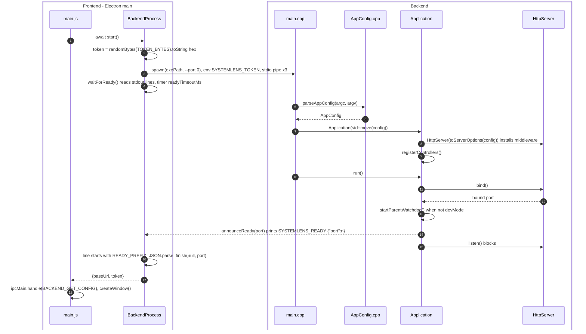

| # | From → To | Function | Processing |
|---|---|---|---|
| 1 | main.js → BackendProcess | `app.whenReady` handler, `start()` | Awaited inside `try`; a rejection is stored in `backendStartError` ([F9](#f9)). |
| 2 | BackendProcess | `start()` | 32 random bytes as hex. |
| 3 | BackendProcess → main.cpp | `start()` | `spawn(this.exePath, ['--port','0'], {env: {...process.env, SYSTEMLENS_TOKEN: token}, stdio: ['pipe','pipe','pipe'], windowsHide: true})`; stderr forwarded as `[backend] ...`. |
| 4 | BackendProcess | `#waitForReady()` | Listens for stdout lines, `error`, `exit` and a timeout ([F7](#f7)). |
| 5 | main.cpp → AppConfig | `parseAppConfig()` | Parses argv and `SYSTEMLENS_TOKEN` ([F2](#f2)). |
| 6 | AppConfig → main.cpp | — | `AppConfig{port=0, token, devMode=false, showHelp=false}`. |
| 7 | main.cpp → Application | `Application(AppConfig)` | Stores the config, builds `m_server`. |
| 8 | Application → HttpServer | `toServerOptions()`, `HttpServer(options)` | Host `127.0.0.1`, port from config, token = `nullopt` in dev mode. |
| 9 | Application | `registerControllers()` | Creates controllers (sample one only if `SYSTEMLENS_ENABLE_SAMPLE_API`), calls `registerRoutes(m_server)` on each ([F5](#f5)). |
| 10 | main.cpp → Application | `run()` | [F4](#f4). |
| 11 | Application → HttpServer | `bind()` | Port 0 → `bind_to_any_port`; throws `std::runtime_error` on failure. |
| 12 | HttpServer → Application | — | The real port. |
| 13 | Application | `startParentWatchdog()` | Thread blocking on stdin ([F6](#f6)); skipped in `--dev` (a warning is logged instead). |
| 14 | Application → BackendProcess | `announceReady()` | `std::cout << "SYSTEMLENS_READY " << {"port":n} << std::endl` (flush); log to stderr. |
| 15 | Application → HttpServer | `listen()` | Blocks until `stop()`. |
| 16 | BackendProcess | `#waitForReady()` | Parses the JSON after the prefix and resolves the port. |
| 17 | BackendProcess → main.js | `start()` | `this.config = {baseUrl: 'http://127.0.0.1:<port>', token}`. |
| 18 | main.js | `ipcMain.handle`, `createWindow()` | Registers `handleGetBackendConfig` ([F10](#f10)) and opens the window. |

### 2.2 Stop

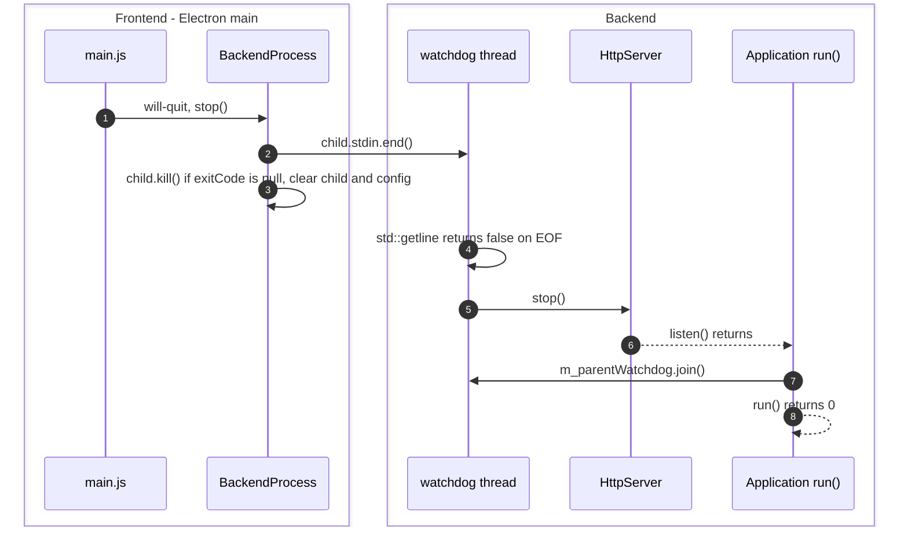

| # | From → To | Function | Processing |
|---|---|---|---|
| 1 | main.js → BackendProcess | `stop()` | Called on `will-quit` ([F8](#f8)). |
| 2 | BackendProcess → watchdog | `stop()` | Closing stdin is the backend's normal shutdown signal. |
| 3 | BackendProcess | `stop()` | Kill right away: the backend must never outlive the app. Steps 4–8 may therefore not run. |
| 4 | watchdog | `startParentWatchdog()` lambda | Loop ends; logs `stdin closed, shutting down`. |
| 5 | watchdog → HttpServer | `HttpServer::stop()` | Only stops if the server is running. |
| 6 | HttpServer → Application | `listen()` | Returns in `run()`. |
| 7 | Application → watchdog | `run()` | `join()` returns immediately: the thread has already finished. |
| 8 | Application | `run()` | Logs `[Application] stopped`; `main()` returns 0. |

## 3. Data / configuration

| Name | Type | Value / meaning | Defined in |
|---|---|---|---|
| `READY_PREFIX` / `kReadyPrefix` | string | `"SYSTEMLENS_READY "` — prefix of the handshake line | `backendProcess.js` / `Application.h` |
| `TOKEN_ENV_VAR` / `kTokenEnvVar` | string | `"SYSTEMLENS_TOKEN"` | `backendProcess.js` / `AppConfig.h` |
| `TOKEN_BYTES` | number | 32 | `backendProcess.js` |
| `DEFAULT_READY_TIMEOUT_MS` | number | 10000 | `backendProcess.js` |
| `DEFAULT_HOST` | string | `"127.0.0.1"` | `backendProcess.js` |
| `SYSTEMLENS_BACKEND_EXE` | env var | Overrides the backend path (default `backend/build/Debug/systemlens-backend.exe`) | `backendProcess.js` |
| `BACKEND_GET_CONFIG` | string | `"backend:getConfig"` (repeated in `preload.js`) | `ipcChannels.js` |
| `AppConfig` | struct | `port` (0 = OS picks), `token` (optional), `devMode`, `showHelp` | `AppConfig.h` |
| `kUsage` | string | Help text for `--help` and invalid arguments | `AppConfig.h` |
| `kMaxPort` | int | 65535 | `AppConfig.cpp` |
| `kExitOk` / `kExitRuntimeError` / `kExitUsageError` | int | 0 / 1 / 2 | `main.cpp` |

Command line of the backend: `systemlens-backend [--port <n>] [--dev] [--help]` (`-h` also accepted).

Exit codes:

| Code | When |
|---|---|
| 0 | Normal shutdown, or `--help`. |
| 1 | Exception during construction or `run()` (e.g. cannot bind). Printed as `Fatal: ...` on stderr. |
| 2 | Invalid arguments or missing token. Printed as `Error: ...` + usage on stderr. |

## 4. Functions

### 4.1 Frontend — `frontend/main/backendProcess.js`

| Function | Purpose | Parameters | Return | Errors | Flowchart |
|---|---|---|---|---|---|
| `resolveBackendExePath()` | Locate the backend executable. | — | `SYSTEMLENS_BACKEND_EXE` if set, else `<repo>/backend/build/Debug/systemlens-backend.exe` | — | — |
| `new BackendProcess({exePath, readyTimeoutMs})` | Store options; `child` and `config` start as `null`. | `exePath` (default `resolveBackendExePath()`), `readyTimeoutMs` (default 10000) | — | — | — |
| `async start()` | Spawn the backend and wait for READY. | — | `Promise<{baseUrl, token}>` | `Error` if the process cannot start, exits early or is not ready in time | [F7](#f7) (wait part) |
| `getConfig()` | Connection info of the running backend. | — | `{baseUrl, token}` | `Error('Backend is not running')` if `start()` did not complete | — |
| `stop()` | Close stdin, kill if still running, reset state. | — | — | — | [F8](#f8) |
| `#waitForReady()` | Resolve with the port from the READY line. | — | `Promise<number>` | rejects on spawn error, exit before READY, timeout | [F7](#f7) |

### 4.2 Frontend — `frontend/main/main.js`, `frontend/preload/preload.js`

| Function | Purpose | Parameters | Return | Errors | Flowchart |
|---|---|---|---|---|---|
| `createWindow()` | Create the 1000 × 700 `BrowserWindow` with `preload.js` (`contextIsolation: true`, `nodeIntegration: false`, `sandbox: true`) and load `renderer/index.html`. | — | — | — | — |
| `handleGetBackendConfig()` | IPC handler for `backend:getConfig`. | — | `{baseUrl, token}` | throws `backendStartError`, or the `getConfig()` error | [F10](#f10) |
| `app.whenReady().then(...)` | Start the backend, register the IPC handler, open the window, re-open on `activate` when no window exists. | — | — | errors are caught and kept in `backendStartError` | [F9](#f9) |
| `window-all-closed` handler | `app.quit()` unless `darwin`. | — | — | — | — |
| `will-quit` handler | `backend.stop()`. | — | — | — | — |
| `window.systemlens.getBackendConfig()` (preload) | `ipcRenderer.invoke('backend:getConfig')`. | — | `Promise<{baseUrl, token}>` | rejects with the main-process error | — |

### 4.3 Backend — `backend/src/main.cpp`, `backend/src/app/`

| Function | Purpose | Parameters | Return | Errors | Flowchart |
|---|---|---|---|---|---|
| `int main(int argc, char* argv[])` | Parse configuration and run the `Application`. | `argc`, `argv` | 0 / 1 / 2 (see exit codes) | catches all `std::exception` | [F1](#f1) |
| `AppConfig parseAppConfig(int argc, const char* const argv[])` | Build the configuration from argv and the environment. | `argc`, `argv` | `AppConfig` | `std::invalid_argument`: unknown argument, `--port` without value, invalid port, token missing outside dev / help | [F2](#f2) |
| `std::optional<std::string> readEnv(const char* name)` (anonymous namespace) | Read an environment variable (`_dupenv_s` under MSVC, `std::getenv` otherwise). | `name` | value, or `nullopt` when unset or empty | — | — |
| `int parsePort(std::string_view text)` (anonymous namespace) | Parse a port number. | `text` | port in [0, 65535] | `std::invalid_argument("Invalid port: ...")` | [F3](#f3) |
| `HttpServerOptions toServerOptions(const AppConfig&)` (anonymous namespace) | Map config to server options. | `config` | options with `token = nullopt` in dev mode | — | — |
| `Application(AppConfig config)` | Build the object graph; no socket opened yet. | `config` | — | exceptions from controller construction | — |
| `int Application::run()` | Bind, announce readiness, serve until shutdown. | — | 0 | `std::runtime_error` if the server cannot bind | [F4](#f4) |
| `void Application::registerControllers()` | Create every controller and register its routes. | — | — | — | [F5](#f5) |
| `void Application::announceReady(int port) const` | Print the READY line to stdout (flushed) and a log line to stderr. | `port` | — | — | — |
| `void Application::startParentWatchdog()` | Start the thread that stops the server when stdin closes. | — | — | — | [F6](#f6) |

## 5. Flowcharts

<a id="f1"></a>
### F1 — `main()`

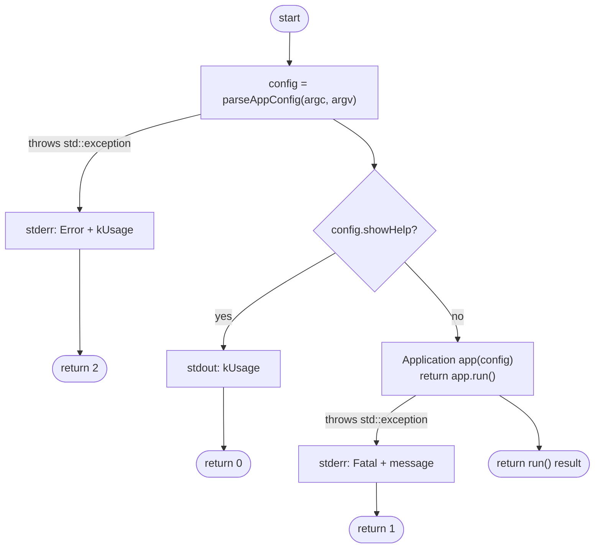

<a id="f2"></a>
### F2 — `parseAppConfig()`

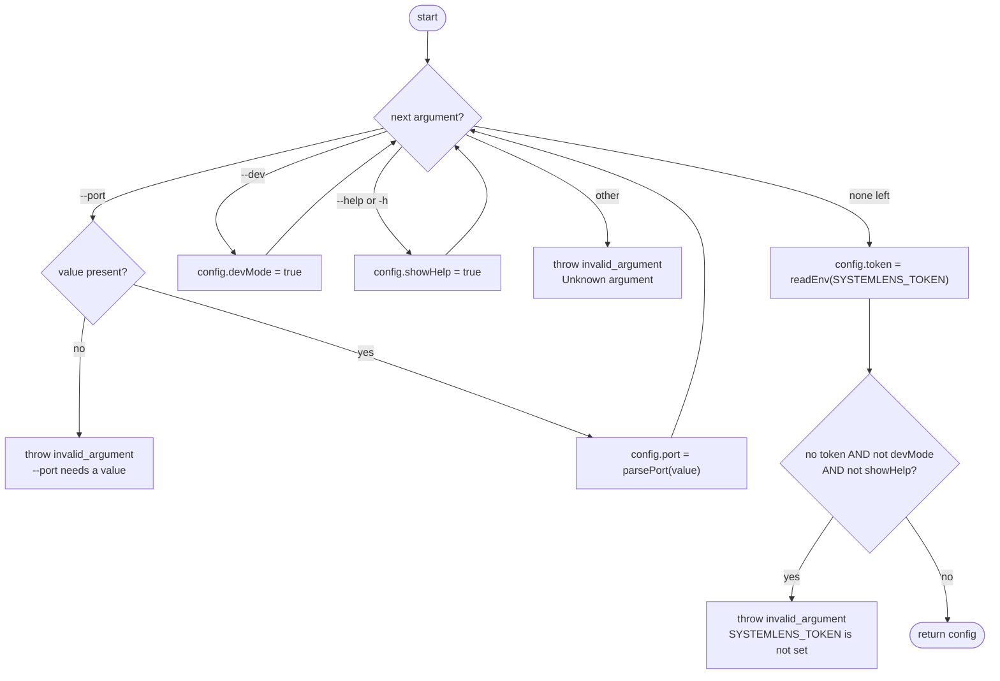

<a id="f3"></a>
### F3 — `parsePort()`

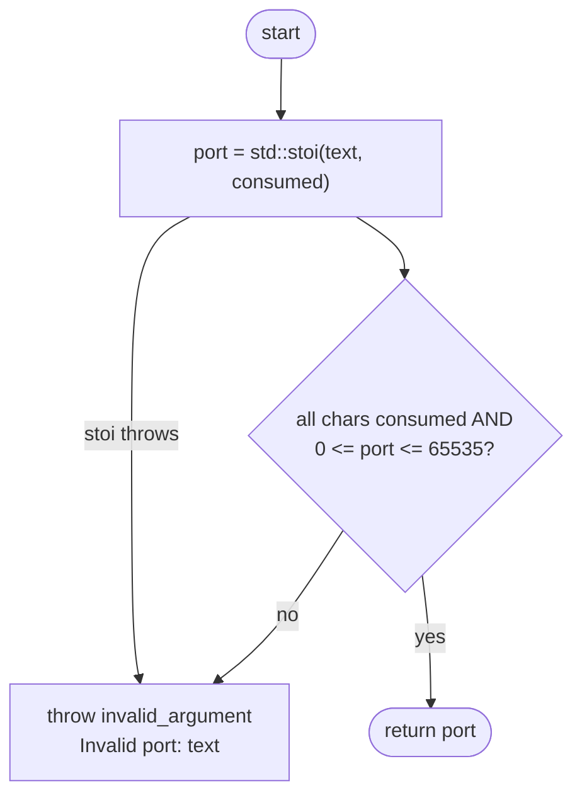

<a id="f4"></a>
### F4 — `Application::run()`

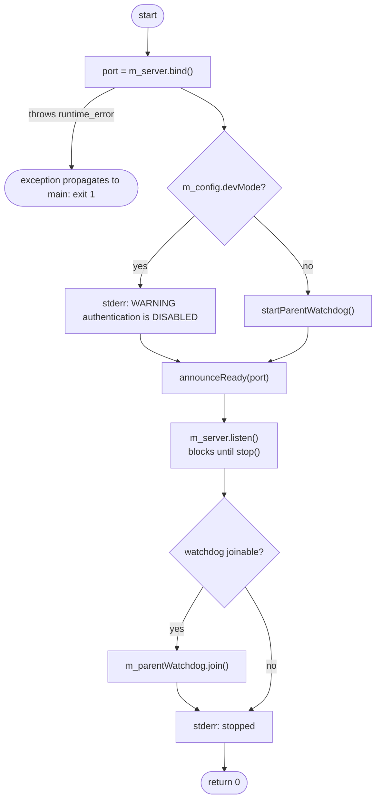

<a id="f5"></a>
### F5 — `Application::registerControllers()`

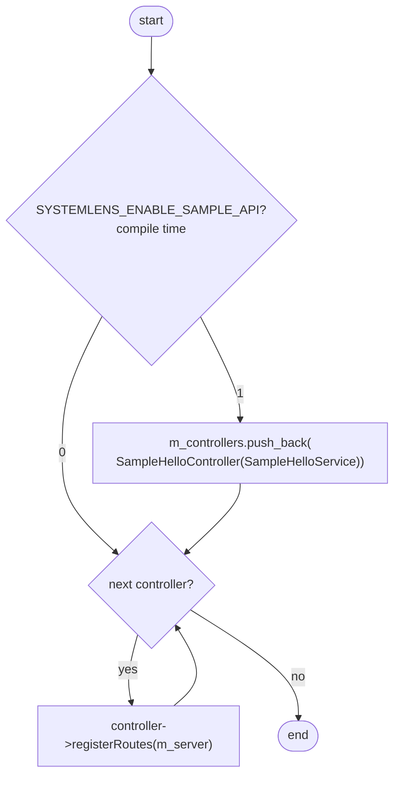

<a id="f6"></a>
### F6 — `Application::startParentWatchdog()` (thread body)

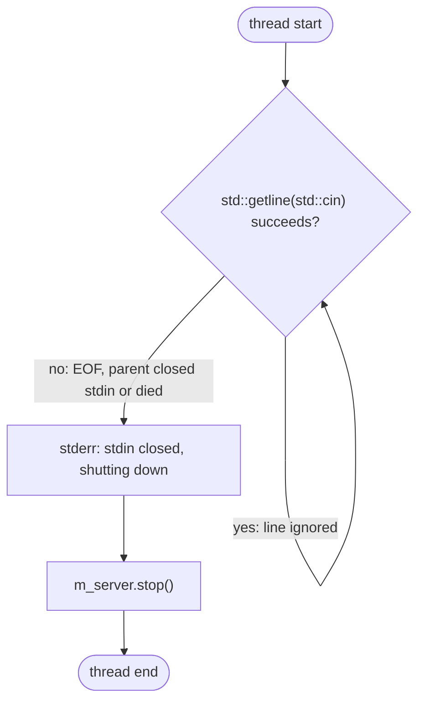

<a id="f7"></a>
### F7 — `BackendProcess.#waitForReady()`

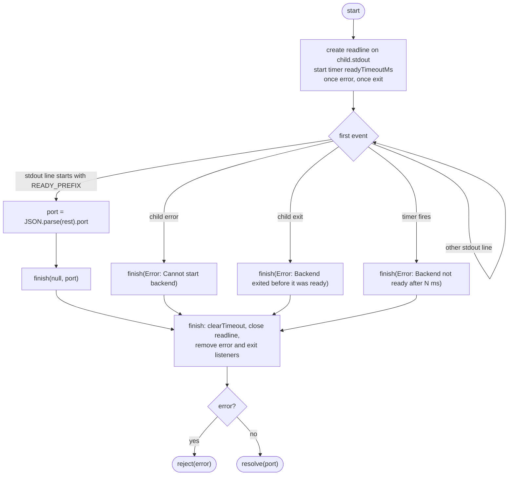

<a id="f8"></a>
### F8 — `BackendProcess.stop()`

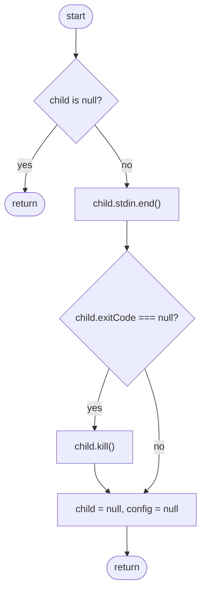

<a id="f9"></a>
### F9 — `app.whenReady()` handler (`main.js`)

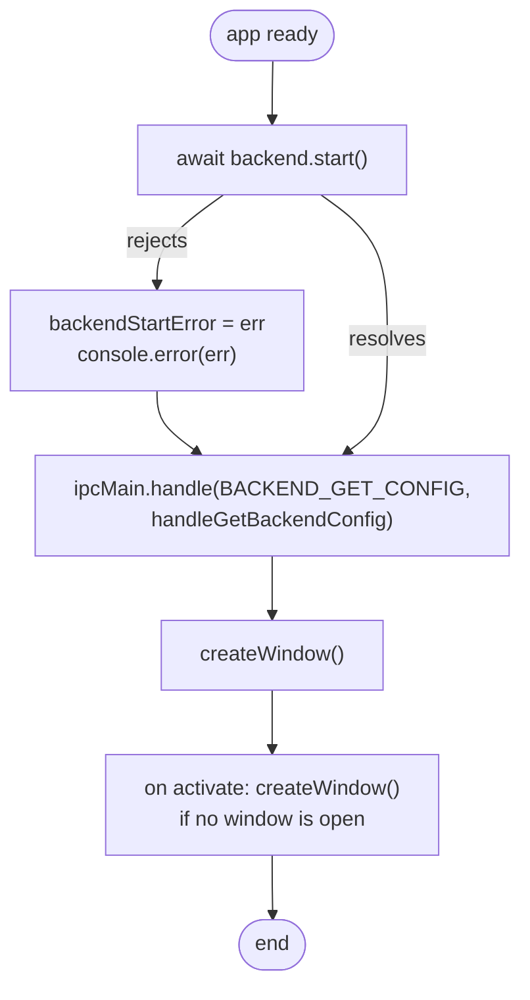

<a id="f10"></a>
### F10 — `handleGetBackendConfig()`

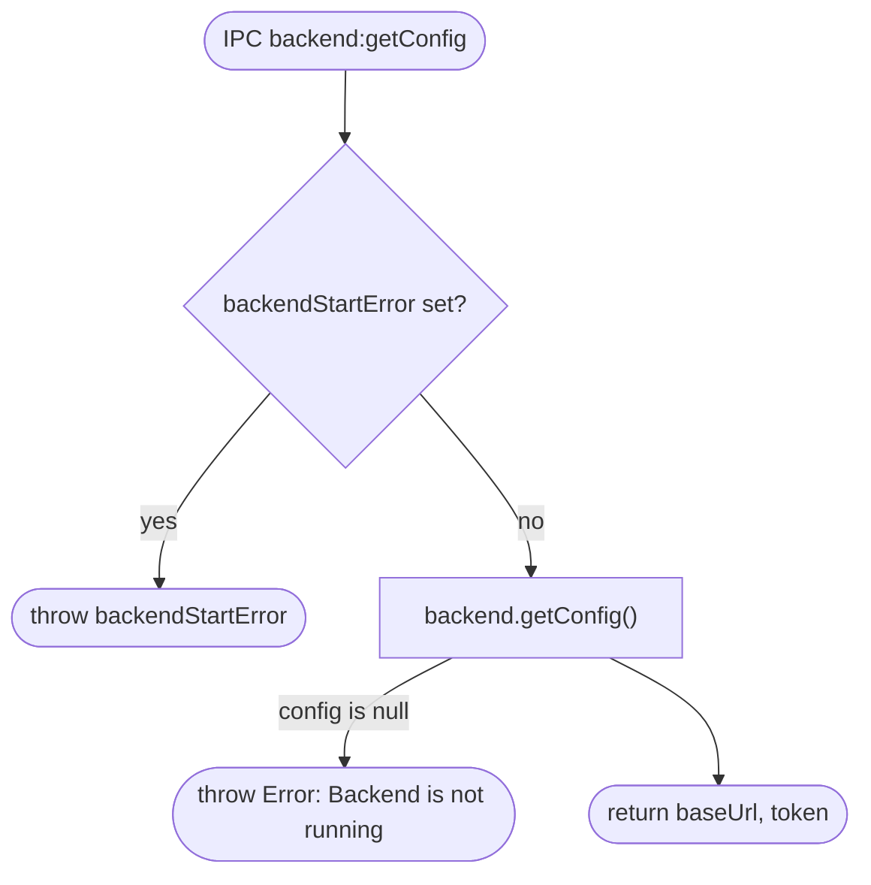

## 6. Notes

- stdout of the backend carries only the READY line; all logs go to stderr (`Application.h`). The frontend
  forwards backend stderr to its own stderr with the prefix `[backend]`.
- The token is passed in the environment, not argv, "so it does not show up in process lists" (`AppConfig.h`).
- `Application` declares `m_controllers` before `m_server` so the controllers are destroyed after the server,
  whose handlers point into them (`Application.h`).
- `preload.js` repeats the channel string because a sandboxed preload can only `require('electron')`.
