# LLD-02 — API request pipeline

| Item | Value |
|---|---|
| Status | Implemented |
| Traces to | [NFR-01](../../requirements/non-functional-requirements.md#nfr-01), [NFR-02](../../requirements/non-functional-requirements.md#nfr-02), [HLD-05](../high-level-design.md#hld-05) |
| API | all endpoints ([api-schema.md](../../api-schema.md)); rules in [api-convention.md](../../api-convention.md) |
| Index / matrix | [docs/README.md](../../README.md#3-traceability-matrix) |

## 1. Scope

The shared path of every API call: the renderer's `ApiClient` sends the request; the backend's `HttpServer`
applies CORS, authentication and error handling around the controller handlers registered through
`IRouteRegistry`; `ApiResponse` builds every response body. Feature-specific parts (api module, controller,
service) are in each feature's LLD, e.g. [LLD-03](LLD-03-sample-hello.md).

Source files:

```
frontend/
└── renderer/
    ├── index.html              CSP connect-src http://127.0.0.1:*
    └── api/
        └── apiClient.js        ApiClient, ApiError
backend/
└── src/
    └── api/
        ├── HttpTypes.h         HttpMethod, Request, Response, Handler
        ├── IRouteRegistry.h    addRoute()
        ├── IController.h       registerRoutes()
        ├── HttpServer.h/.cpp   HttpServerOptions, HttpServer, middleware helpers
        └── ApiResponse.h/.cpp  status constants, ok(), problem()
```

## 2. Sequences

### 2.1 Route registration (backend startup)

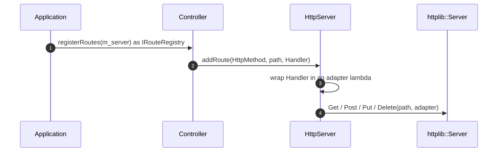

| # | From → To | Function | Processing |
|---|---|---|---|
| 1 | Application → Controller | `IController::registerRoutes()` | Called once per controller in `registerControllers()` ([LLD-01 F5](LLD-01-backend-lifecycle.md#f5)). |
| 2 | Controller → HttpServer | `IRouteRegistry::addRoute()` | The controller only knows the interface and the types in `HttpTypes.h`. |
| 3 | HttpServer | `addRoute()` | Adapter = `writeResponse(handler(toRequest(req)), res)`. Exceptions are not caught here. |
| 4 | HttpServer → cpp-httplib | `addRoute()` | Switch on `HttpMethod` ([F6](#f6)). Must be called before `listen()`. |

### 2.2 One request

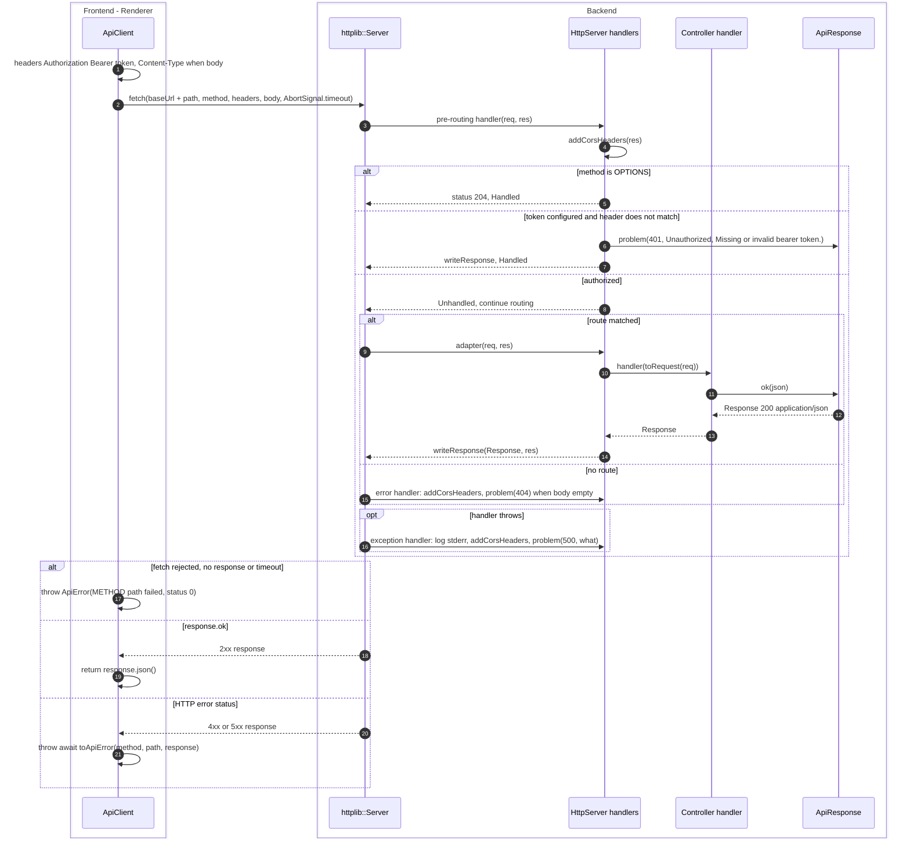

| # | From → To | Function | Processing |
|---|---|---|---|
| 1 | ApiClient | `#request()` | `Authorization: Bearer <token>`; `Content-Type: application/json` only when a body is given. |
| 2 | ApiClient → cpp-httplib | `#request()` | `fetch` with `signal: AbortSignal.timeout(this.timeoutMs)` (default 5000 ms); body is `JSON.stringify(body)` or `undefined`. |
| 3 | cpp-httplib → HttpServer | pre-routing handler | Runs before routing for every request ([F3](#f3)). |
| 4 | HttpServer | `addCorsHeaders()` | Allow-Origin `*`, Allow-Headers `Authorization, Content-Type`, Allow-Methods `GET, POST, PUT, DELETE, OPTIONS`. |
| 5 | HttpServer → cpp-httplib | pre-routing handler | Preflight answered before auth because browsers send it without `Authorization`. |
| 6 | HttpServer → ApiResponse | `problem()` | Built only when `m_options.token` is set and `constantTimeEquals()` fails ([F8](#f8)). |
| 7 | HttpServer → cpp-httplib | `writeResponse()` | Request is finished; routing is skipped. |
| 8 | HttpServer → cpp-httplib | pre-routing handler | Returns `Unhandled`. |
| 9 | cpp-httplib → HttpServer | adapter from `addRoute()` | Exact method + path match. |
| 10 | HttpServer → Controller | `toRequest()`, `Handler` | `Request{path, body}` (path without query string). |
| 11 | Controller → ApiResponse | `ok()` | Controller builds the body from the service result. |
| 12 | ApiResponse → Controller | — | `Response{statusCode, "application/json", body.dump()}`. |
| 13 | Controller → HttpServer | — | Returned from the handler. |
| 14 | HttpServer → cpp-httplib | `writeResponse()` | Copies status, body and content type. |
| 15 | cpp-httplib → HttpServer | error handler | Called for error statuses; fills `problem(404, "Not Found", "No route for <METHOD> <path>")` only when status is 404 and the body is empty ([F4](#f4)). |
| 16 | cpp-httplib → HttpServer | exception handler | Any exception from a handler: `[HttpServer] <METHOD> <path> failed: <detail>` on stderr, response `problem(500, "Internal Server Error", detail)` ([F5](#f5)). |
| 17 | ApiClient | `#request()` | `fetch` rejects only when no HTTP response arrived (backend down, timeout). |
| 18 | cpp-httplib → ApiClient | — | Success status. |
| 19 | ApiClient | `#request()` | Parsed JSON body returned to the api module. |
| 20 | cpp-httplib → ApiClient | — | Error status (401, 404, 500, ...). |
| 21 | ApiClient | `#toApiError()` | [F2](#f2). |

## 3. Data / types

| Name | Kind | Value / fields | Defined in |
|---|---|---|---|
| `HttpMethod` | enum class | `Get`, `Post`, `Put`, `Delete` | `HttpTypes.h` |
| `Request` | struct | `path` (no query string), `body` (raw) | `HttpTypes.h` |
| `Response` | struct | `status` = 200, `contentType` = `"application/json"`, `body` | `HttpTypes.h` |
| `Handler` | alias | `std::function<Response(const Request&)>`; may throw | `HttpTypes.h` |
| `HttpServerOptions` | struct | `host` = `"127.0.0.1"`, `port` = 0, `token` (optional; `nullopt` disables auth) | `HttpServer.h` |
| `status::k*` | constants | 200, 204, 400, 401, 404, 500 | `ApiResponse.h` |
| `kAuthHeader`, `kBearerPrefix` | constants | `"Authorization"`, `"Bearer "` | `HttpServer.cpp` |
| `DEFAULT_TIMEOUT_MS` | constant | 5000 | `apiClient.js` |
| `PROBLEM_CONTENT_TYPE` | constant | `"application/problem+json"` | `apiClient.js` |
| `ApiError` | class | `message`, `name` = `"ApiError"`, `status` (0 = no response), `title` | `apiClient.js` |

## 4. Functions

### 4.1 Frontend — `frontend/renderer/api/apiClient.js`

| Function | Purpose | Parameters | Return | Errors | Flowchart |
|---|---|---|---|---|---|
| `new ApiError(message, {status, title})` | Error for any failed API call. | `message`; `status` (default 0); `title` (default `''`) | — | — | — |
| `new ApiClient({baseUrl, token, timeoutMs})` | Store connection info. | `baseUrl` e.g. `http://127.0.0.1:53121`; `token`; `timeoutMs` (default 5000) | — | — | — |
| `get(path)` | Send a GET request. | `path` e.g. `/api/v1/sample/hello` | `Promise<any>` parsed JSON | `ApiError` | — (calls `#request('GET', path)`) |
| `async #request(method, path, body)` | Send a request and parse the JSON response. | `method`, `path`, `body` (optional, sent as JSON) | `Promise<any>` | `ApiError` | [F1](#f1) |
| `static async #toApiError(method, path, response)` | Build an `ApiError` from an HTTP error response. | `method`, `path`, `response` | `Promise<ApiError>` | — | [F2](#f2) |

### 4.2 Backend — interfaces (`IRouteRegistry.h`, `IController.h`)

| Function | Purpose | Parameters | Return | Errors | Flowchart |
|---|---|---|---|---|---|
| `virtual void IRouteRegistry::addRoute(HttpMethod, const std::string& path, Handler)` | Register a handler for an exact method + path. | `method`, `path`, `handler` | — | — | — |
| `virtual void IController::registerRoutes(IRouteRegistry&)` | Register all routes of a controller. | `registry` (normally the `HttpServer`) | — | — | — |

### 4.3 Backend — `HttpServer.h/.cpp`

| Function | Purpose | Parameters | Return | Errors | Flowchart |
|---|---|---|---|---|---|
| `explicit HttpServer(HttpServerOptions)` | Create the cpp-httplib server and install middleware; does not bind. | `options` | — | — | — |
| `~HttpServer()` | `stop()` if still running. | — | — | — | — |
| `void addRoute(HttpMethod, const std::string&, Handler) override` | Wrap the handler and register it on cpp-httplib. Must be called before `listen()`. | `method`, `path`, `handler` | — | handler exceptions become 500 at request time | [F6](#f6) |
| `int bind()` | Bind the listening socket. | — | bound port (the real one when `port` = 0) | `std::runtime_error` if the address/port cannot be bound | [F7](#f7) |
| `void listen()` | Serve until `stop()`; blocks. Precondition: `bind()` succeeded. | — | — | — | — |
| `void stop()` | Ask `listen()` to return; safe from any thread and more than once. | — | — | — | [F9](#f9) |
| `void installMiddleware()` (private) | Install the pre-routing, error and exception handlers. | — | — | — | [F3](#f3), [F4](#f4), [F5](#f5) |
| `bool constantTimeEquals(a, b)` (anonymous namespace) | Compare strings in time independent of where they differ (avoids guessing the token by timing). | `a`, `b` | `true` if equal | — | [F8](#f8) |
| `void addCorsHeaders(httplib::Response&)` (anonymous namespace) | Add the 3 CORS headers. | `res` | — | — | — |
| `void writeResponse(const Response&, httplib::Response&)` (anonymous namespace) | Copy status, body and content type. | `from`, `to` | — | — | — |
| `Request toRequest(const httplib::Request&)` (anonymous namespace) | Convert to the library-independent `Request`. | `req` | `Request{path, body}` | — | — |

### 4.4 Backend — `ApiResponse.h/.cpp`

| Function | Purpose | Parameters | Return | Errors | Flowchart |
|---|---|---|---|---|---|
| `Response ok(const nlohmann::json& body, int statusCode = status::kOk)` | Success response. | `body`, `statusCode` | `Response{statusCode, "application/json", body.dump()}` | — | — |
| `Response problem(int statusCode, std::string_view title, std::string_view detail)` | RFC 7807 error response. | `statusCode`, `title`, `detail` | `Response{statusCode, "application/problem+json", {"type":"about:blank", title, status, detail}}` | — | — |

## 5. Flowcharts

<a id="f1"></a>
### F1 — `ApiClient.#request()`

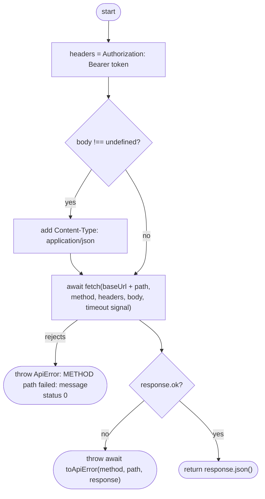

<a id="f2"></a>
### F2 — `ApiClient.#toApiError()`

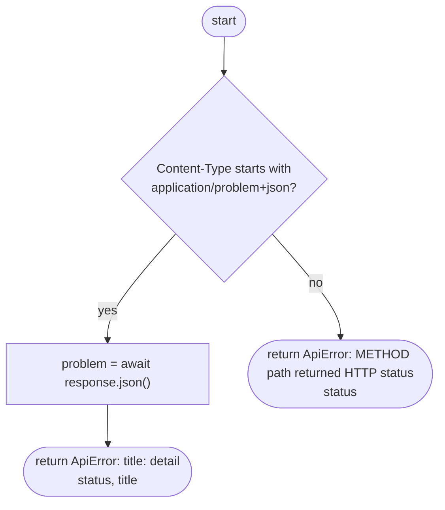

<a id="f3"></a>
### F3 — Pre-routing handler (`installMiddleware`)

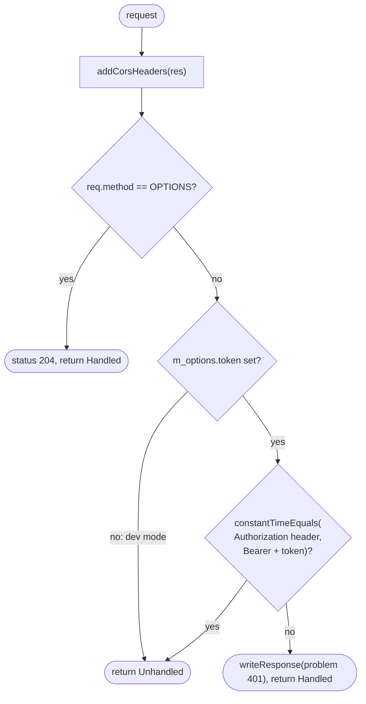

<a id="f4"></a>
### F4 — Error handler (`installMiddleware`)

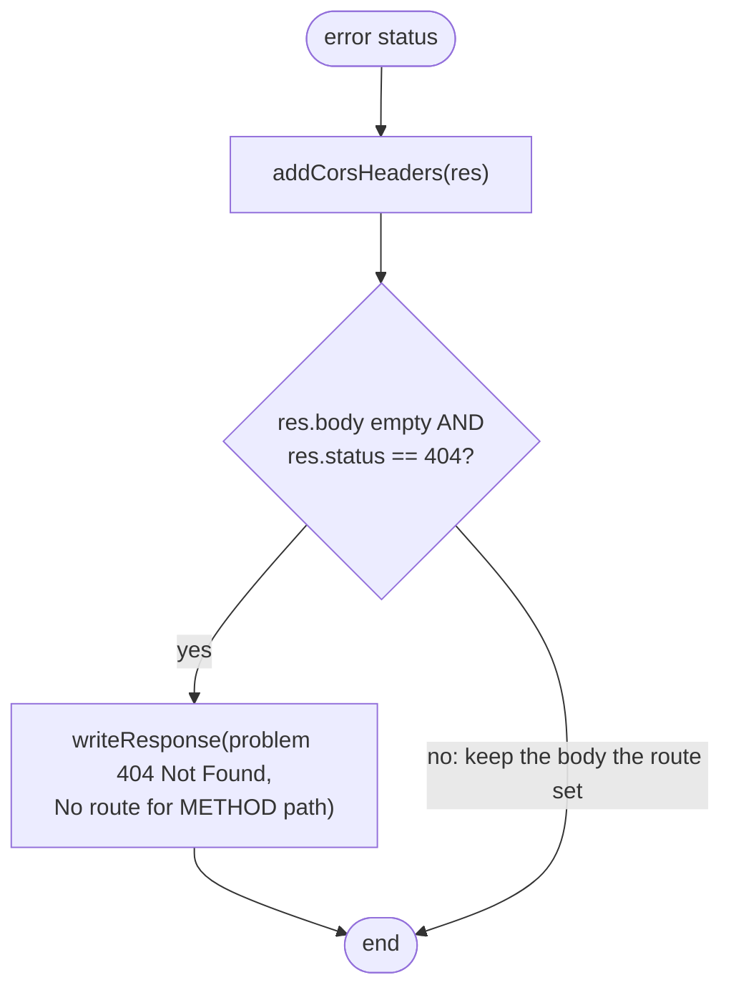

<a id="f5"></a>
### F5 — Exception handler (`installMiddleware`)

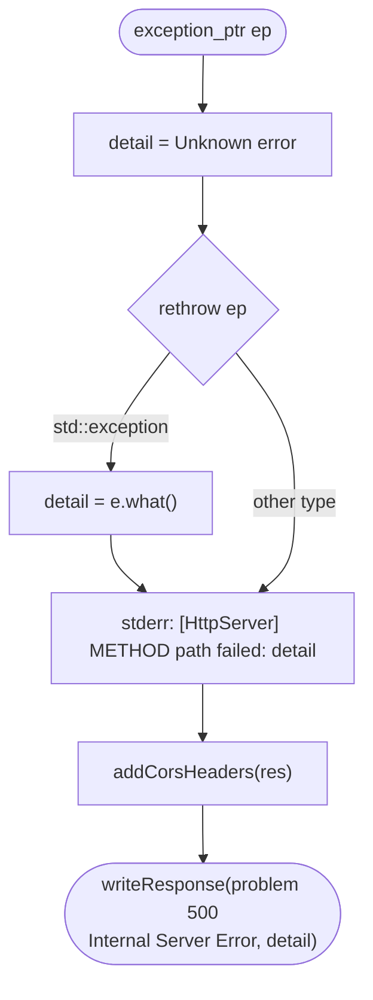

<a id="f6"></a>
### F6 — `HttpServer::addRoute()`

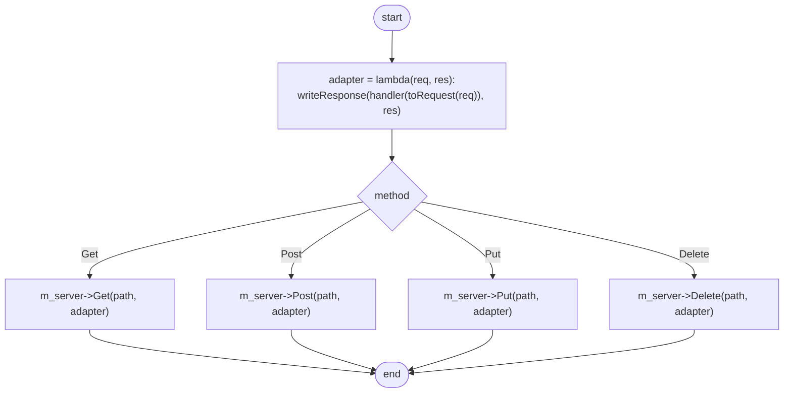

<a id="f7"></a>
### F7 — `HttpServer::bind()`

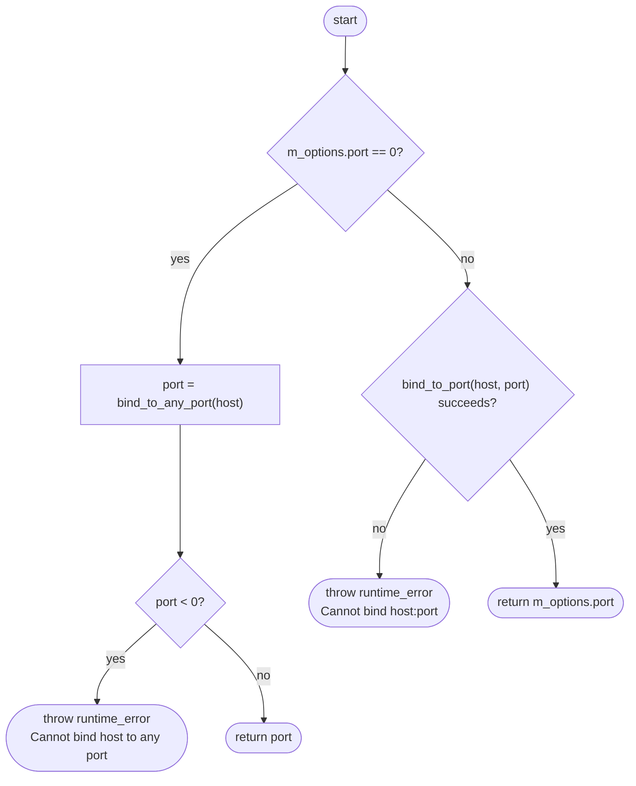

<a id="f8"></a>
### F8 — `constantTimeEquals()`

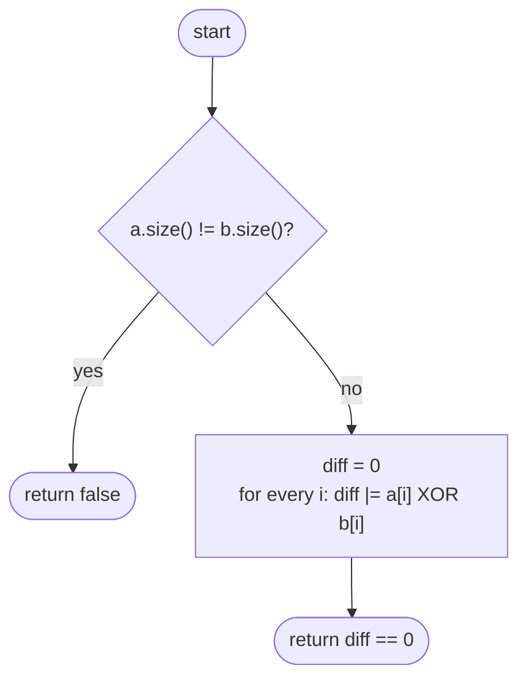

<a id="f9"></a>
### F9 — `HttpServer::stop()`

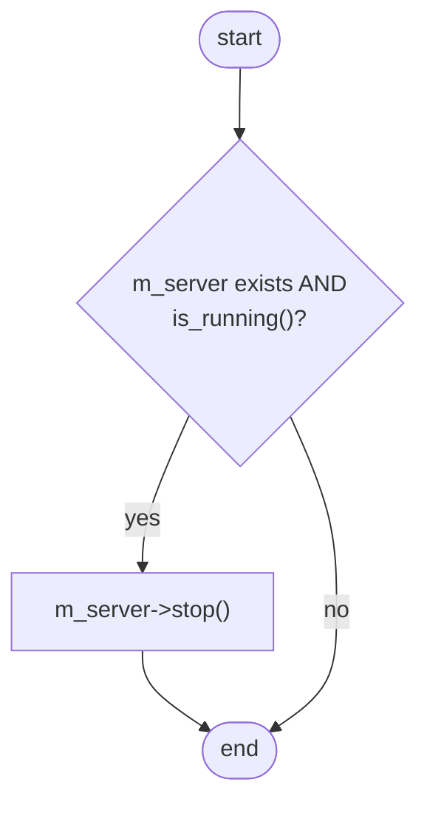

## 6. Notes

- `HttpServer.h` only forward-declares `httplib::Server`, so controllers do not depend on the HTTP library;
  cpp-httplib is used in `HttpServer.cpp` only.
- `Access-Control-Allow-Origin: *` is used because the renderer is loaded from `file://` (origin `null`); the
  code comment states this is acceptable because the API listens on loopback only and every call needs the token.
- cpp-httplib is built without OpenSSL, zlib and Brotli (`backend/CMakeLists.txt`).
- `ApiClient` currently exposes only `get()`; `#request()` already accepts a body.
