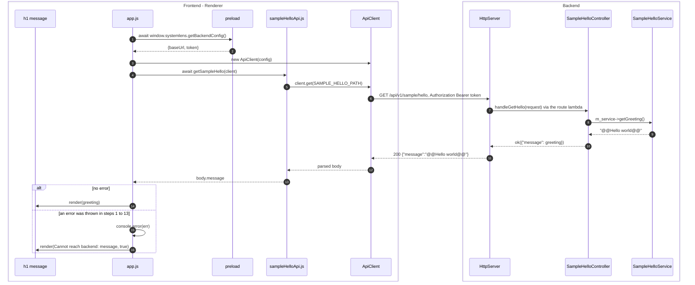
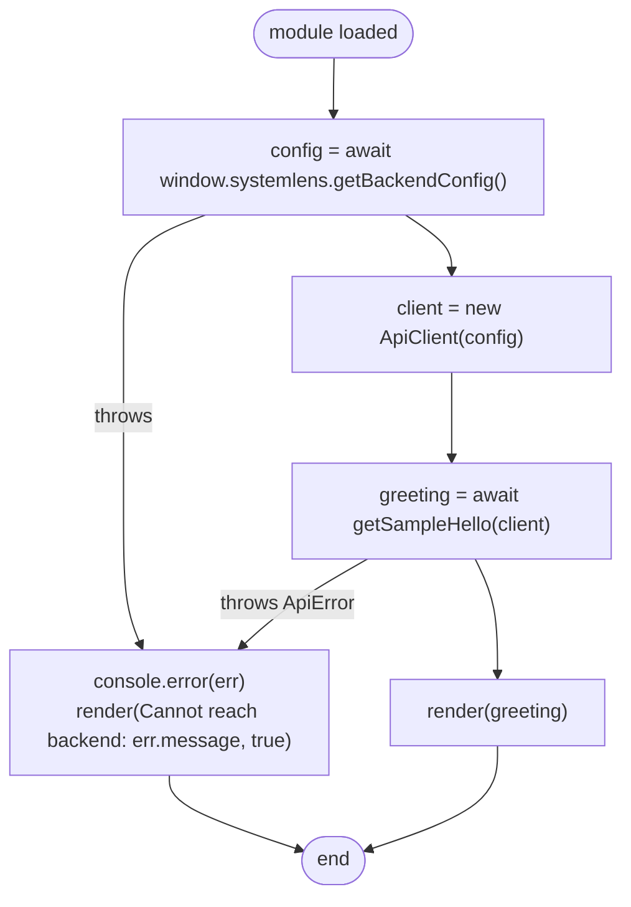
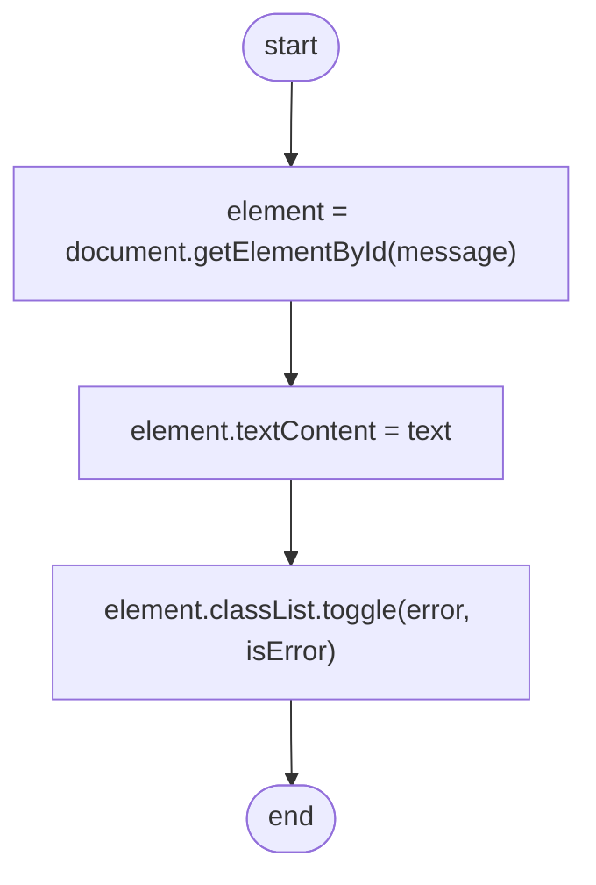
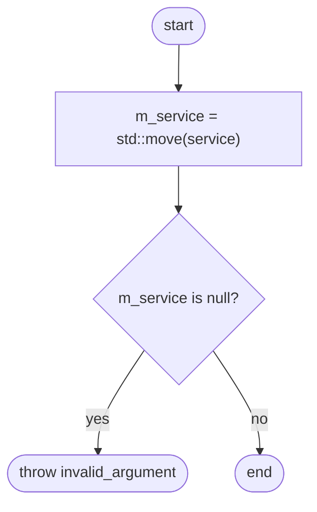

# LLD-03 — Sample hello

| Item | Value |
|---|---|
| Status | Implemented |
| Traces to | [FR-SMP-01](../../requirements/functional-requirements.md#fr-smp-01), [UC-SMP-01](../../requirements/functional-requirements.md#uc-smp-01), [HLD-02](../high-level-design.md#hld-02) |
| API | [`getSampleHello`](../../api-schema.md#getsamplehello) — `GET /api/v1/sample/hello` |
| Index / matrix | [docs/README.md](../../README.md#3-traceability-matrix) |

## 1. Scope

On startup the renderer asks the backend for the greeting and shows it in the page, or shows the error.
This feature is the reference example for new features: FE api module → `ApiClient`, BE controller →
service interface. The shared request path is in [LLD-02](LLD-02-api-request-pipeline.md); startup in
[LLD-01](LLD-01-backend-lifecycle.md).

Source files:

```
frontend/
└── renderer/
    ├── index.html                        <h1 id="message">, loads app.js as a module
    ├── styles.css                        .error style
    ├── app.js                            bootstrap(), render()
    └── api/
        └── sample/
            └── sampleHelloApi.js         SAMPLE_HELLO_PATH, getSampleHello()
backend/
├── CMakeLists.txt                        option SYSTEMLENS_ENABLE_SAMPLE_API
└── src/
    ├── api/
    │   └── sample/
    │       └── SampleHelloController.h/.cpp
    └── services/
        └── sample/
            ├── ISampleHelloService.h
            └── SampleHelloService.h/.cpp
```

## 2. Sequence



| # | From → To | Function | Processing |
|---|---|---|---|
| 1 | app.js → preload | `bootstrap()` | IPC `backend:getConfig` ([LLD-01](LLD-01-backend-lifecycle.md) F10). Rejects if the backend did not start. |
| 2 | preload → app.js | — | Connection info. |
| 3 | app.js → ApiClient | `new ApiClient(config)` | Default timeout 5000 ms. |
| 4 | app.js → sampleHelloApi | `getSampleHello(client)` | — |
| 5 | sampleHelloApi → ApiClient | `client.get()` | Path `/api/v1/sample/hello`. |
| 6 | ApiClient → HttpServer | `#request()` | Auth and CORS as in [LLD-02](LLD-02-api-request-pipeline.md). |
| 7 | HttpServer → Controller | lambda registered in `registerRoutes()` | Calls `handleGetHello()`; the request is unused. |
| 8 | Controller → Service | `ISampleHelloService::getGreeting()` | Through the interface injected in the constructor. |
| 9 | Service → Controller | — | `kGreeting`. |
| 10 | Controller → HttpServer | `ok()` | `Response{200, "application/json", {"message": ...}}`. |
| 11 | HttpServer → ApiClient | — | Matches [`SampleHelloResponse`](../../api-schema.md#samplehelloresponse). |
| 12 | ApiClient → sampleHelloApi | — | `response.json()`. |
| 13 | sampleHelloApi → app.js | `getSampleHello()` | Returns only `body.message`. |
| 14 | app.js → page | `render(text)` | `#message` text = greeting, class `error` removed. |
| 15 | app.js | `bootstrap()` catch | Logs the error to the renderer console. |
| 16 | app.js → page | `render(text, true)` | `#message` text = `Cannot reach backend: <err.message>`, class `error` added ([FR-SMP-01](../../requirements/functional-requirements.md#fr-smp-01) A1, A2). |

## 3. Data / configuration

| Name | Type | Value / meaning | Defined in |
|---|---|---|---|
| `SAMPLE_HELLO_PATH` | string | `"/api/v1/sample/hello"` | `sampleHelloApi.js` |
| `SampleHelloController::kRoute` | `const char*` | `"/api/v1/sample/hello"` | `SampleHelloController.h` |
| `SampleHelloService::kGreeting` | `const char*` | `"@@Hello world@@"` | `SampleHelloService.h` |
| `SYSTEMLENS_ENABLE_SAMPLE_API` | CMake option (default `ON`) | Compiles `SampleHelloController.cpp` and `SampleHelloService.cpp` and defines `SYSTEMLENS_ENABLE_SAMPLE_API=1/0`, used by `Application::registerControllers()` | `backend/CMakeLists.txt` |
| `#message` | DOM element | `<h1 id="message">`, initial text `Connecting to backend...` | `index.html` |
| `.error` | CSS class | color `#f48771`, font-size `1.1rem` | `styles.css` |

## 4. Functions

### 4.1 Frontend

| Function | File | Purpose | Parameters | Return | Errors | Flowchart |
|---|---|---|---|---|---|---|
| `bootstrap()` | `app.js` | Get the backend config, call the sample API and render the result. Called once when the module loads. | — | `Promise<void>` | none (all caught) | [F1](#f1) |
| `render(text, isError = false)` | `app.js` | Show a message or an error in `#message`. | `text`; `isError` toggles class `error` | — | — | [F2](#f2) |
| `getSampleHello(client)` | `sampleHelloApi.js` | Fetch the greeting. | `client`: configured `ApiClient` | `Promise<string>` (`"@@Hello world@@"`) | `ApiError` | — |

### 4.2 Backend

| Function | File | Purpose | Parameters | Return | Errors | Flowchart |
|---|---|---|---|---|---|---|
| `explicit SampleHelloController(std::shared_ptr<const ISampleHelloService> service)` | `SampleHelloController.h/.cpp` | Create the controller. | `service`: must not be null | — | `std::invalid_argument("SampleHelloController: service must not be null")` | [F3](#f3) |
| `void registerRoutes(IRouteRegistry& registry) override` | `SampleHelloController.h/.cpp` | Register `GET kRoute` with a lambda calling `handleGetHello()`. | `registry` | — | — | — |
| `Response handleGetHello(const Request& request) const` (private) | `SampleHelloController.h/.cpp` | Handle `GET kRoute`. | `request`: unused (no input) | `ok({"message": m_service->getGreeting()})` → 200 | exceptions from the service become 500 ([LLD-02](LLD-02-api-request-pipeline.md) F5) | — |
| `virtual std::string ISampleHelloService::getGreeting() const` | `ISampleHelloService.h` | Get the greeting returned to the client. | — | greeting text | — | — |
| `std::string SampleHelloService::getGreeting() const override` | `SampleHelloService.h/.cpp` | Return the fixed greeting. | — | `kGreeting` | — | — |

Wiring (in `Application::registerControllers()`, [LLD-01](LLD-01-backend-lifecycle.md) F5):
`std::make_unique<SampleHelloController>(std::make_shared<SampleHelloService>())`, compiled only when
`SYSTEMLENS_ENABLE_SAMPLE_API` is true.

## 5. Flowcharts

<a id="f1"></a>
### F1 — `bootstrap()`



<a id="f2"></a>
### F2 — `render()`



<a id="f3"></a>
### F3 — `SampleHelloController` constructor



## 6. Notes

- The sample exists to exercise the FE ↔ BE plumbing and as the reference example for real APIs
  (`api/openapi.yaml` tag `sample`, header comments marked `[SAMPLE API]`).
- `ISampleHelloService` is an interface "so the implementation can be swapped" (`ISampleHelloService.h`).
