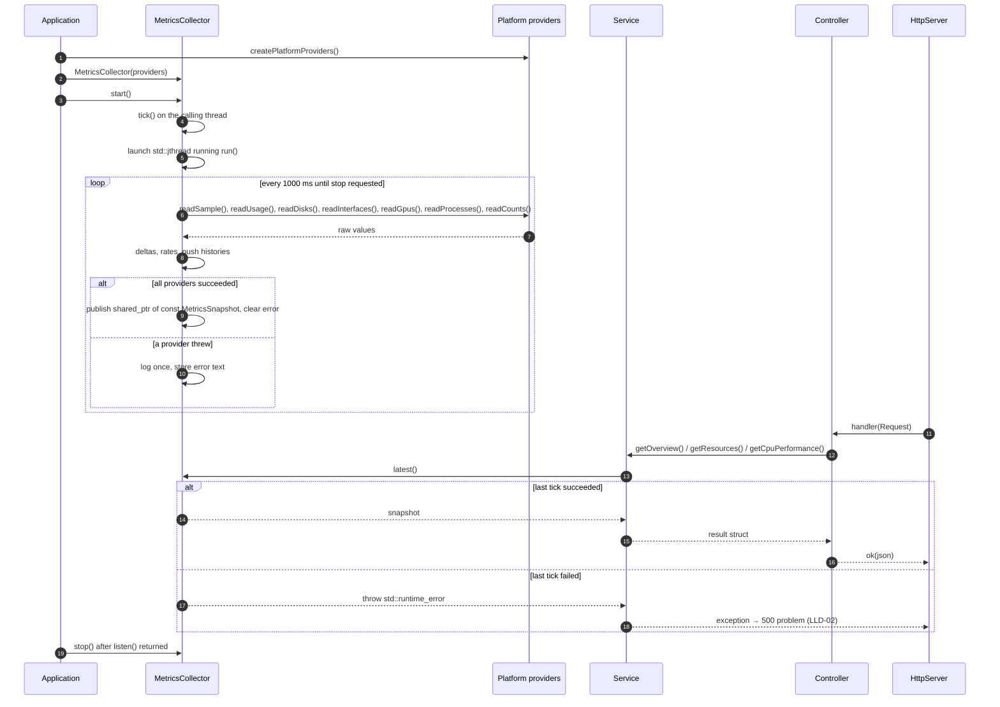
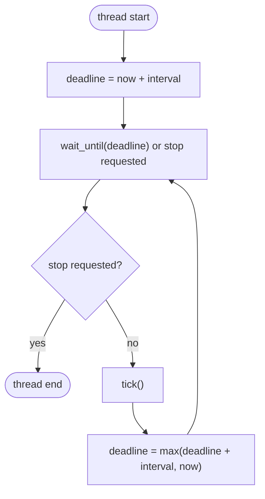
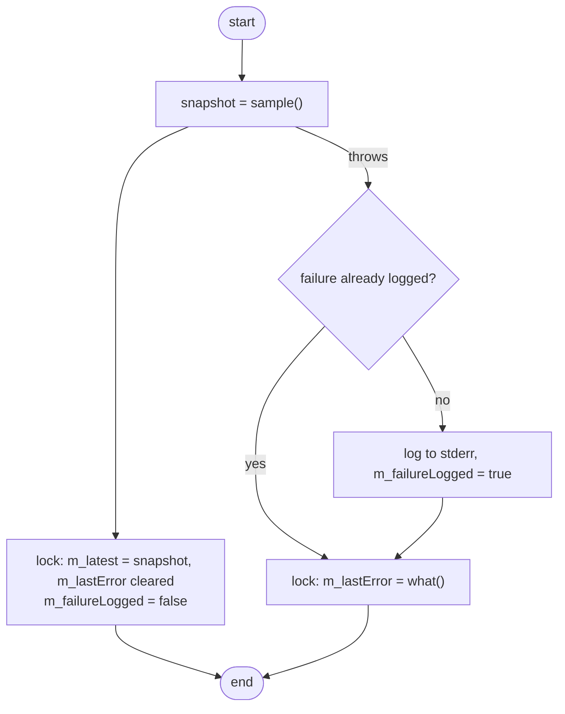

# LLD-04 — Metrics collection (platform providers, sampler, system and performance APIs)

| Item | Value |
|---|---|
| Status | Implemented for Windows and Linux. macOS: interfaces with placeholder implementations. |
| Traces to | [FR-SYS-01](../../requirements/functional-requirements.md#fr-sys-01), [FR-PERF-01](../../requirements/functional-requirements.md#fr-perf-01), [FR-PERF-02](../../requirements/functional-requirements.md#fr-perf-02), [HLD-06](../high-level-design.md#hld-06) |
| API | [`getSystemOverview`](../../api-schema.md#getsystemoverview), [`getPerformanceResources`](../../api-schema.md#getperformanceresources), [`getCpuPerformance`](../../api-schema.md#getcpuperformance) |
| Decisions | [2026-11-10-live-data-windows-linux.md](../../decisions/2026-11-10-live-data-windows-linux.md) |
| Index / matrix | [docs/README.md](../../README.md#3-traceability-matrix) |

## 1. Scope

The backend reads the operating system once per second through platform providers, turns the raw counters
into percentages, rates and 60-second histories, and serves the result through three `GET` endpoints.
The frontend side is in [LLD-05](LLD-05-live-performance-ui.md); the request path in
[LLD-02](LLD-02-api-request-pipeline.md).

Source files:

```
backend/
├── CMakeLists.txt                              selects one provider directory per platform
└── src/
    ├── app/
    │   └── Application.h/.cpp                  creates providers, collector, services, controllers
    ├── api/
    │   ├── JsonHelpers.h/.cpp                  nullable(), nullableArray(), toRfc3339()
    │   ├── system/
    │   │   └── SystemController.h/.cpp         GET /api/v1/system/overview
    │   └── performance/
    │       └── PerformanceController.h/.cpp    GET /api/v1/performance/resources, /cpu
    ├── services/
    │   ├── monitoring/
    │   │   ├── History.h                       fixed-capacity series
    │   │   ├── MetricsSnapshot.h               result of one sampling tick
    │   │   ├── IMetricsSource.h                latest()
    │   │   └── MetricsCollector.h/.cpp         sampler thread
    │   ├── system/
    │   │   ├── ISystemOverviewService.h        SystemOverview, getOverview()
    │   │   └── SystemOverviewService.h/.cpp
    │   └── performance/
    │       ├── IPerformanceService.h           ResourceSummary, CpuPerformance
    │       └── PerformanceService.h/.cpp
    └── providers/
        ├── ISystemInfoProvider.h               identity, boot time, counts
        ├── ICpuProvider.h                      static info, CPU times, counters, clock, temperature
        ├── IMemoryProvider.h                   total / used
        ├── IDiskProvider.h                     disks, cumulative busy time
        ├── INetworkProvider.h                  adapters, cumulative bytes
        ├── IGpuProvider.h                      adapters, utilization
        ├── IProcessProvider.h                  processes, cumulative CPU time, memory
        ├── PlatformProviders.h                 struct PlatformProviders, createPlatformProviders()
        ├── ProviderError.h                     ProviderError, NotImplementedError
        ├── linux/
        │   ├── ProcFs.h/.cpp                   /proc and /sys text helpers
        │   ├── Linux<Domain>Provider.h/.cpp    7 providers
        │   └── LinuxPlatformProviders.cpp      createPlatformProviders()
        ├── windows/
        │   ├── WindowsUtil.h/.cpp              UTF-8, RAII handle, registry
        │   ├── PdhQuery.h/.cpp                 RAII PDH query
        │   ├── NativeApi.h                     NtQuerySystemInformation layouts
        │   ├── Windows<Domain>Provider.h/.cpp  7 providers
        │   └── WindowsPlatformProviders.cpp    createPlatformProviders()
        └── macos/
            └── MacosProviders.cpp              7 placeholders + createPlatformProviders()
```

## 2. Sequence



| # | From → To | Function | Processing |
|---|---|---|---|
| 1 | Application → providers | `createPlatformProviders()` | Defined in the provider directory compiled for this platform; returns 7 `shared_ptr`s. |
| 2 | Application → collector | constructor | Validates providers and interval; reads nothing yet. |
| 3 | Application → collector | `start()` | Called in `Application::run()` before `bind()`. |
| 4 | collector | `tick()` | First sample taken synchronously, so `latest()` has a result or an error before READY is announced. |
| 5 | collector | `std::jthread` | Thread body is `run(stop_token)`. |
| 6 | collector → providers | `sample()` | One call per provider per tick; static data (identity, boot time, CPU info) only on the first successful tick. |
| 7 | providers → collector | — | Cumulative counters and instantaneous values; `std::nullopt` where not available. |
| 8 | collector | `sampleCpu()` … `sampleProcesses()` | See section 3 for the formulas. |
| 9 | collector | `tick()` | Swap `m_latest` under `m_mutex`. |
| 10 | collector | `tick()` | Error logged to stderr once per failure streak; `m_previous` is left unchanged. |
| 11 | HttpServer → controller | route handler | [LLD-02](LLD-02-api-request-pipeline.md). |
| 12 | controller → service | — | Through the injected service interface. |
| 13 | service → collector | `IMetricsSource::latest()` | Copies the `shared_ptr` under the mutex; no operating-system call. |
| 14–16 | — | — | Service shapes the data, controller serializes it (`nullable()` → JSON `null`). |
| 17–18 | — | — | The exception becomes `500` with the sampling error as `detail`. |
| 19 | Application → collector | `stop()` | `request_stop()` + `join()`; also done by the destructor. |

## 3. Data / configuration

| Name | Type | Value / meaning | Defined in |
|---|---|---|---|
| `kDefaultSampleInterval` | `std::chrono::milliseconds` | `1000` | `MetricsCollector.h` |
| `kHistoryCapacity` | `std::size_t` | `61` samples = 60 intervals | `MetricsCollector.h` |
| `kTopProcessCount` | `std::size_t` | `10` | `MetricsCollector.h` |
| `kMinNetworkScaleBitsPerSecond` | `double` | `100000` — smallest full scale of a network sparkline | `PerformanceService.cpp` |
| `MetricsSnapshot` | struct | identity, boot time, counts, CPU info, CPU / memory / disk / network / GPU metrics with histories, top processes | `MetricsSnapshot.h` |

Formulas (all in `MetricsCollector.cpp`; Δ = current tick − previous tick, `elapsed` from `steady_clock`):

| Value | Formula |
|---|---|
| CPU user / kernel / DPC / interrupt / idle % | Δpart / Σ(Δ of the five parts) × 100 |
| CPU usage % | 100 − idle % |
| Clock % | clock / max(max speed, base speed, highest clock seen) × 100 |
| Scheduler rates | Δcounter / elapsed; `nullopt` if a reading is missing or the counter went backwards |
| Disk active % | Δ(busy time) / elapsed × 100 |
| Network bit rate | Δbytes × 8 / elapsed |
| Process CPU % | Δ(process CPU time) / (elapsed × logical processors) × 100; 0 for a PID not seen in the previous tick |
| `isSelf` | PID is the backend or its parent (parent PID > 1) |
| Network sparkline | throughput / max(peak of the window, 100 kbit/s) × 100 (`PerformanceService`) |

Platform sources per provider: see section 4 of the
[decision record](../../decisions/2026-11-10-live-data-windows-linux.md).

## 4. Functions

### 4.1 Provider interfaces

| Function | File | Purpose | Return | Errors |
|---|---|---|---|---|
| `ISystemInfoProvider::readIdentity() const` | `ISystemInfoProvider.h` | Host, OS, version, architecture, user, session. | `SystemIdentity` | `ProviderError` |
| `ISystemInfoProvider::readBootTime() const` | same | Boot time. | `system_clock::time_point` | `ProviderError` |
| `ISystemInfoProvider::readCounts() const` | same | Process / thread / handle / service counts. | `SystemCounts` | `ProviderError` |
| `ICpuProvider::readStaticInfo() const` | `ICpuProvider.h` | Model, topology, speeds, virtualization, caches, counter source. | `CpuStaticInfo` | `ProviderError` |
| `ICpuProvider::readSample()` | same | Cumulative CPU times and event counters, current clock and temperature. | `CpuSample` | `ProviderError` |
| `IMemoryProvider::readUsage() const` | `IMemoryProvider.h` | Total and used physical memory. | `MemoryUsage` | `ProviderError` |
| `IDiskProvider::readDisks()` | `IDiskProvider.h` | Physical disks with cumulative busy time. | `std::vector<DiskSample>` | `ProviderError` |
| `INetworkProvider::readInterfaces()` | `INetworkProvider.h` | Ethernet / Wi-Fi adapters with cumulative bytes. | `std::vector<NetworkSample>` | `ProviderError` |
| `IGpuProvider::readGpus()` | `IGpuProvider.h` | Hardware graphics adapters with utilization. | `std::vector<GpuSample>` | `ProviderError` |
| `IProcessProvider::readProcesses()` | `IProcessProvider.h` | All processes with cumulative CPU time and memory. | `std::vector<ProcessSample>` | `ProviderError` |
| `IProcessProvider::currentProcessId() const` | same | PID of the backend. | `std::uint32_t` | — |
| `PlatformProviders createPlatformProviders()` | `PlatformProviders.h`, `<os>/*PlatformProviders.cpp` | Create the providers of the current platform. | 7 non-null pointers | `ProviderError` |

### 4.2 Services

| Function | File | Purpose | Parameters | Return | Errors | Flowchart |
|---|---|---|---|---|---|---|
| `MetricsCollector(providers, sampleInterval)` | `MetricsCollector.cpp` | Store dependencies. | providers: all non-null; interval > 0 | — | `std::invalid_argument` | — |
| `void start()` | same | First tick, then start the thread. No effect when running. | — | — | — | — |
| `void stop()` | same | Stop and join the thread. Idempotent. | — | — | — | — |
| `latest() const` | same | Most recent snapshot. | — | `shared_ptr<const MetricsSnapshot>` | `std::runtime_error` when the last tick failed or `start()` was not called | — |
| `void run(std::stop_token)` (private) | same | Thread body: tick at fixed deadlines. | stop token | — | — | [F1](#f1) |
| `void tick()` (private) | same | `sample()`, publish result or error. | — | — | none (caught) | [F2](#f2) |
| `MetricsSnapshot sample()` (private) | same | Read all providers, compute the snapshot. | — | snapshot | provider exceptions | — |
| `SystemOverviewService::getOverview() const` | `SystemOverviewService.cpp` | Identity, uptime, quick stats (busiest disk, summed network, top memory process). | — | `SystemOverview` | `std::runtime_error` | — |
| `PerformanceService::getResources() const` | `PerformanceService.cpp` | CPU, memory, disks, adapters, GPUs as `ResourceSummary`. | — | `std::vector<ResourceSummary>` | `std::runtime_error` | — |
| `PerformanceService::getCpuPerformance() const` | same | CPU info, metrics, counts, uptime, top processes. | — | `CpuPerformance` | `std::runtime_error` | — |

### 4.3 Controllers

| Function | File | Purpose | Return | Errors |
|---|---|---|---|---|
| `SystemController::handleGetOverview(const Request&) const` | `SystemController.cpp` | `GET /api/v1/system/overview`. | `ok(SystemOverview JSON)` | service exception → 500 |
| `PerformanceController::handleGetResources(const Request&) const` | `PerformanceController.cpp` | `GET /api/v1/performance/resources`. | `ok({"resources": [...]})` | service exception → 500 |
| `PerformanceController::handleGetCpu(const Request&) const` | same | `GET /api/v1/performance/cpu`. | `ok(CpuPerformance JSON)` | service exception → 500 |
| `std::string toRfc3339(system_clock::time_point)` | `JsonHelpers.cpp` | UTC timestamp with second precision, built with C++20 calendar types. | e.g. `2026-09-14T08:12:41Z` | — |
| `nullable(const std::optional<T>&)`, `nullableArray(...)` | `JsonHelpers.h` | Optional → JSON value or `null`. | `nlohmann::json` | — |

## 5. Flowcharts

<a id="f1"></a>
### F1 — `MetricsCollector::run()`



<a id="f2"></a>
### F2 — `MetricsCollector::tick()`



## 6. Notes

- Providers return cumulative counters so that one implementation of the arithmetic serves every platform;
  a provider may keep state between calls only where the operating system forces it (PDH rate counters).
- `m_previous` (the baseline for deltas) is replaced only after a fully successful tick.
- Request threads never call a provider; they read the immutable snapshot through a `shared_ptr`.
- `std::jthread` is the last member of `MetricsCollector`, so it stops and joins before the state it uses
  is destroyed.
- Concept mapping Windows ↔ Linux: DPC ↔ softirq; handles ↔ allocated file handles; private working set ↔
  resident set size; Linux idle time includes iowait and steal.
- Not available: system calls per second and service count on Linux; GPU temperature on Windows; GPU
  utilization on Linux unless the driver exports `gpu_busy_percent`; CPU temperature where no sensor is
  exposed (typical in virtual machines).
- Windows: `NtQuerySystemInformation(SystemProcessorPerformanceInformation)` covers the processor group of
  the backend process (up to 64 logical processors).
- Verification state: Linux built and run; Windows cross-compiled with MinGW-w64 only (not run, not built
  with MSVC); macOS not compiled.
- There are no unit tests yet; services take interfaces by constructor, so fake providers / sources can be
  injected.
