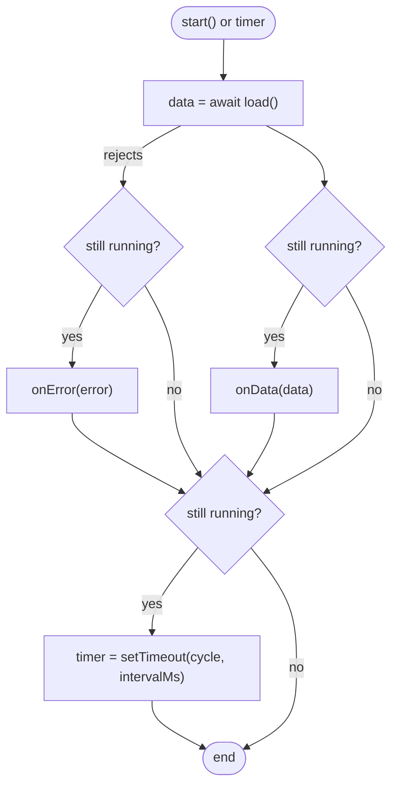

# LLD-05 — Live app shell and Performance › CPU screen (frontend)

| Item | Value |
|---|---|
| Status | Implemented |
| Traces to | [FR-SYS-01](../../requirements/functional-requirements.md#fr-sys-01), [FR-PERF-01](../../requirements/functional-requirements.md#fr-perf-01), [FR-PERF-02](../../requirements/functional-requirements.md#fr-perf-02), [HLD-06](../high-level-design.md#hld-06) |
| API | [`getSystemOverview`](../../api-schema.md#getsystemoverview), [`getPerformanceResources`](../../api-schema.md#getperformanceresources), [`getCpuPerformance`](../../api-schema.md#getcpuperformance) |
| Decisions | [2026-11-10-live-data-windows-linux.md](../../decisions/2026-11-10-live-data-windows-linux.md) |
| Index / matrix | [docs/README.md](../../README.md#3-traceability-matrix) |

## 1. Scope

The renderer refreshes the app shell and the Performance › CPU screen once per second with data from the
backend. API objects are converted to display data by *model* modules; *view* modules own the DOM and
replace only the content that changes. The backend side is in [LLD-04](LLD-04-metrics-collection.md).

Source files:

```
frontend/
├── main/
│   └── backendProcess.js                 resolveBackendExePath(): per-platform backend path
└── renderer/
    ├── app.js                            mountUi(), startLiveData(), bootstrap()
    ├── api/
    │   ├── system/
    │   │   └── systemApi.js              getSystemOverview()
    │   └── performance/
    │       └── performanceApi.js         getPerformanceResources(), getCpuPerformance()
    ├── live/
    │   └── liveDataLoop.js               LiveDataLoop
    ├── shell/
    │   ├── shellTexts.js                 static texts and tooltips
    │   ├── shellModel.js                 toShellData(overview, connected)
    │   └── appShell.js                   createAppShell() → {content, actions, update}
    ├── views/
    │   └── cpu/
    │       ├── cpuPerformanceTexts.js    static texts and tooltips
    │       ├── cpuPerformanceModel.js    toCpuViewData(resources, cpu)
    │       └── cpuPerformanceView.js     createCpuPerformanceView() → {update}
    ├── ui/
    │   └── format.js                     number / unit / time formatting, NO_VALUE
    └── styles/                           .slot, .statusbar__dot--offline, .breakdown__seg--rest
```

## 2. Sequence

```mermaid
sequenceDiagram
    autonumber
    participant APP as app.js
    participant LOOP as LiveDataLoop
    participant API as api modules
    participant MODEL as models
    participant VIEW as appShell / cpuPerformanceView

    APP->>VIEW: createAppShell(toShellData(null, false))
    APP->>LOOP: new LiveDataLoop({load, intervalMs 1000, onData, onError}).start()
    loop until the window closes
        LOOP->>API: load(): getSystemOverview, getPerformanceResources, getCpuPerformance in parallel
        alt all three succeeded
            API-->>LOOP: {overview, resources, cpu}
            LOOP->>APP: onData(data)
            APP->>MODEL: toShellData(overview, true), toCpuViewData(resources, cpu)
            MODEL-->>APP: display data
            APP->>VIEW: shell.update(...), cpuView.update(...) if the screen exists
        else any failed
            API-->>LOOP: ApiError
            LOOP->>APP: onError(error)
            APP->>VIEW: shell.update(toShellData(lastOverview, false))
        end
        LOOP->>LOOP: setTimeout(cycle, 1000)
    end
```

| # | From → To | Function | Processing |
|---|---|---|---|
| 1 | app.js → shell | `mountUi()` | Shell built once with "no value" data (`—`, status `Disconnected from backend`). |
| 2 | app.js → loop | `startLiveData(client, ui)` | Started after the backend config is known. |
| 3 | loop → api modules | `load()` | `Promise.all` of the three calls through `ApiClient`. |
| 4–5 | — | `onData` | Remembers the overview for the disconnected state. |
| 6–7 | app.js → models | `toShellData`, `toCpuViewData` | Formatting only; see section 3. |
| 8 | app.js → views | `update(data)` | The CPU screen is created lazily by `ViewSwitcher`; until then the latest data is kept and used when it is created. |
| 9–11 | — | `onError` | Last values stay; red dot and `Disconnected from backend`. |
| 12 | loop | `#cycle()` | The next load is scheduled after the current one settled: requests never overlap. |

## 3. Data / configuration

| Name | Type | Value / meaning | Defined in |
|---|---|---|---|
| `REFRESH_INTERVAL_MS` | number | `1000` | `app.js` |
| `NO_VALUE` | string | `—`, shown for `null` / missing data | `ui/format.js` |
| `HISTORY_POINTS` | number | `61`; shorter histories are left-padded | `cpuPerformanceModel.js` |
| `SELECTED_RESOURCE_ID` | string | `cpu` | `cpuPerformanceModel.js` |
| `MAX_PROCESS_NAME_LENGTH` | number | `17`; longer names end with `...` | `cpuPerformanceModel.js` |
| `BREAKDOWN_BAR_WIDTH`, `BREAKDOWN_MIN_SEGMENT_WIDTH` | number | `584`, `6` px | `cpuPerformanceModel.js` |
| `CPU_SHADE_LOW`, `CPU_SHADE_HIGH` | RGB | `#254036`, `#2daf6a`: CPU % cell colour, interpolated by value / highest value | `cpuPerformanceModel.js` |
| `RESOURCE_COLORS` | map | sparkline colour per resource kind | `cpuPerformanceModel.js` |
| `.slot` | CSS class | `display: contents`: wrapper whose children are replaced on refresh | `styles/components.css` |

Display formats (`ui/format.js`):

| Function | Example |
|---|---|
| `formatPercent(value, digits)` | `5%`, `3.1%` |
| `formatFrequency(mhz)` | `2.61 GHz` |
| `formatTemperature(celsius)` | `62 °C` |
| `formatInteger(value)` | `114,453` |
| `formatMegabytes(bytes, digits)` | `612 MB`, `111.1 MB` |
| `formatGigabytesValue(bytes)` | `6.9` |
| `formatCacheSize(bytes)` | `256 KB`, `8.0 MB` |
| `formatBitRate(bitsPerSecond)` | `184 Kbps`, `12.4 Mbps` |
| `formatUptime(seconds)` | `45:01:06:32` (days:hours:minutes:seconds) |
| `formatDateTime(iso, {seconds})` | `14.09.2026 08:12:41` (local time) |
| `formatCount(count, singular, plural)` | `1 socket`, `8 logical processors` |

## 4. Functions

| Function | File | Purpose | Parameters | Return | Errors | Flowchart |
|---|---|---|---|---|---|---|
| `mountUi()` | `app.js` | Build shell, register screens. | — | `{showOverview, showCpu}` | — | — |
| `startLiveData(client, ui)` | `app.js` | Create and start the `LiveDataLoop`. | `client`: `ApiClient`; `ui`: result of `mountUi()` | — | none (errors go to `onError`) | — |
| `LiveDataLoop.start()` / `stop()` | `liveDataLoop.js` | Start / stop the refresh cycle. | — | — | — | [F1](#f1) |
| `getSystemOverview(client)` | `systemApi.js` | Fetch `SystemOverview`. | `client` | `Promise<object>` | `ApiError` | — |
| `getPerformanceResources(client)` | `performanceApi.js` | Fetch `PerformanceResource[]`. | `client` | `Promise<object[]>` | `ApiError` | — |
| `getCpuPerformance(client)` | `performanceApi.js` | Fetch `CpuPerformance`. | `client` | `Promise<object>` | `ApiError` | — |
| `toShellData(overview, connected)` | `shellModel.js` | API object → shell display data. | `overview`: object or `null`; `connected`: boolean | object | — | — |
| `createAppShell(container, data)` | `appShell.js` | Build the frame once. | container element; initial data | `{content, actions, update}` | — | — |
| `toCpuViewData(resources, cpu)` | `cpuPerformanceModel.js` | API objects → CPU screen display data. | arrays / objects or `null` | object | — | — |
| `createCpuPerformanceView(container, data)` | `cpuPerformanceView.js` | Build the cards once. | container element; initial data | `{update}` | — | — |
| `resolveBackendExePath()` | `main/backendProcess.js` | `SYSTEMLENS_BACKEND_EXE`, else `backend/build/Debug/systemlens-backend.exe` on Windows, `backend/build/systemlens-backend` elsewhere. | — | string | — | — |

## 5. Flowcharts

<a id="f1"></a>
### F1 — `LiveDataLoop.#cycle()`



## 6. Notes

- Views are split into a static frame (titles, info icons) and slots refilled by `update()`. Replacing the
  whole screen every second would remove a hovered info icon and leave its tooltip stuck open.
- Models are the only modules that know API field names; views only know display data.
- A chart series with no known sample (e.g. temperature without a sensor) is not drawn; its legend entry
  stays. Gaps inside a series repeat the nearest known value.
- The resource sidebar scrolls when the machine has more resources than fit.
- Mock data files (`shellMock.js`, `cpuPerformanceMock.js`) were removed; static texts moved to the
  `*Texts.js` modules.
- Tabs other than Performance, the "Per-core" sub-tab, "Export snapshot", the theme button, "Desktop Monitor"
  and selecting another resource are still not functional.
