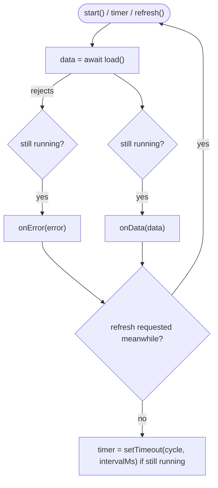

# LLD-05 — Live app shell (frontend)

| Item | Value |
|---|---|
| Status | Implemented |
| Traces to | [FR-SYS-01](../../requirements/functional-requirements.md#fr-sys-01), [FR-NAV-01](../../requirements/functional-requirements.md#fr-nav-01), [HLD-06](../high-level-design.md#hld-06) |
| API | [`getSystemOverview`](../../api-schema.md#getsystemoverview) |
| Decisions | [2026-11-10-live-data-windows-linux.md](../../decisions/2026-11-10-live-data-windows-linux.md) |
| Index / matrix | [docs/README.md](../../README.md#3-traceability-matrix) |

## 1. Scope

The renderer refreshes the app shell (title bar, header, quick stats, tab bar, status bar) once per second
with the system overview. The screens inside the shell are described in [LLD-07](LLD-07-screens.md); the
backend side is in [LLD-04](LLD-04-metrics-collection.md). API objects are converted to display data by a
*model* module; the *view* module owns the DOM and replaces only the content that changes, so hover state
(tooltips) and focus survive the refresh.

Source files:

```
frontend/
├── main/
│   └── backendProcess.js                 resolveBackendExePath(): per-platform backend path
└── renderer/
    ├── app.js                            mountUi(), startShellRefresh(), bootstrap()
    ├── api/system/systemApi.js           getSystemOverview()
    ├── live/liveDataLoop.js              LiveDataLoop
    ├── shell/
    │   ├── shellTexts.js                 window title, tabs (id, name, count key), status texts, tooltips
    │   ├── shellModel.js                 toShellData(overview, connected, activeTabId)
    │   └── appShell.js                   createAppShell() → {content, actions, update}
    └── ui/format.js                      number / unit / time formatting, NO_VALUE
```

## 2. Sequence

```mermaid
sequenceDiagram
    autonumber
    participant APP as app.js
    participant LOOP as LiveDataLoop
    participant API as systemApi.js
    participant MODEL as shellModel.js
    participant SHELL as appShell

    APP->>SHELL: createAppShell(toShellData(null, false, tab), {onTabSelect})
    APP->>LOOP: new LiveDataLoop({load: getSystemOverview, intervalMs 1000}).start()
    loop until the window closes
        LOOP->>API: getSystemOverview(client)
        alt succeeded
            API-->>LOOP: overview
            LOOP->>APP: onData(overview)
            APP->>MODEL: toShellData(overview, true, activeTabId)
            MODEL-->>APP: display data
            APP->>SHELL: update(data)
        else failed
            API-->>LOOP: ApiError
            LOOP->>APP: onError(error)
            APP->>SHELL: update(toShellData(lastOverview, false, activeTabId))
        end
        LOOP->>LOOP: setTimeout(cycle, 1000)
    end
```

| # | From → To | Function | Processing |
|---|---|---|---|
| 1 | app.js → shell | `mountUi()` | Shell built once with "no value" data (`—`, status `Disconnected from backend`); `onTabSelect` switches the screen ([LLD-07](LLD-07-screens.md)). |
| 2 | app.js → loop | `startShellRefresh(client, ui)` | Started once the backend config is known. |
| 3–5 | loop → api | `load()` | `getSystemOverview(client)` through `ApiClient`. |
| 6–8 | app.js → model → shell | `toShellData`, `update` | Formatting only; tabs show live counts (`Processes (253)`, `Services (281)` when known). |
| 9–11 | — | `onError` | The last overview stays; red dot and `Disconnected from backend`. |
| 12 | loop | `#cycle()` | The next load is scheduled after the current one settled: requests never overlap. |

## 3. Data / configuration

| Name | Meaning | Defined in |
|---|---|---|
| `SHELL_REFRESH_INTERVAL_MS` = 1000 | Pause between two shell refreshes | `app.js` |
| `DEFAULT_TAB_ID` = `performance` | Tab shown at startup | `app.js` |
| `SHELL_TEXTS.tabs` | `{id, name, count}`: ids `processes`, `performance`, `history`, `startup`, `users`, `details`, `services` | `shellTexts.js` |
| `NO_VALUE` | `—`, shown for `null` / missing data | `ui/format.js` |

Display formats (`ui/format.js`): `formatPercent` (`5%`), `formatFrequency` (`2.61 GHz`), `formatTemperature`
(`62 °C`), `formatInteger` (`114,453`), `formatMegabytes`, `formatBytes` (auto unit), `formatByteRate`
(`1.2 MB/s`), `formatBitRate` (`184 Kbps`), `formatUptime` (`45:01:06:32`), `formatCpuTime` (`1:02:03`),
`formatDateTime` (`14.09.2026 08:12:41`, local time), `formatCount` (`1 socket`), `formatCacheSize`.

## 4. Functions

| Function | File | Purpose | Errors |
|---|---|---|---|
| `mountUi(getClient, hello)` | `app.js` | Build shell and screens, wire tab clicks and the Hello toggle. Returns `{showOverview, showDisconnected}`. | — |
| `startShellRefresh(client, ui)` | `app.js` | Create and start the shell `LiveDataLoop`. | none (errors go to `onError`) |
| `toShellData(overview, connected, activeTabId)` | `shellModel.js` | API object → shell display data (window title follows the active tab). | — |
| `createAppShell(container, data, {onTabSelect})` | `appShell.js` | Build the frame once; tabs are persistent elements (click or Enter / Space → `onTabSelect(id)`). Returns `{content, actions, update}`. | — |
| `LiveDataLoop.start() / stop() / refresh()` | `liveDataLoop.js` | Start, stop, or load right now (a load in flight is followed by another). | — |
| `resolveBackendExePath()` | `main/backendProcess.js` | `SYSTEMLENS_BACKEND_EXE`, else `backend/build/Debug/systemlens-backend.exe` on Windows, `backend/build/systemlens-backend` elsewhere. | — |

## 5. Flowcharts



## 6. Notes

- The shell frame is built once; replacing it every second would remove a hovered info icon and leave its
  tooltip open.
- The shell keeps polling whatever screen is shown (the tab counts and quick stats are always visible); the
  screens poll only while visible ([LLD-07](LLD-07-screens.md)).
- "Export snapshot", the theme button and "Desktop Monitor" are still not functional.
