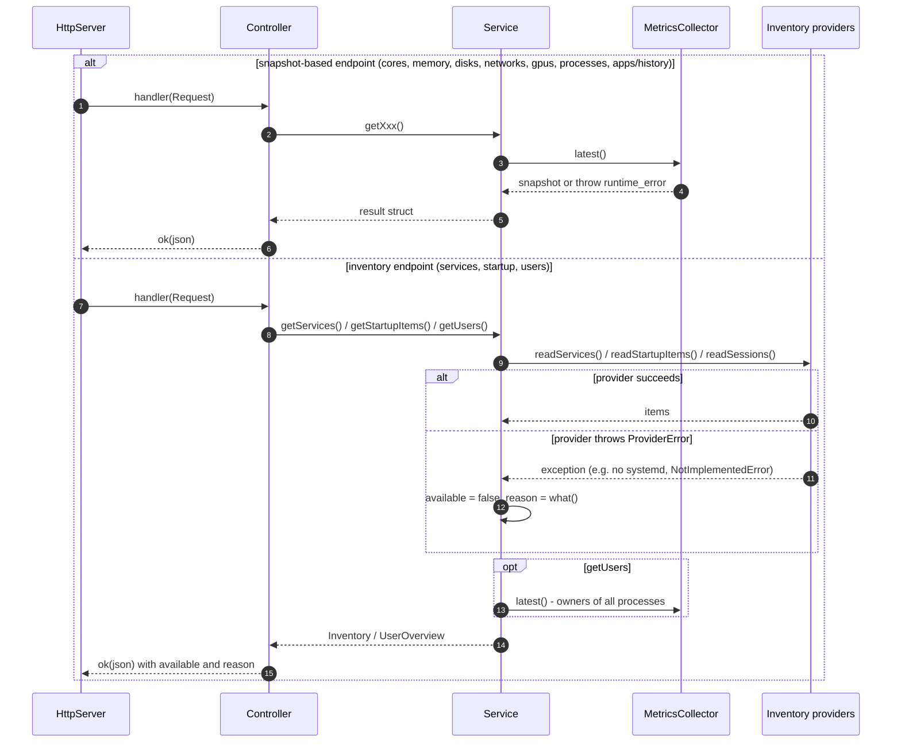

# LLD-06 — Resource details, process list and inventory (backend)

| Item | Value |
|---|---|
| Status | Implemented for Windows and Linux. macOS: placeholders (inventory answers `available=false`; the others answer `500`). |
| Traces to | [FR-PERF-03…07](../../requirements/functional-requirements.md#fr-perf-03), [FR-PROC-01/02](../../requirements/functional-requirements.md#fr-proc-01), [FR-HIST-01](../../requirements/functional-requirements.md#fr-hist-01), [FR-SVC-01](../../requirements/functional-requirements.md#fr-svc-01), [FR-START-01](../../requirements/functional-requirements.md#fr-start-01), [FR-USER-01](../../requirements/functional-requirements.md#fr-user-01), [HLD-06](../high-level-design.md#hld-06) |
| API | `getCpuCores`, `getMemoryPerformance`, `getDiskPerformance`, `getNetworkPerformance`, `getGpuPerformance`, `getProcesses`, `getAppHistory`, `getServices`, `getStartupItems`, `getUsers` ([api-schema.md](../../api-schema.md)) |
| Decisions | [D-43…D-59](../../decisions/2026-11-10-live-data-windows-linux.md) |
| Index / matrix | [docs/README.md](../../README.md#3-traceability-matrix) |

## 1. Scope

Extends [LLD-04](LLD-04-metrics-collection.md). Two kinds of data:

| Kind | Endpoints | Source |
|---|---|---|
| Sampled once per second by `MetricsCollector`, read from the latest `MetricsSnapshot` | cores, memory, disks, networks, GPUs, processes, app history | CPU / memory / disk / network / GPU / process providers (extended with per-core times, memory commit, disk I/O and model, adapter MAC / speed, GPU memory, process owner / threads / status / command line) |
| Read on demand per request, no history | services, startup items, user sessions | `ISystemServiceProvider`, `IStartupProvider`, `IUserSessionProvider` (stateless, called from request threads) |

Source files (new in this LLD):

```
backend/src/
├── api/
│   ├── performance/PerformanceDetailController.h/.cpp   5 routes: cpu/cores, memory, disks, networks, gpus
│   ├── processes/ProcessController.h/.cpp               /processes, /apps/history
│   └── inventory/InventoryController.h/.cpp             /services, /startup, /users
├── services/
│   ├── performance/IPerformanceDetailService.h, PerformanceDetailService.h/.cpp
│   ├── processes/IProcessListService.h, ProcessListService.h/.cpp
│   └── inventory/ISystemInventoryService.h, SystemInventoryService.h/.cpp
└── providers/
    ├── ISystemServiceProvider.h, IStartupProvider.h, IUserSessionProvider.h
    ├── linux/Linux{Service,Startup,UserSession}Provider.h/.cpp
    ├── windows/Windows{Service,Startup,UserSession}Provider.h/.cpp
    └── macos/MacosProviders.cpp                         3 more placeholders
```

## 2. Sequence



| # | From → To | Processing |
|---|---|---|
| 1–6 | HttpServer → … → HttpServer | Snapshot-based path: no operating-system call; an exception from `latest()` becomes `500` ([LLD-02](LLD-02-api-request-pipeline.md)). |
| 7–10 | Service → provider | Inventory providers are stateless and `const`, so concurrent requests are safe. |
| 11–12 | Service | A `ProviderError` (including `NotImplementedError`) is converted into `available = false` + `reason` — a normal state, answered with `200`. |
| 13 | Service → collector | `getUsers()` groups the process list of the snapshot by owner. |

## 3. Data / configuration

| Name | Meaning | Defined in |
|---|---|---|
| `kAppHistoryLimit` = 200 | Applications kept in the history list | `MetricsCollector.h` |
| `kTopProcessCount` = 10 | Rows of "Top CPU processes" and of the memory panel table | `MetricsCollector.h` |
| `AppAccumulator` | Per process name: CPU time since start, peak and current memory, instances | `MetricsCollector.h` |
| `(unknown)` | User group of processes whose owner cannot be read | `SystemInventoryService.cpp` |
| History keys | `<id>`, `<id>/read`, `<id>/write`, `<id>/send`, `<id>/receive` in `m_deviceHistories` | `MetricsCollector.cpp` |

Platform sources of the new fields:

| Field | Windows | Linux |
|---|---|---|
| Per-core times | per-processor array of `SystemProcessorPerformanceInformation` | `cpuN` lines of `/proc/stat` |
| Memory cached / commit | `GetPerformanceInfo` (SystemCache, CommitTotal, CommitLimit) | `Cached + Buffers`, `Committed_AS`, `CommitLimit` |
| Disk model / capacity / I/O | `IOCTL_STORAGE_QUERY_PROPERTY`, `IOCTL_DISK_GET_LENGTH_INFO`, `DISK_PERFORMANCE.BytesRead/Written` | `device/model`, `size`, sectors read / written × 512 |
| Adapter description / MAC / speed | `MIB_IF_ROW2` (Description, PhysicalAddress, ReceiveLinkSpeed) | driver symlink name, `address`, `speed` (Mbit/s) |
| GPU memory | DXGI `DedicatedVideoMemory` | amdgpu `mem_info_vram_total/used` |
| Process owner / threads / status / command line | token of the process (cached per PID) / `NumberOfThreads` / — / — | owner of `/proc/<pid>` / `num_threads` / state letter / `cmdline` |
| Services | Service Control Manager (`EnumServicesStatusExW` + `QueryServiceConfigW`) | `systemctl list-units` + `list-unit-files` via `popen` (fixed arguments) |
| Startup items | `Run` keys (HKCU, HKLM, WOW6432Node), Startup folders, `StartupApproved` | `~/.config/autostart` and `/etc/xdg/autostart` `.desktop` files |
| User sessions | `WTSEnumerateSessionsW` + `WTSQuerySessionInformationW` | `getutxent` (mutex-protected); fallback entry for the backend's user when utmp is empty |

## 4. Functions

| Function | File | Purpose | Errors |
|---|---|---|---|
| `IPerformanceDetailService::getCores/getMemory/getDisks/getNetworks/getGpus` | `IPerformanceDetailService.h`, `PerformanceDetailService.cpp` | Shape the snapshot per endpoint (memory: 10 processes with the most memory). | `std::runtime_error` |
| `IProcessListService::getProcesses/getAppHistory` | `IProcessListService.h`, `ProcessListService.cpp` | Process list (highest CPU first) and per-application totals. | `std::runtime_error` |
| `ISystemInventoryService::getServices/getStartupItems` | `ISystemInventoryService.h`, `SystemInventoryService.cpp` | Provider list sorted by name, or unavailable. | none |
| `ISystemInventoryService::getUsers()` | same | Sessions (or unavailable) + CPU / memory / process count per owner. | `std::runtime_error` |
| `MetricsCollector::sampleProcesses()` (private) | `MetricsCollector.cpp` | Per-process CPU, sorted list, top lists, per-application accumulation. | provider exceptions |
| `PerformanceDetailController::registerRoutes`, `ProcessController::handle*`, `InventoryController::handle*` | `api/...` | Serialize results (`null` for missing values). | service exceptions → `500` |

## 5. Flowcharts

Trivial except the inventory conversion, shown as the second alternative of the sequence above.

## 6. Notes

- App history is accumulated in RAM since the backend started (decision D-47); a process that exited keeps its CPU time in its application's total. A PID reused by another program yields a negative delta and is ignored.
- A process first seen in a tick has no baseline, so its CPU share is 0 until the next tick.
- Windows process owners are cached per PID and dropped when the PID disappears; protected processes have an empty owner (`(unknown)` in Users).
- `systemctl` is run with fixed arguments only; nothing from a request reaches the command line. Without systemd the list is `available = false`.
- Not available: process status and command line on Windows; services PID on Linux; GPU memory in use except amdgpu; link speed of Wi-Fi / virtual adapters on Linux.
- Verification: Linux built and queried (all ten endpoints); Windows cross-compiled with MinGW-w64 only; macOS not compiled.
