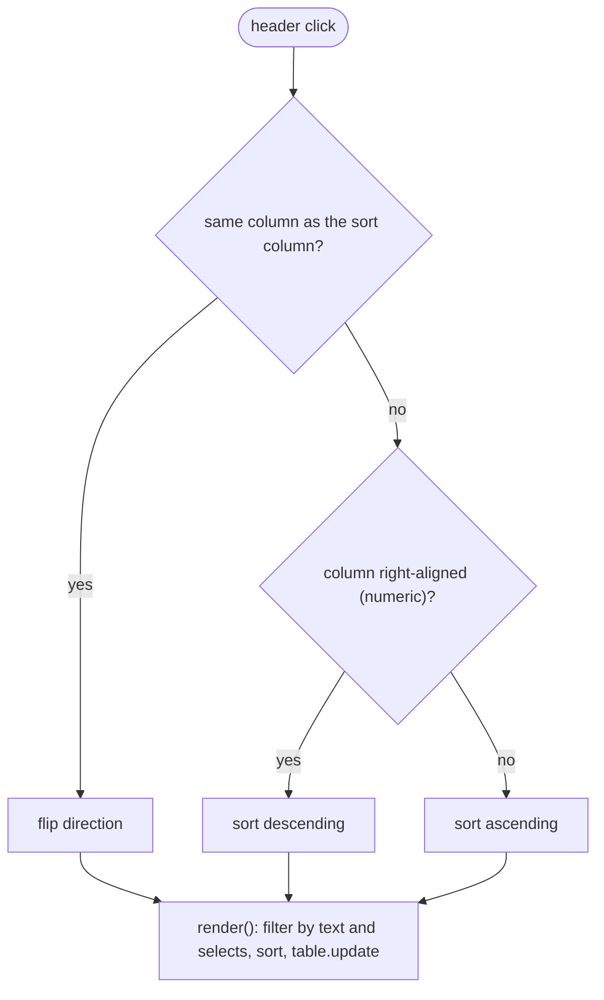

# LLD-07 — Screens: navigation, Performance panels and table screens (frontend)

| Item | Value |
|---|---|
| Status | Implemented |
| Traces to | [FR-NAV-01](../../requirements/functional-requirements.md#fr-nav-01), [FR-PERF-01…07](../../requirements/functional-requirements.md#fr-perf-01), [FR-PROC-01/02](../../requirements/functional-requirements.md#fr-proc-01), [FR-HIST-01](../../requirements/functional-requirements.md#fr-hist-01), [FR-SVC-01](../../requirements/functional-requirements.md#fr-svc-01), [FR-START-01](../../requirements/functional-requirements.md#fr-start-01), [FR-USER-01](../../requirements/functional-requirements.md#fr-user-01), [HLD-07](../high-level-design.md#hld-07) |
| API | all `performance`, `processes` and `inventory` endpoints ([api-schema.md](../../api-schema.md)) |
| Decisions | [D-43…D-64](../../decisions/2026-11-10-live-data-windows-linux.md) |
| Index / matrix | [docs/README.md](../../README.md#3-traceability-matrix) |

## 1. Scope

One screen per tab, each refreshing from the backend only while visible. Three kinds of screens:

| Kind | Screens | Built from |
|---|---|---|
| Performance | sidebar + panel of the selected resource (CPU with Overview / Per-core, Memory, Disk, Ethernet / Wi-Fi, GPU) | `performanceScreen.js`, `resourceSidebar.js`, `cpuPerformance*`, generic `resourceDetailView.js` |
| Table | Processes (grouped), Details, App history, Services, Startup, Users (two tables) | `ui/tableScreen.js` + `ui/dataTable.js` |
| Sample | Hello (behind the `⇄ Hello` button) | `helloView.js` |

Source files (new or changed in this LLD; the shell is in [LLD-05](LLD-05-live-performance-ui.md)):

```
frontend/renderer/
├── app.js                                   registers one screen per tab, tab click → ViewSwitcher.show
├── api/
│   ├── performance/performanceApi.js        + getCpuCores, getMemoryPerformance, getDiskPerformance, getNetworkPerformance, getGpuPerformance
│   ├── processes/processApi.js              getProcesses(), getAppHistory()
│   └── system/inventoryApi.js               getServices(), getStartupItems(), getUsers()
├── live/
│   ├── liveDataLoop.js                      + refresh()
│   └── pollingScreen.js                     createPollingScreen(): poll only while visible
├── ui/
│   ├── series.js                            padHistory, gaplessHistory, scaleToPeak
│   ├── dataTable.js                         presentational sortable table, compareValues
│   ├── tableScreen.js                       title + filters + banner + table, sort / filter state
│   ├── searchBox.js                         filter input
│   └── charts/plot.js                       + fluid option
├── views/
│   ├── viewSwitcher.js                      show(id) with onShow / onHide
│   ├── hello/helloView.js                   createHelloView() → {render, setMessage}
│   ├── performance/
│   │   ├── performanceScreen.js             selection, loading per kind, panel switching
│   │   ├── resourceModel.js, resourceSidebar.js
│   │   └── resourceDetail{Texts,Models,View}.js   generic panel for Memory / Disk / Network / GPU
│   ├── cpu/cpuPerformance{Texts,Model,View}.js    CPU panel: Overview and Per-core
│   ├── processes/processesScreen.js, detailsScreen.js
│   ├── history/appHistoryScreen.js
│   └── inventory/servicesScreen.js, startupScreen.js, usersScreen.js
└── styles/views/resourceDetail.css, dataScreens.css
```

## 2. Sequence

```mermaid
sequenceDiagram
    autonumber
    participant U as User
    participant SH as appShell
    participant APP as app.js
    participant VS as ViewSwitcher
    participant PS as pollingScreen
    participant LOOP as LiveDataLoop
    participant API as api modules

    U->>SH: click tab "Details"
    SH->>APP: onTabSelect("details")
    APP->>VS: show("details")
    VS->>PS: previous screen onHide() - loop.stop()
    VS->>PS: render(host) on first use, then onShow()
    PS->>LOOP: new LiveDataLoop({load}).start()
    loop every intervalMs while visible
        LOOP->>API: load(await getClient())
        API-->>LOOP: data
        LOOP->>PS: view.update(data)
    end
    U->>PS: (Performance) click sidebar row
    PS->>PS: selectedId = id, show that panel, loop.refresh()
```

| # | From → To | Function | Processing |
|---|---|---|---|
| 1–3 | shell → app → switcher | `createAppShell` tab click, `ViewSwitcher.show` | App also redraws the shell (active tab, window title). |
| 4–6 | switcher → screen | `onHide`, `render`, `onShow` | `render` runs once per screen; the host element persists, so sort order, filter text and scroll position survive switching. |
| 7 | screen → loop | `createPollingScreen` | Interval: Performance 1 s, Processes / Details / App history 2 s, Services / Startup / Users 5 s. |
| 8–10 | loop → api → view | `load`, `view.update` | `getClient()` resolves once the backend config is known. Errors only go to the console; the shell reports the disconnection. |
| 11–12 | user → Performance | `select(id)` | Panel switches at once; `refresh()` reloads without waiting; a response for a previously selected resource is ignored. |

## 3. Data / configuration

| Name | Meaning | Defined in |
|---|---|---|
| `REFRESH_INTERVAL_MS` | 1000 / 2000 / 5000 per screen | each screen file |
| `DEFAULT_RESOURCE_ID` = `cpu` | Resource selected when Performance opens | `resourceModel.js` |
| `kindOf(id)` | Panel for a resource id: `cpu`, `memory`, `disk*`, `net-*`, `gpu*` | `performanceScreen.js` |
| `DETAIL_LOADERS` | Which endpoints a panel needs (CPU: cpu + cores) | `performanceScreen.js` |
| `MIN_DISK_SCALE_BYTES_PER_SECOND` = 100 KiB/s, `MIN_NETWORK_SCALE_BITS_PER_SECOND` = 100 kbit/s | Smallest full scale of transfer charts | `resourceDetailModels.js` |
| `HISTORY_POINTS` = 61 | Points per plot; shorter histories are left-padded | `ui/series.js` |
| Resource detail model | `{title, subtitle, charts: [{title, tooltip, topRight, legend, series}], statsTooltip, stats, info: {title, tooltip, rows}, table}` | `resourceDetailModels.js` |
| Table column | `{key, label, align, width, sortValue, text / render, className}`; right-aligned = numeric (sorts descending first) | `ui/dataTable.js`, `ui/tableScreen.js` |
| `expandedGroups` | Names of the expanded groups of the Processes tab | `processesScreen.js` |

## 4. Functions

| Function | File | Purpose | Errors |
|---|---|---|---|
| `createPollingScreen({getClient, intervalMs, load, create})` | `live/pollingScreen.js` | Screen definition: `render`, `onShow` (start loop), `onHide` (stop loop), `refresh`. | none |
| `ViewSwitcher.show(id)` | `views/viewSwitcher.js` | Hide / show hosts, call `onHide` / `onShow`. | `Error` for an unknown id |
| `createPerformanceScreen({getClient})` | `performanceScreen.js` | Sidebar + panel; loads sidebar list and the selected resource's data; falls back to CPU when the selection disappears. | none |
| `toResourceRows`, `toMemoryModel`, `toDiskModel`, `toNetworkModel`, `toGpuModel`, `toCpuViewData` | models | API objects → display data; missing data gives `—`. | — |
| `createResourceDetailView()` | `resourceDetailView.js` | Generic panel; builds its cards on the first `update`, later updates replace content only. | — |
| `createCpuPerformanceView(data)` | `cpuPerformanceView.js` | CPU panel `{element, update}`; sub-tab buttons toggle Overview / Per-core. | — |
| `createTableScreen(options)` | `ui/tableScreen.js` | Toolbar (filter box, select filters, summary), banner, table; keeps sort / filter state; `update({rows, unavailableReason, note})`. | — |
| `createDataTable(options)` | `ui/dataTable.js` | Table with sticky header, sort arrows, row selection. | — |
| `create…Screen({getClient})` | `views/*/…Screen.js` | Column definitions and wiring of one table screen. | — |

## 5. Flowcharts



## 6. Notes

- Processes tab: the grouping, the sort of groups by their sums and the expansion are done in
  `processesScreen.js` through the `transform` option of the table screen; while a filter text is set all
  matching groups are open.
- Table cells are rebuilt on each refresh (a few hundred rows every 2 s); the selection is kept by row key.
- Own processes (`isSelf`) are highlighted in the process tables.
- The CPU Overview cards keep the fixed sizes of the Figma design; the new panels use fluid plots
  (`.plot--fluid`, `vector-effect: non-scaling-stroke`) and a responsive grid.
- Memory process table: names are cut with an ellipsis; Linux names that the kernel truncated to 15 characters are
  restored from the command line (up to the first space).
- No Figma design exists for the new screens; they reuse the colour tokens, cards, tables and fonts of the existing UI.
- Verification: renderer run in headless Chromium against the Linux backend (all tabs and panels, sort, filter,
  expand, Hello toggle) without console errors; Services / Startup parsing checked with a fake `systemctl` and
  autostart files. Not run through Electron or on Windows.
