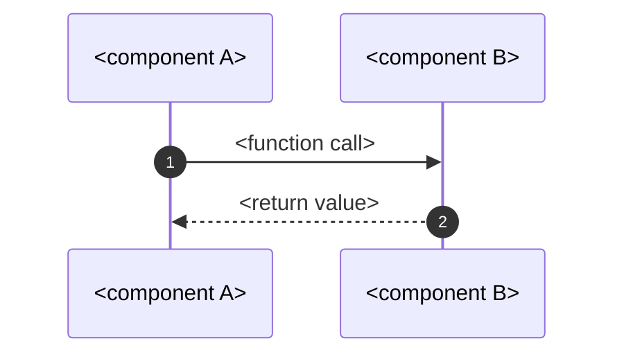
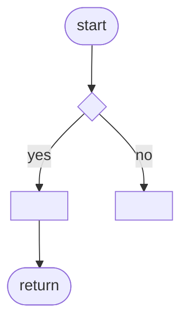

# LLD-NN — <feature name>

<!--
Template for a low-level design. Copy to LLD-NN-<short-name>.md (next free number), replace every <...>,
then add the LLD to the traceability matrix in docs/README.md.
Rules:
- Every sequence diagram uses `autonumber`; the step table below it has one row per number.
- Every function in section 4 lists its flowchart ID, or "—" when it is trivial (no branch / loop).
- Folder trees use the symbols ├── └── │.
Example of a filled LLD: LLD-03-sample-hello.md.
-->

| Item | Value |
|---|---|
| Status | <Implemented / Partially implemented / Not implemented> |
| Traces to | <FR-... / NFR-...>, <HLD-NN> |
| API | <operationId(s) in ../../api-schema.md, or —> |
| Index / matrix | [docs/README.md](../../README.md#3-traceability-matrix) |

## 1. Scope

<What this feature does, in one or two sentences.>

Source files:

```
<folder>/
└── <subfolder>/
    ├── <file1>        <role>
    └── <file2>        <role>
```

## 2. Sequence



| # | From → To | Function | Processing |
|---|---|---|---|
| 1 | A → B | `<function>` | <what happens> |
| 2 | B → A | — | <what is returned> |

## 3. Data / configuration

| Name | Type | Value / meaning | Defined in |
|---|---|---|---|
| `<CONSTANT>` | <type> | <value> | `<file>` |

## 4. Functions

| Function | File | Purpose | Parameters | Return | Errors | Flowchart |
|---|---|---|---|---|---|---|
| `<signature>` | `<file>` | <what it does> | <name: meaning> | <value> | <thrown errors> | [F1](#f1) |

## 5. Flowcharts

<a id="f1"></a>
### F1 — `<function>`



## 6. Notes

<Facts from the code worth knowing: constraints, pitfalls. No proposals.>
