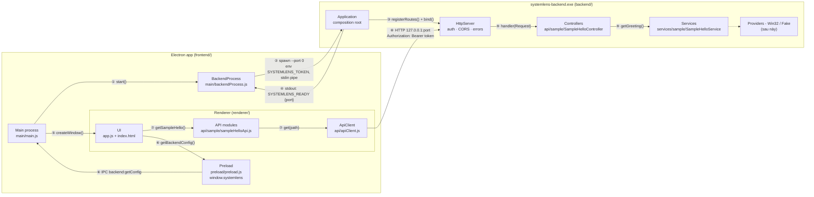
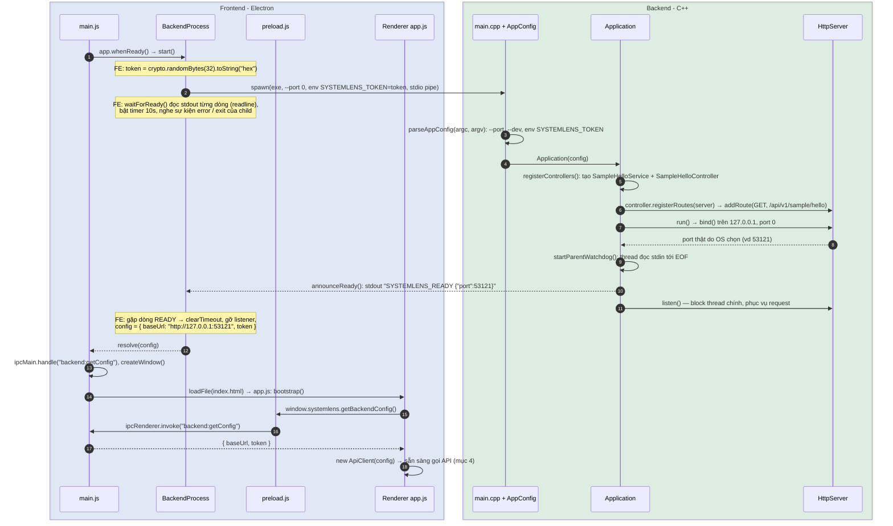
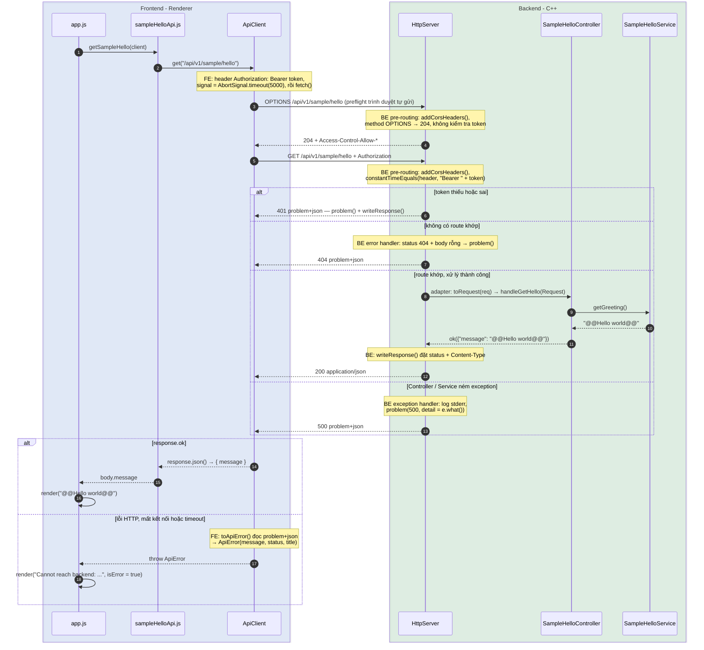
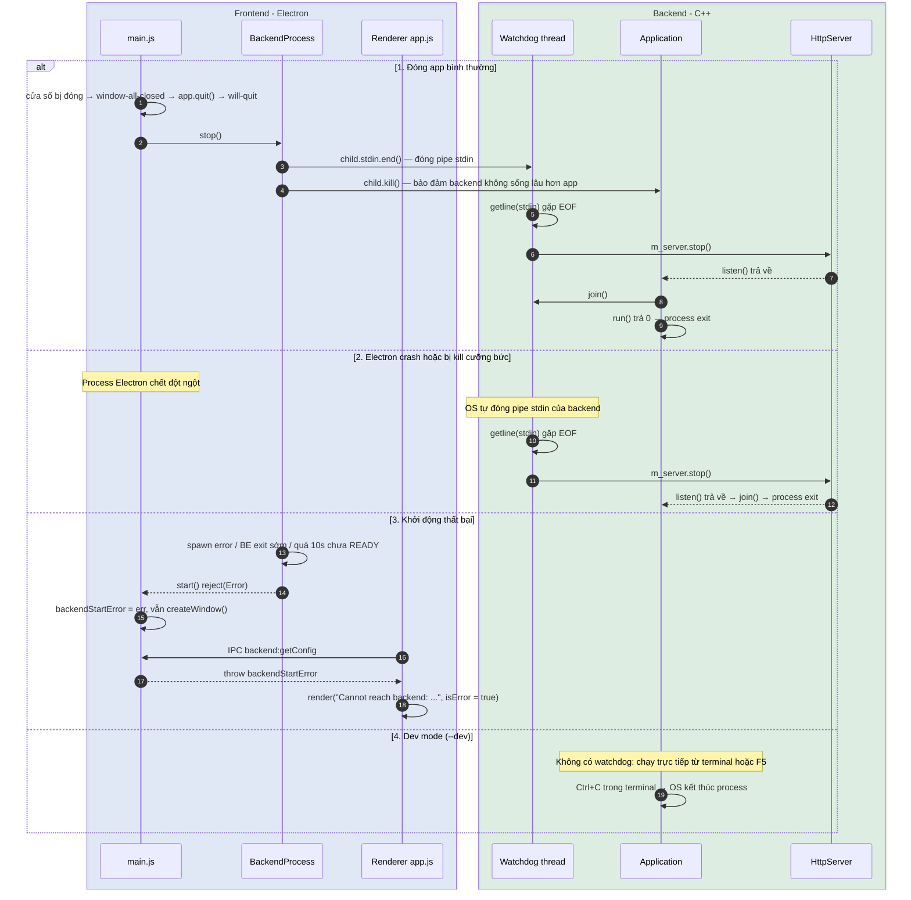

# SystemLens — High Level Design

> Phạm vi hiện tại: **giao tiếp Frontend ↔ Backend**. Các phần khác (thu thập dữ liệu hệ thống,
> streaming realtime, đóng gói) sẽ được bổ sung khi tới bước tương ứng.
>
> Chuỗi tài liệu: [SystemLens_spec.md](SystemLens_spec.md) (yêu cầu) → **HLD (file này)** →
> [lld/backend-lld.md](lld/backend-lld.md) · [lld/frontend-lld.md](lld/frontend-lld.md) (thiết kế chi tiết).
>
> Liên quan: [api-reference.md](api-reference.md) · [api-convention.md](api-convention.md) ·
> [coding-convention.md](coding-convention.md) ·
> contract [api/openapi.yaml](../api/openapi.yaml)

## 1. Tổng quan & mục tiêu

SystemLens là ứng dụng Task Manager cho Windows gồm 2 tiến trình:

| Thành phần | Công nghệ | Vai trò |
|---|---|---|
| **Frontend** | Electron (HTML/CSS/JS) | Giao diện, khởi động và quản lý vòng đời backend |
| **Backend** | C++20, cpp-httplib, nlohmann/json | Thu thập dữ liệu hệ thống, thực thi lệnh, phục vụ HTTP API local |

Mục tiêu thiết kế cho phần giao tiếp:

- **Contract-first:** FE và BE phát triển song song dựa trên `api/openapi.yaml`.
- **An toàn:** API chỉ nghe trên loopback và yêu cầu token ngẫu nhiên cho mỗi lần chạy.
- **Vòng đời gắn chặt:** backend không bao giờ sống lâu hơn Electron.
- **Dễ mở rộng:** thêm một API chỉ cần thêm Service + Controller + module JS, không đụng tới hạ tầng.

## 2. Component diagram

| Bước | Từ → Đến | Ý nghĩa |
|---|---|---|
| ① | Main → BackendProcess | Khi Electron sẵn sàng (`app.whenReady`), main gọi `BackendProcess.start()` |
| ② | BackendProcess → Application | Sinh token, spawn exe với `--port 0`, token qua env, giữ stdin pipe làm "dây sống" |
| ③ | Application → HttpServer | Tạo service + controller, đăng ký route lên HttpServer, `bind()` 127.0.0.1 (OS chọn port) |
| ④ | Application → BackendProcess | In dòng READY kèm port thật ra stdout; FE tạo `baseUrl` |
| ⑤ | Main → Renderer | Đăng ký IPC handler, mở cửa sổ, load `index.html` + `app.js` |
| ⑥ | UI → Preload → Main | Renderer xin `{ baseUrl, token }` qua `window.systemlens` → IPC `backend:getConfig` |
| ⑦ | UI → API module → ApiClient | UI gọi hàm của API module; module gọi `ApiClient.get(path)` |
| ⑧ | ApiClient → HttpServer | HTTP request kèm bearer token; HttpServer kiểm tra CORS + auth |
| ⑨ | HttpServer → Controller → Service | Route khớp → controller gọi service → JSON trả ngược về UI |

## 3. Startup & handshake

Số bước khớp với số Mermaid tự đánh (`autonumber`) trên từng mũi tên của sequence.

| Bước | Phía | Từ → Đến | Xử lý |
|---|---|---|---|
| 1 | FE | main.js → BackendProcess | `app.whenReady()` rồi gọi `start()`; BackendProcess sinh token `crypto.randomBytes(32)` |
| 2 | FE → BE | BackendProcess → backend exe | `spawn(exe, --port 0)`, token qua env `SYSTEMLENS_TOKEN`, stdio là pipe; `waitForReady()` bắt đầu đọc stdout (readline) và bật timer 10s |
| 3 | BE | main.cpp | `parseAppConfig()` đọc `--port`, `--dev`, env token; sai tham số → thoát mã 2 |
| 4 | BE | main.cpp → Application | Tạo `Application(config)`; constructor tạo `HttpServer` (token = null nếu `--dev`) |
| 5 | BE | Application | `registerControllers()`: tạo `SampleHelloService` + `SampleHelloController` |
| 6 | BE | Application → HttpServer | `registerRoutes(server)` → `addRoute(GET, /api/v1/sample/hello)` |
| 7 | BE | Application → HttpServer | `run()` → `bind()` trên `127.0.0.1`, port 0 |
| 8 | BE | HttpServer → Application | Trả port thật do OS chọn (vd 53121) |
| 9 | BE | Application | `startParentWatchdog()`: thread đọc stdin tới EOF (không chạy ở dev mode) |
| 10 | BE → FE | Application → BackendProcess | `announceReady()`: in `SYSTEMLENS_READY {"port":53121}` ra stdout |
| 11 | BE | Application → HttpServer | `listen()`: block thread chính, bắt đầu phục vụ request |
| 12 | FE | BackendProcess → main.js | Gặp dòng READY: `clearTimeout`, gỡ listener, resolve `{ baseUrl, token }` |
| 13 | FE | main.js | `ipcMain.handle("backend:getConfig")` rồi `createWindow()` |
| 14 | FE | main.js → Renderer | `loadFile(index.html)` → `app.js` chạy `bootstrap()` |
| 15 | FE | Renderer → preload.js | `window.systemlens.getBackendConfig()` |
| 16 | FE | preload.js → main.js | `ipcRenderer.invoke("backend:getConfig")` |
| 17 | FE | main.js → Renderer | Trả `{ baseUrl, token }` |
| 18 | FE | Renderer | `new ApiClient(config)`, sẵn sàng gọi API (mục 4) |

Nếu khởi động thất bại (thiếu exe, BE thoát sớm, quá 10s chưa READY), xem kịch bản 3 ở [mục 5](#5-shutdown--lifecycle).

**Vì sao như vậy:**

- **`--port 0`:** tránh xung đột port. Backend báo lại port thật qua stdout.
- **Token qua biến môi trường:** không truyền qua argv, vì argv hiện ra trong danh sách process (chính Task Manager hiển thị được!).
- **stdout chỉ dùng cho handshake:** mọi log đi ra stderr, nên FE parse dòng READY không bị lẫn log.
- **Bind trước, READY sau:** FE chỉ nhận port khi socket đã mở, nên request đầu tiên không bao giờ bị từ chối kết nối.

## 4. Request flow

Số bước khớp với số Mermaid tự đánh trên từng mũi tên. Các bước 6, 7, 8–12, 13 là các nhánh loại trừ nhau
(chỉ một nhánh xảy ra); tương tự 14–16 và 17–18.

| Bước | Phía | Từ → Đến | Xử lý |
|---|---|---|---|
| 1 | FE | app.js → sampleHelloApi.js | `getSampleHello(client)` |
| 2 | FE | sampleHelloApi.js → ApiClient | `get("/api/v1/sample/hello")`; ApiClient gắn `Authorization: Bearer <token>`, `AbortSignal.timeout(5000)` rồi `fetch()` |
| 3 | FE → BE | ApiClient → HttpServer | Trình duyệt tự gửi preflight `OPTIONS` (renderer là origin `null`, request có header `Authorization`) |
| 4 | BE → FE | HttpServer → ApiClient | Pre-routing: `addCorsHeaders()`, `OPTIONS` → `204`, không kiểm tra token |
| 5 | FE → BE | ApiClient → HttpServer | Request thật `GET /api/v1/sample/hello` kèm token; pre-routing kiểm tra bằng `constantTimeEquals()` |
| 6 | BE → FE | HttpServer → ApiClient | *Nhánh token thiếu/sai:* `401` problem+json (`problem()` + `writeResponse()`) |
| 7 | BE → FE | HttpServer → ApiClient | *Nhánh không có route:* error handler tạo `404` problem+json |
| 8 | BE | HttpServer → SampleHelloController | *Nhánh thành công:* adapter `toRequest(req)` → `handleGetHello(Request)` |
| 9 | BE | Controller → SampleHelloService | `getGreeting()` |
| 10 | BE | Service → Controller | Trả `"@@Hello world@@"` |
| 11 | BE | Controller → HttpServer | `ok({"message": "@@Hello world@@"})` |
| 12 | BE → FE | HttpServer → ApiClient | `writeResponse()` → `200 application/json` |
| 13 | BE → FE | HttpServer → ApiClient | *Nhánh exception:* exception handler log stderr, trả `500` problem+json (`detail = e.what()`) |
| 14 | FE | ApiClient → sampleHelloApi.js | *`response.ok`:* `response.json()` → `{ message }` |
| 15 | FE | sampleHelloApi.js → app.js | Trả `body.message` |
| 16 | FE | app.js | `render("@@Hello world@@")` |
| 17 | FE | ApiClient → app.js | *Lỗi HTTP/mạng/timeout:* `toApiError()` đọc problem+json → `throw ApiError(message, status, title)` |
| 18 | FE | app.js | `render("Cannot reach backend: ...", isError = true)` |

- **Preflight CORS:** renderer chạy từ `file://` (origin `null`), nên request có header `Authorization` sẽ kèm một preflight `OPTIONS`. HttpServer trả `204` cho preflight trước khi kiểm tra auth.
- **Controller không bắt exception:** việc chuyển exception thành 500 nằm ở một chỗ duy nhất (exception handler của HttpServer).

## 5. Shutdown & lifecycle

- **Vì sao dùng stdin làm "dây sống":** khi Electron chết vì bất kỳ lý do gì, OS luôn đóng pipe. Backend nhận EOF và tự thoát mà không cần FE gửi lệnh nào.
- **Dev mode (`--dev`):** backend không theo dõi stdin vì stdin là console (không bao giờ EOF). Dừng bằng `Ctrl+C`.

## 6. Bảo mật

| Rủi ro | Biện pháp |
|---|---|
| Máy khác trong mạng gọi API (sau này có kill process…) | Chỉ bind `127.0.0.1` |
| Process/trang web khác trên cùng máy gọi API | Bearer token 256-bit ngẫu nhiên mỗi lần chạy; so sánh constant-time |
| Lộ token qua danh sách process | Token truyền bằng biến môi trường, không qua argv |
| Renderer bị chèn script | `contextIsolation`, `sandbox`, `nodeIntegration: false`, CSP chỉ cho `connect-src http://127.0.0.1:*` |
| Chạy nhầm chế độ không auth | `--dev` phải bật tường minh và in cảnh báo ra stderr |

## 7. Layering & mở rộng

| Lớp | Thư mục | Trách nhiệm | Không được |
|---|---|---|---|
| HttpServer | `backend/src/api/HttpServer.*` | Socket, auth, CORS, map lỗi → problem | Chứa logic nghiệp vụ |
| Controller | `backend/src/api/<area>/` | HTTP ↔ DTO JSON, gọi service | Gọi Win32 API trực tiếp |
| Service | `backend/src/services/<area>/` | Logic nghiệp vụ, interface `I...Service` để mock | Biết về HTTP |
| Provider *(sau này)* | `backend/src/platform/` | Gọi Win32/NT API (bản thật) hoặc dữ liệu giả (Fake) | Biết về HTTP/JSON |
| ApiClient | `frontend/renderer/api/apiClient.js` | fetch, token, timeout, ApiError | Biết về endpoint cụ thể |
| API module | `frontend/renderer/api/<area>/` | Mỗi endpoint một hàm, trả dữ liệu thuần | Đụng vào DOM |

- **Thêm API mới:** theo checklist trong [api-convention.md](api-convention.md#checklist-thêm-api-mới).
- **Điểm mở rộng dự kiến:**
  - Stream số liệu realtime (WebSocket/SSE), cần ADR riêng vì cpp-httplib chưa hỗ trợ WebSocket.
  - Lớp Provider Win32/Fake cho dữ liệu hệ thống.
  - Đóng gói `backend.exe` cùng app Electron (`SYSTEMLENS_BACKEND_EXE`/đường dẫn resources).

## 8. Quyết định & vấn đề còn mở

| # | Quyết định | Lý do |
|---|---|---|
| D1 | HTTP local (REST) giữa FE và BE | Ngôn ngữ trung lập, dễ test bằng curl, contract bằng OpenAPI |
| D2 | cpp-httplib | Header-only, đơn giản; được bọc sau `HttpServer` nên có thể đổi |
| D3 | CMake FetchContent cho dependency | Không cần cài thêm gì vào máy; version được pin |
| D4 | Lỗi theo RFC 7807 (problem+json) | Chuẩn mở, FE xử lý lỗi thống nhất |
| D5 | Handshake bằng stdout + vòng đời bằng stdin | Không cần file/port cố định; backend tự thoát khi Electron chết |

**Còn mở:**

- Giao thức stream realtime.
- Cơ chế đóng gói và đường dẫn exe khi phát hành.
- Chạy backend với quyền admin (cần cho một số process).
