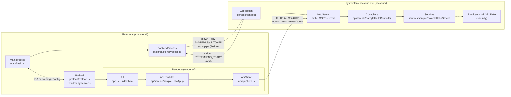
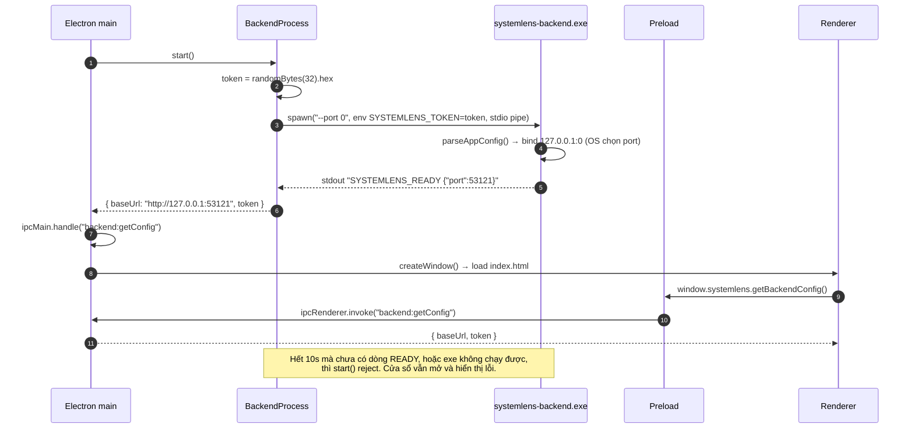
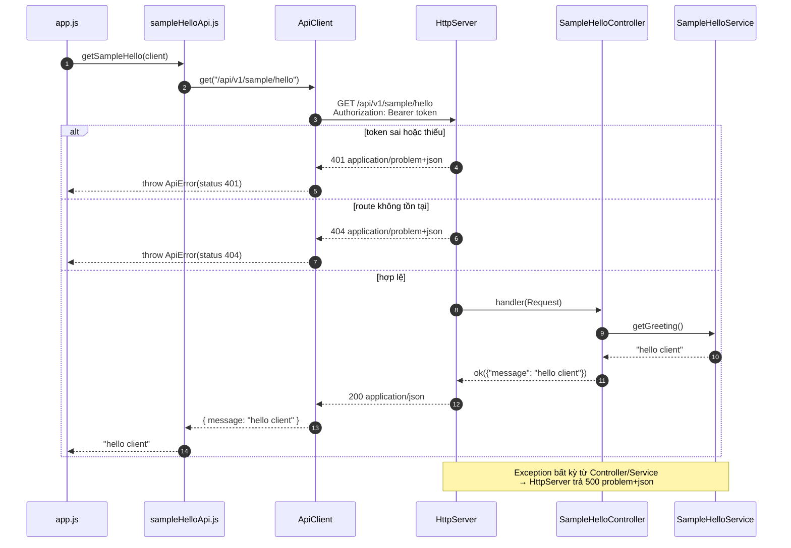
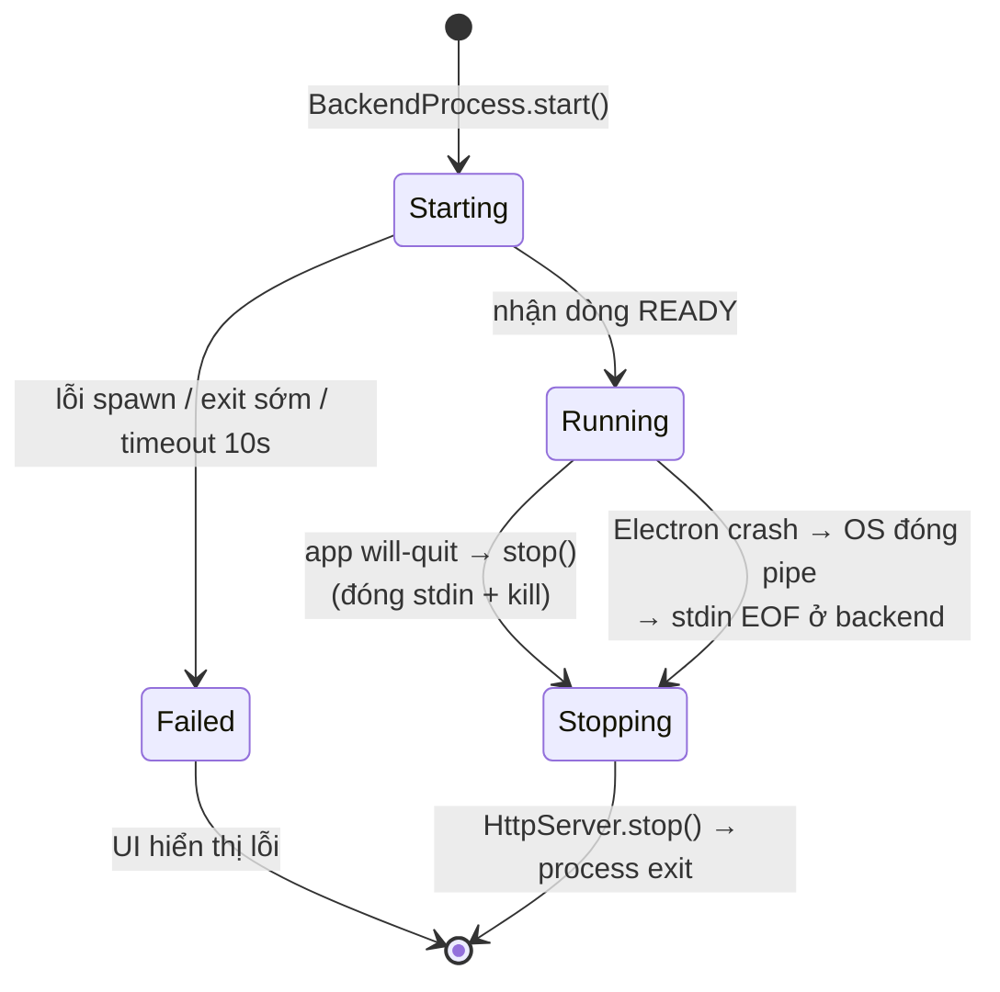

# SystemLens — High Level Design

> Phạm vi hiện tại: **giao tiếp Frontend ↔ Backend**. Các phần khác (thu thập dữ liệu hệ thống,
> streaming realtime, đóng gói) sẽ được bổ sung khi tới bước tương ứng.
>
> Liên quan: [api-convention.md](api-convention.md) · [coding-convention.md](coding-convention.md) ·
> contract [api/openapi.yaml](../api/openapi.yaml)

## 1. Tổng quan & mục tiêu

SystemLens là ứng dụng Task Manager cho Windows gồm 2 tiến trình:

| Thành phần | Công nghệ | Vai trò |
|---|---|---|
| **Frontend** | Electron (HTML/CSS/JS) | Giao diện, khởi động và quản lý vòng đời backend |
| **Backend** | C++20, cpp-httplib, nlohmann/json | Thu thập dữ liệu hệ thống, thực thi lệnh, phục vụ HTTP API local |

Mục tiêu thiết kế cho phần giao tiếp:

- **Contract-first:** FE và BE phát triển song song dựa trên `api/openapi.yaml`.
- **An toàn:** API chỉ nghe trên loopback và yêu cầu token ngẫu nhiên cho mỗi lần chạy.
- **Vòng đời gắn chặt:** backend không bao giờ sống lâu hơn Electron.
- **Dễ mở rộng:** thêm một API chỉ cần thêm Service + Controller + module JS, không đụng tới hạ tầng.

## 2. Component diagram

## 3. Startup & handshake

**Vì sao như vậy:**

- **`--port 0`:** tránh xung đột port. Backend báo lại port thật qua stdout.
- **Token qua biến môi trường:** không truyền qua argv, vì argv hiện ra trong danh sách process (chính Task Manager hiển thị được!).
- **stdout chỉ dùng cho handshake:** mọi log đi ra stderr, nên FE parse dòng READY không bị lẫn log.

## 4. Request flow

- **Preflight CORS:** renderer chạy từ `file://` (origin `null`), nên request có header `Authorization` sẽ kèm một preflight `OPTIONS`. HttpServer trả `204` cho preflight trước khi kiểm tra auth.

## 5. Shutdown & lifecycle

- **Dev mode (`--dev`):** backend không theo dõi stdin, vì được chạy trực tiếp từ terminal bằng `Tool\run-backend.ps1` hoặc F5. Dừng bằng `Ctrl+C`.

## 6. Bảo mật

| Rủi ro | Biện pháp |
|---|---|
| Máy khác trong mạng gọi API (sau này có kill process…) | Chỉ bind `127.0.0.1` |
| Process/trang web khác trên cùng máy gọi API | Bearer token 256-bit ngẫu nhiên mỗi lần chạy; so sánh constant-time |
| Lộ token qua danh sách process | Token truyền bằng biến môi trường, không qua argv |
| Renderer bị chèn script | `contextIsolation`, `sandbox`, `nodeIntegration: false`, CSP chỉ cho `connect-src http://127.0.0.1:*` |
| Chạy nhầm chế độ không auth | `--dev` phải bật tường minh và in cảnh báo ra stderr |

## 7. Layering & mở rộng

| Lớp | Thư mục | Trách nhiệm | Không được |
|---|---|---|---|
| HttpServer | `backend/src/api/HttpServer.*` | Socket, auth, CORS, map lỗi → problem | Chứa logic nghiệp vụ |
| Controller | `backend/src/api/<area>/` | HTTP ↔ DTO JSON, gọi service | Gọi Win32 API trực tiếp |
| Service | `backend/src/services/<area>/` | Logic nghiệp vụ, interface `I...Service` để mock | Biết về HTTP |
| Provider *(sau này)* | `backend/src/platform/` | Gọi Win32/NT API (bản thật) hoặc dữ liệu giả (Fake) | Biết về HTTP/JSON |
| ApiClient | `frontend/renderer/api/apiClient.js` | fetch, token, timeout, ApiError | Biết về endpoint cụ thể |
| API module | `frontend/renderer/api/<area>/` | Mỗi endpoint một hàm, trả dữ liệu thuần | Đụng vào DOM |

- **Thêm API mới:** theo checklist trong [api-convention.md](api-convention.md#checklist-thêm-api-mới).
- **Điểm mở rộng dự kiến:**
  - Stream số liệu realtime (WebSocket/SSE), cần ADR riêng vì cpp-httplib chưa hỗ trợ WebSocket.
  - Lớp Provider Win32/Fake cho dữ liệu hệ thống.
  - Đóng gói `backend.exe` cùng app Electron (`SYSTEMLENS_BACKEND_EXE`/đường dẫn resources).

## 8. Quyết định & vấn đề còn mở

| # | Quyết định | Lý do |
|---|---|---|
| D1 | HTTP local (REST) giữa FE và BE | Ngôn ngữ trung lập, dễ test bằng curl, contract bằng OpenAPI |
| D2 | cpp-httplib | Header-only, đơn giản; được bọc sau `HttpServer` nên có thể đổi |
| D3 | CMake FetchContent cho dependency | Không cần cài thêm gì vào máy; version được pin |
| D4 | Lỗi theo RFC 7807 (problem+json) | Chuẩn mở, FE xử lý lỗi thống nhất |
| D5 | Handshake bằng stdout + vòng đời bằng stdin | Không cần file/port cố định; backend tự thoát khi Electron chết |

**Còn mở:**

- Giao thức stream realtime.
- Cơ chế đóng gói và đường dẫn exe khi phát hành.
- Chạy backend với quyền admin (cần cho một số process).
