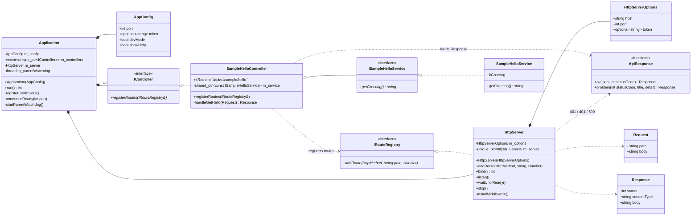
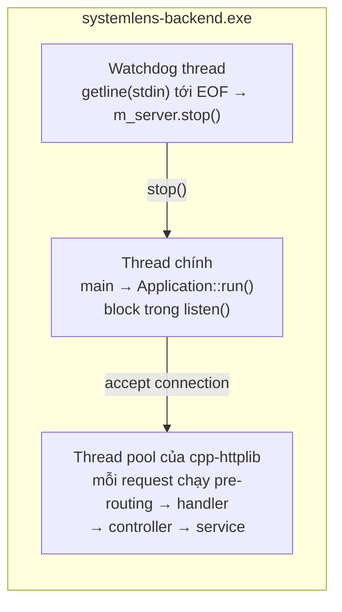

# SystemLens — Backend Low Level Design

> Chuỗi tài liệu: [SystemLens_spec.md](../SystemLens_spec.md) → [high-level-design.md](../high-level-design.md) →
> **LLD backend (file này)** · [frontend-lld.md](frontend-lld.md)
>
> Phạm vi: `systemlens-backend.exe` (C++20) ở trạng thái hiện tại: hạ tầng HTTP + sample API.

## 1. Cấu trúc mã nguồn & build

```
backend/
  CMakeLists.txt            targets + options + FetchContent dependencies
  src/
    main.cpp                entry point: parse config → Application::run()
    app/                    AppConfig (args/env), Application (composition root)
    api/                    HttpServer, HttpTypes, IRouteRegistry, IController, ApiResponse
      sample/               SampleHelloController            [SAMPLE API]
    services/
      sample/               ISampleHelloService, SampleHelloService   [SAMPLE API]
  tests/
    CMakeLists.txt          systemlens-tests (gtest_discover_tests)
    api/                    API tests: HTTP thật tới HttpServer
    interaction/            interaction tests: gmock
    support/                test doubles dùng chung (FakeRouteRegistry)
```

| Target | Loại | Nội dung |
|---|---|---|
| `systemlens_core` | static lib | Toàn bộ code trừ `main.cpp`; tests link cùng thư viện này |
| `systemlens-backend` | exe | `main.cpp` + `systemlens_core` |
| `systemlens-tests` | exe | Test suites + `systemlens_core` + `GTest::gmock_main` |

| CMake option | Mặc định | Tác dụng |
|---|---|---|
| `SYSTEMLENS_ENABLE_SAMPLE_API` | ON | Build và đăng ký `/api/v1/sample/*` (macro `SYSTEMLENS_ENABLE_SAMPLE_API=1/0`) |
| `SYSTEMLENS_BUILD_TESTS` | ON | Build `tests/` |

| Dependency (FetchContent) | Version | Dùng cho |
|---|---|---|
| cpp-httplib | 0.18.3 | HTTP server (và client trong API test); tắt OpenSSL/zlib/brotli |
| nlohmann/json | 3.12.0 | Serialize JSON |
| googletest | 1.15.2 | gtest + gmock |

Compile definitions chung: `_WIN32_WINNT=0x0A00` (httplib cần Windows 10 API), `WIN32_LEAN_AND_MEAN`, `NOMINMAX`, `/utf-8`.

## 2. Class diagram



## 3. Đặc tả từng thành phần

### 3.1. `main.cpp`
- Gọi `parseAppConfig()`. Bắt `std::exception` → in `Error: ...` + usage ra stderr, trả **2**.
- `--help` → in usage ra **stdout**, trả **0**.
- Tạo `Application` và gọi `run()`. Bắt exception lúc chạy (ví dụ bind lỗi) → `Fatal: ...`, trả **1**.

### 3.2. `AppConfig` (`app/AppConfig.h`)
- `parseAppConfig(argc, argv)` duyệt argv: `--port <0..65535>`, `--dev`, `--help`/`-h`; tham số khác → `std::invalid_argument`.
- Token đọc từ env `SYSTEMLENS_TOKEN` (`_dupenv_s` trên MSVC); chuỗi rỗng coi như không có.
- Không token + không `--dev` + không `--help` → `std::invalid_argument`.

### 3.3. `Application` (`app/Application.h`) — composition root
- **Constructor:** `m_server(toServerOptions(config))` (dev mode → `token = nullopt`) rồi `registerControllers()`.
- **`registerControllers()`:** nơi **duy nhất** tạo service + controller (dependency injection thủ công), sau đó gọi `registerRoutes(m_server)` cho từng controller.
- **`run()`:** `bind()` → (không dev) `startParentWatchdog()` → `announceReady(port)` → `listen()` (block) → `join` watchdog → trả 0.
- **Thứ tự khai báo member:** `m_controllers` đứng **trước** `m_server`. C++ hủy member theo thứ tự ngược, nên server (đang giữ lambda trỏ vào controller) bị hủy trước controller.

### 3.4. `HttpServer` (`api/HttpServer.h`)
- Bọc `httplib::Server` (chỉ forward-declare trong header, nên controller/test không phụ thuộc httplib).
- **`addRoute()`:** bọc `Handler` thành lambda của httplib: `toRequest(req)` → handler → `writeResponse()`. Không bắt exception tại đây.
- **`bind()`:** `port == 0` → `bind_to_any_port`, ngược lại `bind_to_port`. Lỗi → `std::runtime_error`.
- **`listen()`** = `listen_after_bind()`. **`stop()`** an toàn khi gọi nhiều lần, từ thread bất kỳ. **`waitUntilReady()`** cho test.
- **`installMiddleware()`** cài 3 handler:

| Handler httplib | Chạy khi | Việc làm |
|---|---|---|
| pre-routing | Mọi request, trước routing | `addCorsHeaders()`; `OPTIONS` → 204 (Handled); có token mà header ≠ `"Bearer " + token` (so sánh `constantTimeEquals`) → 401 problem (Handled); còn lại → Unhandled (đi tiếp vào routing) |
| error handler | Status lỗi sau routing | `addCorsHeaders()`; nếu 404 và body rỗng → `problem(404, "Not Found", "No route for <METHOD> <path>")` |
| exception handler | Handler ném exception | Log stderr, `problem(500, "Internal Server Error", e.what())` |

### 3.5. `IController` / `SampleHelloController`
- Controller **không chứa logic nghiệp vụ**: Request → gọi service → `ok(json)`.
- Mỗi controller có hằng `kRoute`, `registerRoutes()` public, handler private.
- Constructor nhận `shared_ptr<const IXxxService>`; null → `std::invalid_argument`.

### 3.6. `ISampleHelloService` / `SampleHelloService`
- Interface để interaction test mock được. Implementation trả `kGreeting`.
- Method `const` và không giữ state thay đổi được, nên an toàn khi nhiều thread gọi cùng lúc (xem mục 4).

### 3.7. `ApiResponse` (`api/ApiResponse.h`)
- `ok(json, statusCode = 200)` → `application/json`.
- `problem(statusCode, title, detail)` → `application/problem+json`, body `{type: "about:blank", title, status, detail}`.
- Namespace `status::` chứa hằng HTTP status (`kOk`, `kNoContent`, `kUnauthorized`, `kNotFound`, `kInternalServerError`…) để tránh magic number.

## 4. Threading model



| Thread | Tạo bởi | Vòng đời |
|---|---|---|
| Thread chính | OS | `run()` block trong `listen()` tới khi `stop()` |
| Thread pool httplib | `HttpServer` (httplib) | Xử lý request song song; dừng khi server stop |
| Watchdog | `startParentWatchdog()` (không có ở dev mode) | Kết thúc sau EOF stdin; `run()` `join()` nó |

**Hệ quả cho code mới:** handler của controller và service có thể chạy **đồng thời trên nhiều thread**. Service phải:
- hoặc stateless / `const`,
- hoặc tự bảo vệ state bằng `std::mutex` / `std::atomic`.

## 5. Giao thức process, lỗi & exit code

**stdout / stderr**

| Kênh | Nội dung |
|---|---|
| stdout | Đúng 1 dòng `SYSTEMLENS_READY {"port":<n>}` (`kReadyPrefix` + JSON), flush bằng `std::endl`. `--help` in usage ra stdout. |
| stderr | Mọi log: `[Application] ...`, `[HttpServer] ... failed: ...`, cảnh báo dev mode, lỗi khởi động |
| stdin | Không đọc dữ liệu; EOF = parent đã đóng/chết → shutdown |

**Bảng lỗi HTTP**

| Tình huống | Nơi xử lý | Status | `title` | `detail` |
|---|---|---|---|---|
| `OPTIONS` (preflight) | pre-routing | 204 | — | — |
| Thiếu/sai token | pre-routing | 401 | `Unauthorized` | `Missing or invalid bearer token.` |
| Không có route | error handler | 404 | `Not Found` | `No route for <METHOD> <path>` |
| Controller/service ném exception | exception handler | 500 | `Internal Server Error` | `e.what()` |

**Exit code**

| Code | Khi nào |
|---|---|
| 0 | Shutdown bình thường; `--help` |
| 1 | Lỗi lúc chạy (ví dụ không bind được port) |
| 2 | Sai tham số hoặc thiếu `SYSTEMLENS_TOKEN` khi không có `--dev` |

## 6. Cấu trúc test

| Suite | File | Kỹ thuật | Kiểm tra |
|---|---|---|---|
| API test | `tests/api/SampleHelloApiTest.cpp` | `RunningServer` start `HttpServer` thật (token `test-token`, port 0) trên thread riêng; gọi bằng `httplib::Client` | 200 + body, 401 thiếu/sai token, 204 preflight + CORS header, 404 problem, 500 problem (service ném exception: `ThrowingSampleHelloService`) |
| Interaction test | `tests/interaction/SampleHelloControllerTest.cpp` | `MockSampleHelloService` (gmock) + `FakeRouteRegistry` (`tests/support/`) — không có HTTP | Đăng ký đúng 1 route GET; gọi service đúng 1 lần; map ra JSON đúng; exception được ném tiếp; constructor từ chối null |

- `FakeRouteRegistry` lưu các route được đăng ký và cho phép `call(method, path, request)` gọi thẳng handler.
- Chạy: `Tool\run-backend-tests.ps1` (configure + build + `ctest`).

## 7. Công thức thêm API mới

Ví dụ thêm `GET /api/v1/processes` (area `processes`). Làm theo checklist trong [api-convention.md](../api-convention.md#checklist-thêm-api-mới); phần code backend gồm:

```cpp
// src/services/processes/IProcessService.h
class IProcessService
{
public:
    virtual ~IProcessService() = default;
    /** @brief Snapshot of all running processes. @return One entry per process. */
    virtual std::vector<ProcessInfo> listProcesses() const = 0;
};

// src/api/processes/ProcessController.h
class ProcessController final : public IController
{
public:
    static constexpr const char* kRoute = "/api/v1/processes";
    explicit ProcessController(std::shared_ptr<const services::processes::IProcessService> service);
    void registerRoutes(IRouteRegistry& registry) override;   // addRoute(HttpMethod::Get, kRoute, ...)
private:
    Response handleList(const Request& request) const;        // return ok(toJson(m_service->listProcesses()));
    std::shared_ptr<const services::processes::IProcessService> m_service;
};

// src/app/Application.cpp — registerControllers()
m_controllers.push_back(std::make_unique<api::processes::ProcessController>(
    std::make_shared<services::processes::ProcessService>()));
```

Sau đó:
1. Thêm `.cpp` vào `target_sources` của `systemlens_core` (`backend/CMakeLists.txt`).
2. Viết `tests/api/ProcessApiTest.cpp` + `tests/interaction/ProcessControllerTest.cpp`, thêm vào `tests/CMakeLists.txt`.
3. **Không** sửa `HttpServer` / `ApiResponse` trừ khi cần một khả năng hạ tầng mới (khi đó cần ADR).
