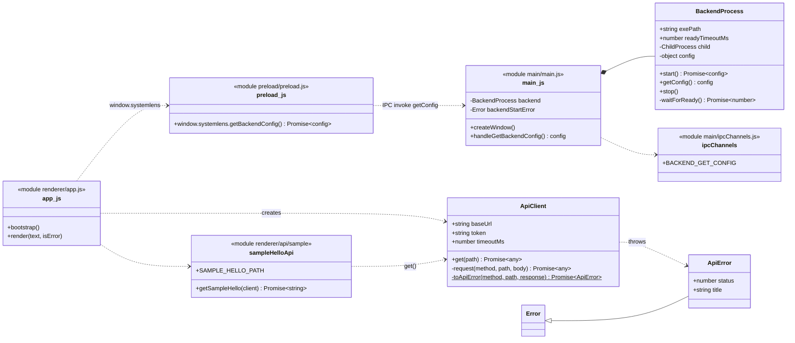
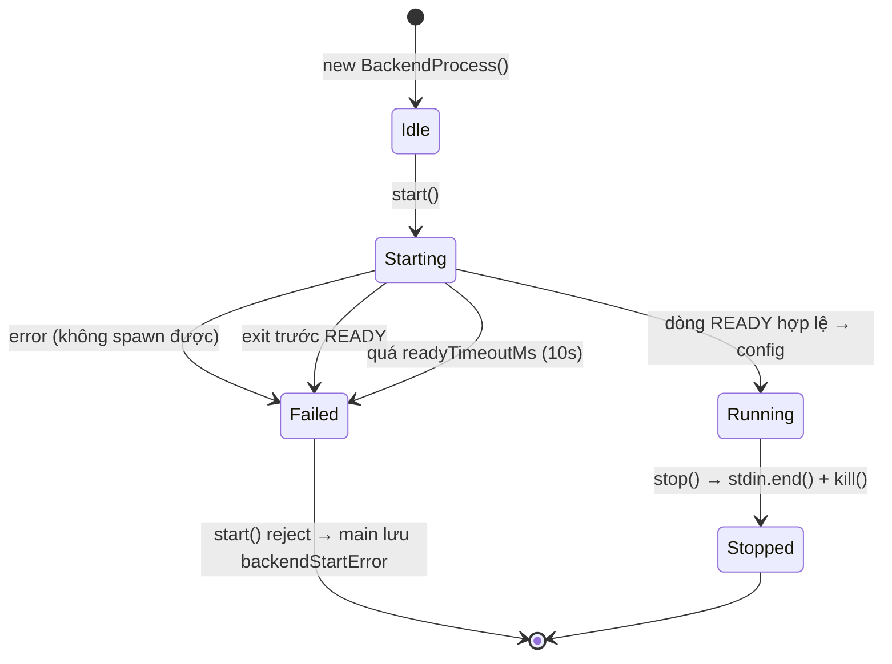
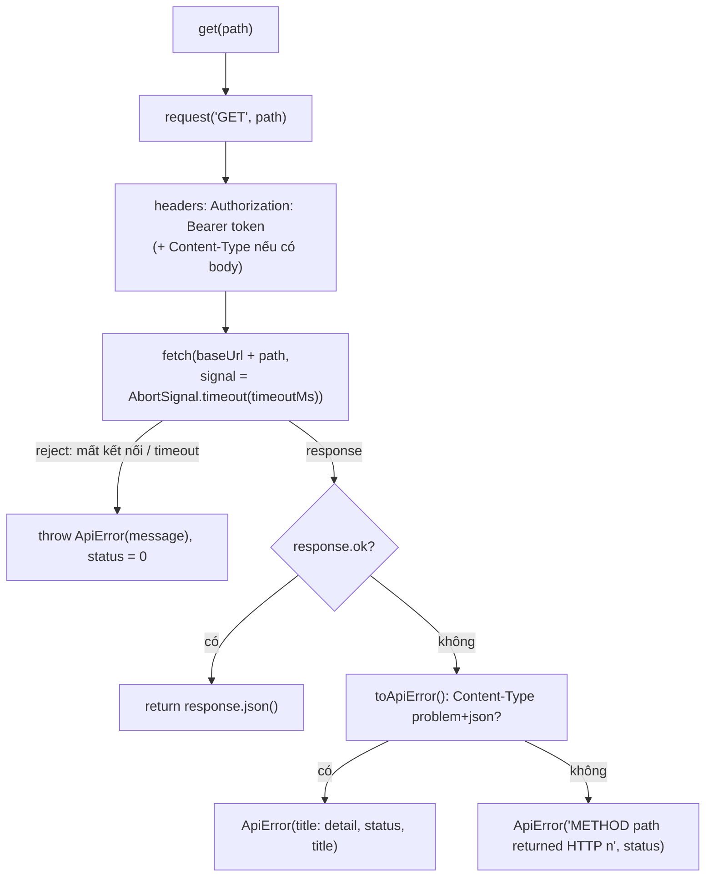

# SystemLens — Frontend Low Level Design

> Chuỗi tài liệu: [SystemLens_spec.md](../SystemLens_spec.md) → [high-level-design.md](../high-level-design.md) →
> [backend-lld.md](backend-lld.md) · **LLD frontend (file này)**
>
> Phạm vi: ứng dụng Electron trong `frontend/` ở trạng thái hiện tại: khởi động backend, IPC, gọi API, hiển thị sample greeting.

## 1. Mô hình process & cấu trúc mã nguồn

Electron chạy 3 môi trường tách biệt với quyền khác nhau:

| Môi trường | File | Quyền | Vai trò |
|---|---|---|---|
| **Main process** (Node.js) | `main/main.js`, `main/backendProcess.js`, `main/ipcChannels.js` | Toàn quyền Node: spawn process, đọc env, file system | Vòng đời app, spawn/stop backend, trả lời IPC |
| **Preload** (sandboxed) | `preload/preload.js` | Chỉ `require('electron')` (`contextBridge`, `ipcRenderer`) | Expose API tối thiểu `window.systemlens` cho renderer |
| **Renderer** (web page) | `renderer/index.html`, `app.js`, `api/**`, `styles.css` | Như một trang web: không có Node, bị CSP giới hạn | UI, gọi HTTP API của backend |

```
frontend/
  package.json              "main": "main/main.js", script start = electron .
  main/
    main.js                 app lifecycle, IPC handler, createWindow
    backendProcess.js       class BackendProcess: spawn, handshake READY, stop
    ipcChannels.js          tên các kênh IPC
  preload/
    preload.js              contextBridge → window.systemlens
  renderer/
    index.html              trang duy nhất, CSP, <script type="module" src="app.js">
    styles.css
    app.js                  entry point: bootstrap() + render()
    api/
      apiClient.js          ApiClient + ApiError (dùng chung)
      sample/
        sampleHelloApi.js   [SAMPLE API] getSampleHello()
```

**Giới hạn của sandbox:**
- Preload chạy với `sandbox: true` nên **không** `require` được file local. Vì vậy tên kênh IPC được lặp lại trong `preload.js` (có comment giải thích) thay vì import từ `ipcChannels.js`.
- Renderer dùng ES module (`import`/`export`). Main/preload dùng CommonJS (`require`).

## 2. Module / class diagram



Quy tắc phụ thuộc: **UI → API module → ApiClient**. UI không gọi `fetch`; API module không đụng DOM; `ApiClient` không biết endpoint cụ thể nào.

## 3. `BackendProcess` (`main/backendProcess.js`)

### 3.1. Trạng thái



### 3.2. Chi tiết

| Hàm | Hành vi |
|---|---|
| `constructor({ exePath, readyTimeoutMs })` | `exePath` mặc định = `resolveBackendExePath()`; `readyTimeoutMs` mặc định 10000 |
| `resolveBackendExePath()` | Ưu tiên env `SYSTEMLENS_BACKEND_EXE`; mặc định `../../backend/build/Debug/systemlens-backend.exe` (tính từ `main/`) |
| `start()` | Sinh token `crypto.randomBytes(32).toString('hex')`; `spawn(exe, ['--port','0'], { env: {..., SYSTEMLENS_TOKEN}, stdio: ['pipe','pipe','pipe'], windowsHide: true })`; chuyển stderr của backend sang stderr của Electron với prefix `[backend]`; chờ `waitForReady()`; trả `{ baseUrl: 'http://127.0.0.1:<port>', token }` |
| `waitForReady()` (private) | `readline` trên stdout; dòng bắt đầu bằng `SYSTEMLENS_READY ` → `JSON.parse` phần còn lại lấy `port`. Lắng nghe `error`, `exit` và timer. Mọi nhánh kết thúc đi qua `finish()` để luôn `clearTimeout`, đóng readline, gỡ listener. |
| `getConfig()` | Trả config; ném `Error('Backend is not running')` nếu chưa start thành công |
| `stop()` | `child.stdin.end()` (tín hiệu shutdown của backend) rồi `kill()` nếu còn chạy; reset state. Gọi nhiều lần an toàn. |

**Vì sao giữ stdin pipe:** backend coi EOF của stdin là "parent đã đi". Khi Electron crash, OS đóng pipe và backend tự thoát. Xem HLD §5.

## 4. IPC & preload

| Kênh | Chiều | Request | Response | Lỗi |
|---|---|---|---|---|
| `backend:getConfig` | renderer → main (`ipcRenderer.invoke` / `ipcMain.handle`) | — | `{ baseUrl: string, token: string }` | Nếu backend khởi động thất bại, handler ném `backendStartError` → promise ở renderer reject với message `Error invoking remote method 'backend:getConfig': Error: ...` |

Bề mặt `window.systemlens` (định nghĩa trong `preload.js` bằng `contextBridge.exposeInMainWorld`):

| Thuộc tính | Kiểu | Mô tả |
|---|---|---|
| `getBackendConfig()` | `() => Promise<{baseUrl, token}>` | Lấy thông tin kết nối backend |

Nguyên tắc: chỉ expose **hàm cụ thể**, không expose `ipcRenderer` hay object Node nào.

**Thứ tự trong `main.js`:** `app.whenReady()` → `await backend.start()` (lỗi được lưu vào `backendStartError`, không chặn app) → `ipcMain.handle(...)` → `createWindow()`. `app.on('will-quit')` → `backend.stop()`.

## 5. Renderer & `ApiClient`

### 5.1. Khởi động trang (`app.js`)
1. `bootstrap()`: `await window.systemlens.getBackendConfig()`.
2. `new ApiClient(config)`.
3. `await getSampleHello(client)` → `render(message)`.
4. Bất kỳ lỗi nào → `render("Cannot reach backend: " + err.message, true)` (class CSS `error`).

### 5.2. Pipeline request của `ApiClient`



| Tình huống | `ApiError.status` | `ApiError.title` | `message` |
|---|---|---|---|
| Backend không chạy / sai port | 0 | `''` | `GET <path> failed: <lỗi fetch>` |
| Quá `timeoutMs` (mặc định 5000) | 0 | `''` | `GET <path> failed: ... timeout ...` |
| Lỗi có body problem+json | HTTP status | `problem.title` | `<title>: <detail>` |
| Lỗi không có problem+json | HTTP status | `''` | `GET <path> returned HTTP <n>` |

### 5.3. API module
- Mỗi area một thư mục `renderer/api/<area>/`, mỗi endpoint một hàm `async` export ra ngoài, nhận `ApiClient`, trả **dữ liệu thuần** (không trả Response).
- Path là hằng `UPPER_SNAKE_CASE` export cùng module (ví dụ `SAMPLE_HELLO_PATH`).

## 6. Bảo mật & cấu hình

| Hạng mục | Giá trị | Lý do |
|---|---|---|
| `contextIsolation` | `true` | Renderer không chạm được vào object của preload/Electron |
| `nodeIntegration` | `false` | Renderer không có `require` / Node API |
| `sandbox` | `true` | Preload bị giới hạn quyền tối đa |
| CSP | `default-src 'self'; script-src 'self'; style-src 'self'; connect-src http://127.0.0.1:*` | Chỉ chạy script local; chỉ gọi mạng tới backend local (port thay đổi mỗi lần) |
| Token | Chỉ nằm trong bộ nhớ main + renderer, không ghi ra đĩa | Hết hiệu lực khi app tắt |

| Biến môi trường | Dùng ở | Ý nghĩa |
|---|---|---|
| `SYSTEMLENS_BACKEND_EXE` | `backendProcess.js` | Ghi đè đường dẫn exe backend (test lỗi khởi động, đóng gói sau này) |
| `SYSTEMLENS_TOKEN` | truyền **cho** backend | Token của lần chạy (FE tự sinh, không đọc từ môi trường của FE) |

## 7. Công thức thêm API module & màn hình

Ví dụ màn hình danh sách process gọi `GET /api/v1/processes`:

```js
// renderer/api/processes/processesApi.js
/**
 * @file   processesApi.js
 * @brief  Client for the /api/v1/processes endpoints (contract: api/openapi.yaml).
 */

/** Path of the process list endpoint. */
export const PROCESSES_PATH = '/api/v1/processes';

/**
 * Fetch all running processes.
 * @param {import('../apiClient.js').ApiClient} client Configured API client.
 * @returns {Promise<object[]>} Process entries as defined in the contract.
 * @throws {import('../apiClient.js').ApiError}
 */
export async function listProcesses(client) {
  return client.get(PROCESSES_PATH);
}
```

1. Endpoint phải có trong `api/openapi.yaml` (contract-first). Nếu backend chưa xong, dùng mock (pending, xem spec mục MCK).
2. Tạo API module như trên; UI import và gọi hàm, xử lý `ApiError` để hiển thị lỗi.
3. Nếu `ApiClient` thiếu method (ví dụ `post`), thêm method public mỏng gọi `#request()`. Không đổi pipeline chung khi chưa có lý do.

**Checklist test thủ công (FE):**
- [ ] `Tool\run-frontend.ps1` → dữ liệu hiển thị đúng.
- [ ] Backend lỗi (`SYSTEMLENS_BACKEND_EXE` sai) → UI hiện lỗi, không trắng trang.
- [ ] Đóng app → không còn process `systemlens-backend.exe`.
- [ ] DevTools Console không có lỗi CSP.
